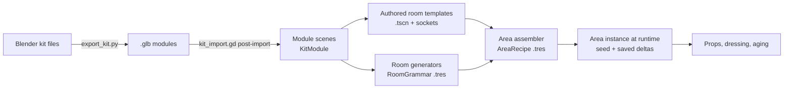

# Environment implementation plan (start here for level building)

**Status:** draft for review, 2026-10-18.
**Inputs:** `design/room-atlas.html` (20 room types, kit, build modes), the game
design foundation (`design/The_Eternal_Library_Game_Design_Foundation_v0.1 (1).docx`),
`ART_DIRECTION.md` and the current prototype.

## 0. Decisions already made

| Question | Decision |
|---|---|
| When do generated rooms exist? | **At runtime from a saved seed**, plus an **editor preview** that runs the same generator. A layout you like can be **baked** into a normal scene and finished by hand. |
| Where are module meshes made? | **Blender**, exported to `.glb`, with a Godot post-import script that adds collision, pixel materials and snap points. |
| How physical are props? | **Pick up plus light physics.** Props sleep as static objects until touched, then wake as rigid bodies. Moved, taken and broken props are saved per area. |
| First vertical slice | **R01 Reading Room** (authored from kit modules) joined to a generated **R02 Stack Gallery**. |

Language stays statically typed GDScript, matching the prototype and `AGENTS.md`.

---

## 1. Where the prototype stands, and what changes

The prototype builds everything in code at startup. `main.tscn` is nearly empty and
about 5,000 lines of GDScript (`world.gd`, `vista.gd`, `cavern.gd`, the `*_pass.gd`
files) create the geometry. That got the look right, but nothing can be selected,
moved or tweaked in the editor.

The new structure turns that around:

- **Geometry lives in scenes and Blender files.** Code only *assembles* scenes
  (generators) and *decorates* them (sockets, aging, dressing).
- **Every number a designer might tweak lives in a Resource (`.tres`)** shown in
  the Inspector, never as a constant buried in a script.
- **Authored and generated rooms use the same modules, sockets and connectors**,
  so a generated layout can be baked into an authored one and an authored room
  can sit inside a generated area.

What carries over from the prototype:

| Keep | Becomes |
|---|---|
| Pixel materials (`assets/textures/px`, `tools/pixel_materials*`) and the slot-name swap in `asset_factory.gd` | The material library the post-import script applies to modules. |
| World-triplanar 32 tx/m mapping | Default for architecture, so modules need no UV work and textures run across seams. |
| `art_direction.gd`, `atmosphere.gd` (grade, glow, fog, flicker) | A per-area `Atmosphere` node driven by an `AtmosphereProfile` resource. |
| `tools/build_props.py` Blender pipeline | Grows into `tools/export_kit.py`. |
| `vista.gd`, `cavern.gd`, `vista_cliff.gd` | Later, the R10 Chasm Spans generator (phase 5). |
| `tests/` capture, playtest and audit scripts | Reused as gates for every phase. |
| Hand-placed geometry in `world.gd` and the passes | Stays as the camp, which holds the gameplay loop. Authored rooms such as R01 are played alongside it (phase 1 step 6 decision); the camp is rebuilt from kit modules once props carry gameplay (phase 3). |

---

## 2. Layers



| Layer | What it is | Who edits it, and how |
|---|---|---|
| **Kit** | Modules: wall bays, arches, vaults, stairs, shelves, lamps | You, in Blender (shape) and the Inspector (metadata) |
| **Room** | An authored template scene, or the output of a room generator | Authored: you, in the editor. Generated: the rules, in `.tres` files |
| **Area** | A connected set of rooms (a few hundred metres), the unit of streaming and saving | `AreaRecipe` resource |
| **Stratum** | Style, ecology and rule set for a depth band | `StratumProfile` resource |

---

## 3. The kit: how modules fit together

### 3.1 Grid and conventions

- **Bay:** 4 m. **Storey:** 4 m. **Half bay:** 2 m. **Fine snap:** 0.5 m. Rotations in 90° steps.
- **Up is +Y; a room's "forward" is −Z** (Godot's default).
- **Three module shapes**, which is what lets pieces fit without hand alignment:

| Shape | Occupies | Origin | Examples |
|---|---|---|---|
| **Edge** | One cell edge, 4 m wide (or 2 m) | Floor level, at the left end of the edge, wall plane on the cell boundary, interior facing −Z | Plain wall, shelf-recess bay, arch opening, door, window |
| **Cell** | One or more whole cells | Floor-level corner of the cell | Floor tile, vault bay, dome cell, stair run, pool |
| **Post** | A grid corner | The corner point | Pier, column, corner block |

- **Wall thickness is split across the boundary** (half inside each cell), so two
  rooms built back to back share one wall without overlap or z-fighting.
- **Every module states its footprint** (`size_cells`, `storeys`) and its **edge
  signature**: one tag per side, from
  `solid | opening_3m | opening_full | door | open | none`. Generators match
  signatures; you never set them by hand on placed instances.
- **No scaling, ever.** Scaling breaks the 32 tx/m texel density. A 3 m arch and
  a 4 m arch are two modules.

### 3.2 Blender side (authoring and tweaking meshes)

- Sources live in `art_src/kit/` (with a `.gdignore`, so Godot doesn't import the
  `.blend` files directly and headless import never needs Blender). One file per
  family: `kit_walls.blend`, `kit_vaults.blend`, `kit_vertical.blend`,
  `kit_storage.blend`, `kit_dressing.blend`, `props.blend`.
- **One top-level object (or collection) = one module.** Naming:
  `M_<family>_<name>_<variant>`, e.g. `M_wall_shelfbay_4m_a`.
- Inside a module, child **empties** carry meaning by prefix:

| Empty prefix | Becomes | Purpose |
|---|---|---|
| `SNAP_<name>` | `Marker3D` connector | Where other modules or rooms attach (door, stair head, bridge end) |
| `SOCKET_<set>` | `VariantSocket` | A variation point, e.g. `SOCKET_recess_fill` inside a shelf bay |
| `LIGHT_<profile>` | `OmniLight3D` / `SpotLight3D` from a light profile | Lanterns carry their light |
| `ANCHOR_<kind>` | `Marker3D` in group `npc_anchor` | Seats, work spots, lookout points for future NPCs |

- **Collision** uses Godot's import name hints. Phase 0 modules put `-col` on the
  visible mesh (`wall_plain_4m__body-col`), which gives exact trimesh collision
  from the render mesh. For detailed meshes, add a separate low-poly child named
  `*-colonly` instead. A structural module with no collision gets an import
  warning.
- **Occluders** use the `-occonly` hint on thick walls, so occlusion culling is
  authored once per module.
- **Materials:** only the *slot name* matters (`ashlar`, `brick`, `plaster`,
  `tile_teal`, `wood`, …). The import script swaps in the matching pixel material.
- `tools/export_kit.py` (run by Blender headless, like `build_props.py`) writes one
  `.glb` per module into `assets/kit/<family>/`. A one-click `tools/export_kit.bat`
  wraps it. You can also export one file from inside Blender with the same script.

**Tweaking a mesh:** open the `.blend`, edit, run `export_kit.bat`, and switch back
to Godot. It reimports, and every room that uses the module updates, because
rooms reference the module scene, not a copy.

### 3.3 Godot side

- `tools/kit_import.gd` (an `EditorScenePostImport` script, set as the default for
  `assets/kit/`):
  1. assigns pixel materials by slot name and enforces texel density;
  2. converts `SNAP_`, `SOCKET_`, `LIGHT_` and `ANCHOR_` empties into real nodes;
  3. sets collision layers (see §6.4), visibility ranges and shadow flags;
  4. reads Blender custom properties (`size_cells`, `edges`, `tags`, `weight`) into
     metadata.
- `tools/kit_catalog.gd` (an editor tool) creates or updates one **wrapper scene**
  per module in `kit/modules/<family>/<name>.tscn`. Its root has a `KitModule`
  script exposing footprint, edge signature, style tags (`brick`, `plaster`,
  `tile`, `stratum_1` …) and a generator weight. Wrapper scenes are where you add
  Godot-only extras (a particle emitter, a sound) without touching Blender. The
  catalog never overwrites nodes you added.
- `kit/catalog.tres` (a `KitCatalog` resource) indexes every module by shape,
  signature and tags. Generators query it; you never edit it by hand.

---

## 4. Authored rooms: building and tweaking in the editor

### 4.1 Placing modules

Use **scene instancing with a small editor plugin**, not `GridMap`. GridMap only
stores meshes and collision, and would drop the sockets, lights, anchors and
connectors that live inside modules.

`addons/kit_palette/` (an `EditorPlugin`) adds:

- **A Kit dock** with module thumbnails, filtered by family and tags.
  Click a module, then click in the viewport to place it on the grid.
- **Shortcuts:** rotate 90°, flip, raise or lower a storey, and "repeat last along
  the edge" (lay a run of six shelf bays in one drag).
- **Connector snap:** dragging a room template near another snaps their `SNAP_`
  markers together.
- **Validate Room**, which checks that edges have no gaps, modules sit on the grid,
  nothing is scaled, collision is present, connectors are on cell boundaries, and
  every socket candidate fits its slot.

Godot's own grid snap (0.5 m, 90°) works alongside the plugin for free-form dressing.

### 4.2 Room template scene layout

```
ReadingRoom (RoomTemplate)              # id, footprint, stratum tags, age rules
├─ Shell        (Node3D)                # kit modules only; merged into one static batch at load
├─ Sockets      (Node3D)                # free-standing VariantSockets (module sockets live inside modules)
├─ Props        (Node3D)                # authored interactive props (WorldProp)
├─ Dressing     (Node3D)                # scatter volumes, shelf fills (MultiMesh at runtime)
├─ Lights       (Node3D)                # extra lights; lantern modules bring their own
├─ Connectors   (Node3D)                # SNAP markers exposed to the area assembler
├─ Atmosphere   (Atmosphere)            # optional override of the area's AtmosphereProfile
└─ Bounds       (Area3D)                # room volume for streaming, music, aging
```

### 4.3 Variant sockets (the "somewhat generated" part of authored rooms)

`VariantSocket` is an `@tool` `Node3D`. It references a **`SocketSet` resource**,
so a set like `recess_library.tres` is shared by every shelf recess in the game:
tune its weights once and they change everywhere.

| Socket mode | What it does | Example |
|---|---|---|
| `REPLACE` | Instance one candidate scene | Recess: shelves, tile panel, sealed door, collapsed |
| `TOGGLE` | Present or absent, by probability | A rug, a ladder, rubble |
| `SCATTER` | N props inside a box or along a line | Pots on a ledge, books on a table |
| `SHELF_FILL` | Fills a shelf volume with books as one MultiMesh | Every shelf in R01–R03 |
| `STATE` | Picks a state on a child | Lantern lit, failing or dark |

Each `SocketSet` entry has a scene, a weight, tags, and optional conditions
(`stratum`, `min_age_years`, `faction`, `settlement_state`).

**In the editor**, a socket shows a live preview. The Inspector has
**Prev / Next / Random** buttons and a **preview seed** field on the `RoomTemplate`
that re-rolls every socket in the room at once: the same thing the atlas's
"Reroll sockets" button does, but on the real scene. A **Pin** checkbox forces a
specific candidate for a hand-tuned spot.

**At runtime**, the pick is `hash(area_seed, room_id, socket_node_path)`, filtered by
conditions. Hashing by node path means adding a new socket never reshuffles the
others, so old saves keep their look.

### 4.4 Tweak workflows

| You want to… | Do this |
|---|---|
| Move a wall or add a bay | Open the room scene, select or place modules in the Kit dock, save |
| Change what recesses can contain | Edit `recess_library.tres`: add a scene, change weights |
| Force one recess to always be a sealed door | Select its socket, pick the candidate, tick **Pin** |
| See other variants of the room | Change the room's preview seed, or press **Random** |
| Make a one-off variant of a module | Duplicate the wrapper scene, add nodes; or duplicate the Blender object with a new `_b` suffix |
| Change a module's shape everywhere | Edit the `.blend`, run `export_kit.bat` |

---

## 5. Generated rooms: rules you can tweak

### 5.1 Two generation levels

1. **Area layout:** which rooms exist and how they connect (the `AreaRecipe`).
2. **Room layout:** for fully generated types (R02, R03, R06, R09, R11, R14, R15, R17,
   R10), fill a 3D cell grid using a `RoomGrammar`.

Both are plain data you edit in the Inspector:

| Resource | Holds | Example knobs |
|---|---|---|
| `StratumProfile` | Style tags, ecology, palette, atmosphere, which socket conditions apply | `styles: [brick, tile_teal]`, `lamp_density: 0.6` |
| `AreaRecipe` | Required authored rooms, counts of generated types, size, connector rules | `required: [ReadingRoom]`, `stack_galleries: 3–6`, `max_dead_ends: 2` |
| `RoomGrammar` (one subclass per generated type) | The layout rules for that type | R02: `max_straight_bays 6`, `side_passage_chance 0.11`, `collapse_chance 0.08`, `lamp_every_bays 2`, `lamp_falloff_by_distance` |
| `ModuleRules` | Which modules may fill which edge or cell signature, with weights and style tags | `edge solid + style brick → [wall_plain 3, wall_shelfbay 8, wall_niche 2]` |

### 5.2 Pipeline

1. **Graph.** The `AreaRecipe` places required authored rooms, then adds generated
   rooms and links (a spanning tree plus a few loops, so there's more than one way back).
2. **Place and route.** Authored templates are placed by their connectors.
   Corridors are routed on the 4 m grid by A*, with stair cells for level changes.
3. **Mark edges.** Every cell edge becomes `solid`, `opening`, `door` or `open`
   according to the grammar.
4. **Pick modules** by edge and cell signature from `ModuleRules`, weighted and
   seeded. This is a lookup table rather than full wave-function collapse; it is
   enough for corridor, grid, ring and lane rooms, and much easier to reason about.
5. **Resolve sockets** exactly as in authored rooms.
6. **Dress:** shelf fills, scatter, lamps by distance rule.
7. **Age:** apply `AgeRules` for time passed (see §6.3).
8. **Validate:** connectivity, plus a route audit with the real player capsule
   using `PhysicsServer3D.body_test_motion`, as `AGENTS.md` requires.

Generation runs on a worker thread and builds nodes off-tree, then adds them in
one go. A room of about 200 modules should take well under a frame budget per room
when spread across frames.

### 5.3 Editor preview and bake

`GeneratorPreview` (an `@tool` node; drop it in any scene) has slots for a
`RoomGrammar` or `AreaRecipe`, a seed, and buttons:

- **Generate:** builds the result live in the editor, as a temporary child.
- **Overlay:** draws the cell grid, edge types in colour, and socket picks as labels.
- **Step:** runs the pipeline one stage at a time, for debugging a rule.
- **Bake to scene:** writes a normal `.tscn` that uses the same module scenes and
  sockets. The baked scene is an ordinary authored room you can finish by hand,
  which is how a good generated layout becomes a landmark.

**Tweaking a rule:** select the `.tres`, change a number, press Generate. No play
mode needed.

### 5.4 Determinism and saves

- `area_seed = hash(world_seed, area_id)`. Every random choice comes from a
  sub-seed of that, keyed by what is being decided, never from call order.
- Saves store the seed, the **recipe version** and the player's deltas, not the
  geometry. If a recipe changes after release, the old version is kept for old saves.

---

## 6. Interactive objects

### 6.1 Four kinds of object

| Kind | Examples | Node | Interactive | Saved |
|---|---|---|---|---|
| **Architecture** | Walls, vaults, stairs | Module, merged static batch | No | No (regenerated) |
| **Dressing** | Most shelf books, rubble, wall pots out of reach | `MultiMeshInstance3D` | No | No |
| **Props** | Vases, loose books, stools, lanterns, crates | `WorldProp` | Yes: push, knock, pick up, break | Yes, as deltas |
| **Items** | Lore books, ingredients, tools | `WorldProp` + `ItemDef` | Yes: pick up into inventory | Yes |

### 6.2 `WorldProp`

- A `RigidBody3D` with `freeze = true` (static) at rest, so a room full of props
  costs about the same as static meshes.
- **Wakes** (unfreezes) on player contact, a hit, an explosion, or when something
  under it moves. It goes back to frozen once it has slept for a few seconds.
- An **active-body budget** (start with 48) re-freezes the oldest sleeping props if exceeded.
- **Breakable** props swap to pre-fractured pieces (made in Blender as
  `M_prop_vase_a_broken`). Pieces despawn after a while; a "broken" delta is saved.
- **Items** reference an `ItemDef` resource. Picking one up moves ownership to the
  inventory, so quick slots reference owned items instead of copying them.
  Dropping recreates the prop.
- Props use **local triplanar or UVs**, not world triplanar, so their texture
  doesn't swim when they move.

**Books** are the special case: thousands per room. Shelves are `SHELF_FILL`
dressing. When the player looks at a shelf, the nearest book slot can be
**promoted** into a real `WorldProp`: its MultiMesh instance is hidden and a prop
spawns in its place. Lore books are pinned slots that are always promotable.

### 6.3 Persistence and aging

- Every prop has a **stable id**: `area_id / room_id / node_path` for authored props,
  `area_id / room_id / generator_key` for generated ones.
- `AreaState` saves only deltas: `{id: {state: moved|taken|broken, transform}}`,
  plus spawned props (things the player dropped).
- **Load order:** generate the area from its seed, resolve sockets, apply aging for
  time passed, then apply player deltas. Player deltas always win.
- **Aging** (the design doc's "returning to a hometown after many years") is an
  `AgeRules` resource per stratum: lamps go out, recesses collapse, gardens
  overgrow, settlements change hands. It acts only on things the player hasn't touched.
- The persistence gate from `AGENTS.md` applies: save in one OS process, restore in
  a freshly launched one.

### 6.4 Collision layers (fixed now, so NPCs slot in later)

| Layer | Use |
|---|---|
| 1 | World static (architecture) |
| 2 | Interaction ray targets (already used by `interactable.gd`) |
| 3 | Props (`WorldProp`) |
| 4 | Player |
| 5 | NPCs and creatures (reserved) |
| 6 | Triggers and room bounds |
| 7 | Water volumes |

---

## 7. Ready for NPCs later, without building them now

- Modules carry `ANCHOR_` markers (seat, work, sleep, lookout, trade), so rooms are
  already annotated when NPCs arrive.
- Each room bakes a navigation mesh at load on a thread
  (`NavigationRegion3D.bake_navigation_mesh(true)`). Props on layer 3 are excluded,
  so a knocked-over vase doesn't trigger a rebake.
- Rooms keep their tags (faction, settlement, ecology) in `RoomTemplate`, for future
  spawn rules.

---

## 8. Streaming, performance, lighting

- **Streaming unit:** the area. Within an area, rooms load when the player is
  within two connectors of them and unload after leaving that range for a while.
  Loading uses `ResourceLoader.load_threaded_request`.
- **Static merging:** each room's `Shell` merges into a few batches per material at
  load, as the prototype already does with its merged static groups (keep under the
  playtest ceiling of about 100 per view).
- **Culling:** module occluders (`-occonly`) and `OccluderInstance3D`, with
  visibility ranges on dressing and small props.
- **Lighting:** runtime generation rules out baked lightmaps (`LightmapGI`). Use
  SDFGI (already on in the prototype) plus real-time lights. Lantern modules bring
  their own light with a **light budget**: only the nearest N cast shadows; the rest
  use cheap omni lights with no shadows.
- Keep the prototype's frame time (about 5.5 ms) as the target for a
  fully dressed room.

---

## 9. Folder layout

```
art_src/kit/*.blend            # Blender sources (.gdignore)
art_src/props/*.blend
assets/kit/<family>/*.glb      # exported modules (generated)
assets/props/*.glb
kit/modules/<family>/*.tscn    # wrapper scenes with KitModule (generated, then extended by hand)
kit/catalog.tres
kit/sockets/*.tres             # SocketSet resources
rooms/authored/*.tscn          # RoomTemplate scenes (R01, R05, R07 …)
rooms/baked/*.tscn             # generated layouts promoted to authored
gen/grammars/*.tres            # RoomGrammar per generated type
gen/rules/*.tres               # ModuleRules
gen/recipes/*.tres             # AreaRecipe
world/strata/*.tres            # StratumProfile, AgeRules, AtmosphereProfile
scripts/world/                 # KitModule, RoomTemplate, VariantSocket, WorldProp, AreaState, AreaAssembler
scripts/gen/                   # generators per room type
addons/kit_palette/            # editor dock, validate, preview
tools/export_kit.py|.bat, tools/kit_import.gd, tools/kit_catalog.gd
```

---

## 10. Roadmap (each phase is a playable slice)

Each phase passes the headless 240-frame gate, a GPU capture and, where relevant,
the route audit and the two-process persistence test.

| Phase | Builds | Done when |
|---|---|---|
| **0. Kit spike** | `export_kit.py`, `kit_import.gd`, `kit_catalog.gd`; one `kit_walls.blend` with about 8 modules (plain wall, shelf bay, arch 3 m, corner pier, floor, vault bay, gallery slab, lantern); the Kit dock with place and rotate | You edit a wall in Blender, run the export, and it updates in a graybox room in Godot with correct pixel materials and collision. Headless import works without Blender installed. |
| **1. Authored R01** | `RoomTemplate`, `VariantSocket`, `SocketSet`, `SHELF_FILL`; the Reading Room rebuilt in the editor from modules; Validate Room; atmosphere ported | R01 is playable in place of the code-built interior, a GPU capture is close to `previews/concept_v011.png`, and re-rolling the preview seed changes recesses, the iwan centrepiece and lamps. |
| **2. Generated R02** | Cell grid, edge marking, `ModuleRules`, the R02 `RoomGrammar`, `GeneratorPreview` with overlay and bake, and connector joining to R01 | Walking from R01 into a generated gallery works; changing `max_straight_bays` and pressing Generate visibly changes the corridor; the route audit passes on 20 seeds. |
| **3. Props and persistence** | `WorldProp`, wake and sleep, breakables, book promotion, `ItemDef` pickup, `AreaState`, aging rules | Knock over a vase, pull a lore book and take it, quit; in a new process both stay changed. Advancing the world clock darkens untouched lamps only. |
| **4. Areas and streaming** | `AreaRecipe`, graph and routing, threaded room streaming, light budget | An area of 6–10 rooms (R01, several R02, one baked room) streams without hitches at the frame target. |
| **5. Kit breadth** | R03 grid generator, R05 courtyard template, R09 ring generator, R11 (R03 plus water), and porting the Overlook and R10 from `vista.gd` | Each new type is added mostly through modules and `.tres` rules, with little new code. That is the test of the architecture. |

---

## 11. Risks and open items

- **Headless import.** Exporting `.glb` (rather than importing `.blend` directly)
  keeps CI and headless runs Blender-free. The cost is one export step after edits;
  `export_kit.bat` keeps it to a double-click.
- **Edge-signature tables may get too coarse** for organic spaces (R06 lanes, R15
  terraces). Those generators can place modules directly; the table stays the default.
- **World triplanar on architecture vs UVs on props.** Rules are in §6.2. Modules
  that move (doors, bridges that collapse) need UVs.
- **SDFGI with streaming** can pop when rooms load. Measure in phase 4; fallback is
  per-room `VoxelGI` for authored rooms.
- **Save size** grows with deltas. Cap dropped props per area and compact old deltas.
- ~~Missing references in `AGENTS.md`~~: resolved 2026-10-18. `AGENTS.md` had been
  copied from another project; it was rewritten for this one and no longer cites
  a `references/` folder.

---

## 12. Progress

### Phase 0: kit spike (done 2026-10-18)

**Try it:** open the project in Godot, open `rooms/test/kit_graybox.tscn`, and use
the **Kit** dock (bottom left) to place modules: click a module, then click in
the 3D view. R rotates, Page Up/Down changes storey, Ctrl snaps to 2 m, Shift
to 0.5 m, Esc stops. Placement is undoable.

**Edit a module:** open `art_src/kit/kit_walls.blend` in Blender, change it,
save, double-click `tools/export_kit.bat`. Godot reimports and every room using
the module updates.

| Piece | File |
|---|---|
| Starter `.blend` generator (one-time, refuses to overwrite) | `tools/kit_seed_walls.py` |
| Blender exporter, one `.glb` per `M_*` empty | `tools/export_kit.py` |
| One-click export, import and catalog refresh | `tools/export_kit.bat` |
| Post-import (materials, collision layer, markers, lights, metadata) | `tools/kit_import.gd`, set for all scenes in `project.godot` `[importer_defaults]`; it skips anything outside `assets/kit/` |
| Shared material library (editable `.tres`, built from the pixel maps) | `scripts/world/px_material.gd` → `kit/materials/` |
| Module wrapper root, catalog, builder, validator | `scripts/world/kit_module.gd`, `kit_catalog.gd`, `kit_catalog_builder.gd`, `kit_validate.gd` |
| Wrapper scenes and catalog (generated, then extended by hand) | `kit/modules/walls/*.tscn`, `kit/catalog.tres` |
| Kit dock editor plugin | `addons/kit_palette/` |
| Graybox room (1 × 3 bays, two storeys, vaulted) | `rooms/test/kit_graybox.tscn` (from `tools/build_graybox.gd`) |
| Gate and capture | `tests/kit_test.gd` (121 checks in phase 0; 129 now), `tests/kit_capture.gd` → `previews/kit_graybox_*.png` |

Nine modules: plain wall, shelf-recess bay, 3 m arch (with a `SNAP_door`
connector), pier, floor, pointed vault bay, vault gable, gallery slab with
balustrade, and a hanging lantern that carries its own light.

**Verified:** `tests/kit_test.gd` passes (catalog, every wrapper, library materials
only, collision on layer 1, markers in groups, a hand-added wrapper node
surviving a refresh, graybox validation, floor/wall/vault ray hits, and a player
capsule walking through the arch but stopped by the wall). The 240-frame
headless gate is clean for the graybox and the prototype. GPU captures look
right. A Blender edit (pier widened 25%) reached the graybox through one export.
Import never needs Blender (`art_src/` has a `.gdignore`).

**Not verified, and known gaps:**
- ~~Interactive placement in the Kit dock~~: the user confirmed click-to-place
  works in the editor (2026-10-18).
- The first import that creates a new library material prints "invalid UID"
  warnings until a second import; `export_kit.bat` imports twice.
- Shelf recesses use simple book blocks; real book dressing is phase 1
  (`SHELF_FILL`).
- `-occonly` occluders, visibility ranges and "repeat along edge" placement are
  not in yet.
- The shelf-recess bay's back protrudes 0.25 m past the standard wall face.
  That is fine against rock, but two recess bays back to back would overlap.

### Phase 1: authored R01 (in progress, started 2026-10-18)

**Done this session: the socket system.**

| Piece | File |
|---|---|
| Candidate list and entry (weights, labels, tags) | `scripts/world/socket_set.gd`, `socket_entry.gd` |
| Variation point: picks by seed, internal child never saved, Pin, "Next candidate" button | `scripts/world/variant_socket.gd` |
| Room root: resolves all sockets from `preview_seed` (key = seed + room_id + socket path), "Reroll sockets" button | `scripts/world/room_template.gd` |
| Book dressing as one MultiMesh (full, sparse or fallen), seeded by its socket | `scripts/world/shelf_fill.gd`, `kit/dressing/recess_books_*.tscn` |
| Recess socket set (full 6, sparse 3, collapsed 1) | `kit/sockets/recess_library.tres` (created by `tools/seed_sockets.gd`) |
| Importer turns `SOCKET_<set>` empties into `VariantSocket` linked to `kit/sockets/<set>.tres` | `tools/kit_import.gd` |

The shelf-bay mesh now has boards only; books come from the socket. The
graybox root is a `RoomTemplate`. Select it and press **Reroll sockets** in the
Inspector, or select one recess socket (inside a shelf-bay instance) and press
**Next candidate** or set **Pinned**.

**Verified:** `tests/kit_test.gd` passes 126 checks: 10 sockets in the graybox,
the same seed gives the same picks, different seeds vary, pinning holds, and
more than 300 books get built. Both 240-frame headless gates are clean. The GPU
capture `previews/kit_graybox_entrance.png` shows books on the shelves.
Reroll and Pin haven't been clicked in the editor yet.

**Step 0 done (2026-10-18): socket panel in the Kit dock.** The Kit dock now
has a lower **Sockets** half (drag the splitter to resize it):

- **Selection:** select a module (or anything inside one) to list its sockets
  with the current pick, where the pick comes from (seed, module pin or room
  pin), **Prev / Next / Random** (each pins the result) and a **Pin** box
  (untick to let the seed choose again).
- **Room:** every socket in the open `RoomTemplate`, the same controls, a
  **Clear all pins** button, and rows for stale pins (module renamed, moved or
  deleted) with their own **Clear**. Clicking a socket's path selects its
  module.

Pins are stored on the room, not the socket: `RoomTemplate.socket_pins`
(`{socket path: entry index}`), so no Editable Children is needed and the pin
is saved with the room. A room pin wins over the socket's own `pinned`, which
stays as the module-wide default. Every change goes through the editor undo
history. Files: `addons/kit_palette/socket_panel.gd`, `plugin.gd`,
`scripts/world/room_template.gd`, `variant_socket.gd`.

**Verified:** `tests/kit_test.gd` passes 129 checks (room pin beats seed and
module pin, clearing restores the seeded pick, stale pins reported).
`tests/socket_pin_persist.gd` saves pinned picks in one process (`-- save`)
and restores them in a fresh one (`-- load`) with no `[editable]` entries.
Both 240-frame gates are clean, and the editor loads the plugin headless
without errors. **Not verified:** clicking the panel in the editor (layout,
icons, undo/redo from Ctrl+Z).

**Step 1 done (2026-10-18): R01 modules.** Eight new modules in
`kit_walls.blend` (17 in the catalog), added by `tools/kit_add_r01.py`. That
script is additive: it opens the hand-edited `.blend`, adds only missing
modules and saves, so re-running never touches your edits. Shared Blender
helpers now live in `tools/kit_blender.py` (the seed script uses them too).

| Module | Shape | Notes |
|---|---|---|
| `vault_hall_12m` | cell 3×1 | Pointed barrel vault over 12 m (k 0.58), tiled crown strip, transverse rib on the bay boundary. Place it one storey up on two-storey walls: springs at 8 m, intrados crown at 14.55 m |
| `wall_gable_12m` | edge, 3 bays | Closes the vault end above the wall top (also one storey up) |
| `wall_iwan_12m` | edge, 3 bays × 2 storeys | 6 m pointed iwan, 3 m deep, tile-lined, mosaic frame, four blind tiled niches, back shelves with a `recess_library` socket, `ANCHOR_study` for the centrepiece. It protrudes 3.3 m behind the wall line, so use it against rock |
| `stair_gallery_8m` | edge, 2 bays | Masonry stair along a wall, up 4.15 m to the gallery slab lane; walkable `-colonly` ramp, balustrade, `SNAP_stair_foot` / `SNAP_stair_head`. Leave the gallery slab out over its two bays |
| `post_pier_corbel` | post | Pier with corbels under the gallery slab (use at storey 0; plain pier above) |
| `table_reading` | free | 1.4 × 4.4 m, six `ANCHOR_seat` markers |
| `lantern_cluster` | free | One big and four small lanterns, chain up to the 12 m vault crown, one `chandelier` light (new profile in `kit_import.gd`, casts shadows) |
| `rug_runner` | free | Three rugs end to end (13.4 m), UV-mapped `rug` map; the exporter now writes UVs (`export_texcoords=True`; the old modules exported byte-identical) |

`tests/kit_r01_capture.gd` assembles a 3 × 3 bay slice in memory (never saved)
and captures `previews/kit_r01_hall.png`, `kit_r01_iwan.png` and
`kit_r01_gallery.png`. Catalog refreshes now keep `kit/catalog.tres`'s UID (read from
the file header, since `get_resource_uid` returns -1 in headless runs).

**Verified:** `tests/kit_test.gd` passes 241 checks: every new module's
materials, collision and markers, the iwan socket, the chandelier light, rug
UVs, and a player capsule (`move_and_slide` with gravity) climbing the stair
onto a gallery slab. Both 240-frame gates are clean, with no import warnings.
The GPU captures show the iwan, vault crown tiles, ribs, gallery, stair and
chandelier as intended. **Caveats:** the iwan's tile lining is one
uniform pattern, which is busy and has no ochre/lapis variation yet. The small
cluster lanterns barely read at hall scale. The 13.4 m runner overhangs a
3-bay hall, so for R01 (5 bays) place it with tables and lanterns in mind.
Nothing has been placed in the editor yet.

**Step 2 drafted (2026-10-18): `rooms/authored/reading_room.tscn`.** At the
user's request the first draft comes from a script, `tools/build_reading_room.gd`.
It refuses to overwrite the room unless given `--force`; from here on the scene
is edited by hand in the editor. It is a `RoomTemplate` (`room_id` `reading_room`), 3 × 5
bays (12 × 20 m), two storeys under `vault_hall_12m`, built from 92 kit
modules under `Shell / Sockets / Props / Dressing / Lights / Connectors /
Bounds`.

- **Layout (after step 2b):** entrance arch in the south middle bay, iwan and
  gable at the north end, side doors in bay 1 on both sides. Both stairs run
  over bays 2-3 and rise toward the entrance (the east one is
  `stair_gallery_8m_r`) onto side galleries over bays 0-1. Those galleries are
  joined along the entrance wall by `gallery_end_12m` into one U-shaped walk.
  A 2-bay stair along a side wall always crosses the middle bay, so the side
  doors moved off it (the atlas plan had them in the middle). Bays behind the
  stairs get plain walls. **16 recess sockets**, matching the atlas (the
  upper south recess opens onto the end gallery).
- **Dressing and lights:** rug runner, four reading tables, two chandeliers,
  four lanterns under the galleries and one at the iwan apex.
- **Connectors:** `SNAP_entrance`, `SNAP_door_west` and `SNAP_door_east`
  (Marker3D, group `room_connector`, -Z points out of the room).
- **Temporary:** `TempSafetyFloor` (invisible, 0.25 m under the floor; delete
  it once the room sits in an area) and `PreviewEnvironment` (replaced by the
  Atmosphere node in step 4, which defers to any environment the game or an
  area already supplies).

**Verified:** `tests/reading_room_test.gd` passes 28 checks: KitValidate
clean, 16 sockets, floor in all 15 cells, the three doors open, walls closed,
and a capsule walking the hall into the iwan, up each stair, around the whole
U gallery (west, end, east), and out a side door onto the safety floor. The
rails still hold mid-run and along the end gallery. The 240-frame gate is
clean. `tests/reading_room_capture.gd` captures `previews/reading_room_*.png`
(entrance, iwan, gallery, stair, vault, end_gallery). **Caveats:** the side
doors open onto darkness. The room is dim until step 4's grade. The iwan
centrepiece spot is empty until step 3. The solid masonry stairs look heavy
from the entrance; an open-stringer variant would lighten them. The user
approved the step 2 draft in the editor; the 2b rebuild (`--force`, no hand
edits existed yet) was checked in the editor by the user.

**Step 2b done (2026-10-18): joined galleries.** Four modules, added through
the same additive `tools/kit_add_r01.py` (21 in the catalog):
`gallery_end_12m` (end-wall gallery between the side lanes, newel posts that
swallow the meeting rail ends, wall corbels clear of a central 3 m arch),
`gallery_slab_4m_open_end` / `_open_start` (side slab whose rail stops 1.6 m
short of that end, for the corner square), and `stair_gallery_8m_r` (the
stair mirrored, so it rises toward its origin). `kit_test` passes 312 checks,
including rail extents and the reversed stair's head position.

**Step 3 done (2026-10-18): socket sets and modes.**

| Piece | File |
|---|---|
| `SCATTER` mode (N weighted items in a box, kept `scatter_spacing` apart; a pin makes every item that entry) and `STATE` mode (the entry label is a state applied to the socket's parent) | `scripts/world/variant_socket.gd` |
| Lamp states `lit` / `failing` (dimmed, flickering internal node) / `dark` (light off, glass unlit) on every light and `emit_*` surface of a lamp module | `scripts/world/lamp_state.gd` |
| An entry without a scene is now a valid pick ("nothing", or a state) | `scripts/world/socket_set.gd` |
| Blender properties `socket_mode`, `scatter_count`, `scatter_extent`, `scatter_spacing` on `SOCKET_` empties configure the socket | `tools/kit_import.gd` |
| New family `dressing` (13 modules): recess boards (whole and broken), tile panel with bench, sealed door, iwan lectern (with rug), reading tree in a tiled planter, fountain, and six table props | `art_src/kit/kit_dressing.blend` via the additive `tools/kit_add_dressing.py` → `kit/modules/dressing/` |
| Sets: `recess_library` (+ tile panel 1, sealed door 0.7), `iwan_centre` (lectern, reading tree, fountain), `lamp_state` (lit 6, failing 2, dark 1), `table_props` (book stack, open book, pot, oil lamp, scroll, inkwell) | `kit/sockets/*.tres`, from the additive `tools/seed_sockets.gd` |
| `water` library material (hand-written; no pixel map) | `kit/materials/water.tres` |

**Shelf boards moved out of the shelf-bay and iwan meshes** into the recess
candidates (`Boards` child in `kit/dressing/recess_books_*.tscn`), so a tile
panel or sealed door can replace them. `tools/kit_add_r01.py` gained an
idempotent upgrade pass that removes the baked boards and adds the new sockets
to existing modules: `SOCKET_iwan_centre` in the iwan, `SOCKET_table_props`
(scatter, 2-5 items) on the reading table, and `SOCKET_lamp_state` in both
lantern modules. The seed scripts match for fresh builds. The reading room now
has 28 sockets: 16 recesses, the iwan centrepiece, 4 table tops and 7 lamps.
Order matters when rebuilding: export `kit_dressing.blend`, then run
`seed_sockets.gd`, then export `kit_walls.blend` (the importer links sets that
already exist).

**Verified:** `tests/socket_modes_test.gd` passes 56 checks: set contents,
every candidate instancing, boards in shelf candidates, lamp lit/failing/dark
(energy, visibility, glass material, flicker cleanup), scatter count, bounds,
spacing, determinism and pinning, and the iwan centrepiece varying by seed.
`kit_test` passes 443 checks and `reading_room_test` 28 (socket counts by
set; the hall walk now steps around the centrepiece, which has collision).
Pin persistence holds across processes, and all three 240-frame gates are
clean. Captures: `previews/reading_room_iwan_{tree,lectern,fountain}.png`
(seeds 1-3), `reading_room_table.png`, `reading_room_recesses.png`.
**Caveats:** at these weights about a third of the lamps fail or go dark,
which makes the room noticeably dimmer; the plan wants that only with age, so
weights should drop once age conditions exist. Table props are small and read
poorly at hall distance. The sealed door hasn't shown up in a capture yet
(the test instances it). Age, stratum and faction conditions are still unused. The user checked Reroll and the Sockets panel in the editor.

**Step 4 done (2026-10-19): Atmosphere.**

| Piece | File |
|---|---|
| `AtmosphereProfile`: tonemap, exposure, ambient, glow (levels, threshold, bloom), haze, SSAO, contrast/saturation, split-tone grade, SDFGI and lantern sway. `apply(env)` sets exactly what `art_direction.gd` used to; `build_environment()` makes a whole room environment | `scripts/world/atmosphere_profile.gd` |
| `Atmosphere` node: adds an internal `WorldEnvironment` from its profile only when nothing else supplies one (in the editor: only a saved `WorldEnvironment` counts), sways lit lanterns, and offers a deterministic `tick(t)` | `scripts/world/atmosphere.gd` (the prototype's `scripts/atmosphere.gd` is a different, older file) |
| Profiles: `prototype_v011.tres` (the script defaults are the v0.11 numbers) and `reading_room.tres` (exposure 1.25, haze 0.012, darker background) | `kit/atmosphere/`, from `tools/seed_atmosphere.gd` |
| The prototype now takes its look from `prototype_v011.tres` | `scripts/art_direction.gd` (look constants removed; light constants stay) |

**Reading room:** `PreviewEnvironment` is replaced by an `Atmosphere` node
(patched in place, no other node touched). Both chandeliers are pinned `lit`
in the room's `socket_pins` (the hero lights are authored; smaller lanterns
still vary). Authored fills under `Lights` follow the warm/cool rule:
`IwanGlow` low in the iwan, plus `CoolFillWest` / `CoolFillEast` (teal) over
the back half. The builder makes the same.

**Kit fixes found while tuning:** the chandelier lit almost nothing. Its glass
shared a mesh with the brass, so it cast shadows, and its solid bottom cap
0.3 m under a shadowed light threw a ~10 m shadow disc on the floor.
`lantern_cluster` is now rev 2: glass as its own non-shadow mesh and open
ring caps, rebuilt by a `kit_rev` rule in `tools/kit_add_r01.py`. The
`chandelier` light profile gets `light_size` 0.35, so the frame posts no
longer throw hard bands across the vault.

**Verified:** the prototype is pixel-identical within render noise. Two
before-captures differ by mean 0.143 (0-255); after vs before is 0.104 and
0.198 (`tests/image_diff.gd`). `tests/room_atmosphere_test.gd` passes 32
checks: prototype profile values, the room builds and activates its own
environment, defers to an existing one, sways only lit lamps
deterministically, pins, and fills. Every other gate passes (socket modes 56,
kit 444, room 28, prototype atmosphere test), and the three 240-frame gates
are clean. The editor loads the room headless without errors. Luminance
(`tests/luma.gd`) of the entrance view went from 37 (21% near-black) before
the step to 47.6 (2%); gallery 40.0 (12%); iwan 29.5. **Caveats:** the iwan
view's lower corners (bay-4 lower recesses) stay dark teal (luma ~12-15);
ambient and SDFGI energy barely move them, so a lantern there would be the
fix. The user checked the look in the editor viewport.
Fog volumes, the prototype's foliage wind shader and water ripples were not
ported (no room uses them yet).

**Next steps for phase 1, in order:**
0. ~~**Socket panel in the Kit dock**~~ (done, see above).
1. ~~**More modules for R01**~~ (done, see above).
2. ~~**Build `rooms/authored/reading_room.tscn`**~~ (drafted by script, see above; tweak it by hand).
2b. ~~**Gallery corner / end-wall gallery**~~ (done, see above).
3. ~~**More socket sets**~~ (done, see above). Follow-up: age conditions on lamp and recess weights.
4. ~~**Atmosphere**~~ (done, see above).
5. ~~**Validate Room**~~ (done, see below).
6. ~~**Swap R01 into the game**~~ (done as a selectable room by decision, see below).

**Step 5 done (2026-10-19): Validate Room.** The Kit dock's button is now
**Validate room**. On any scene it runs the existing module checks (grid,
rotation, scale). On a `RoomTemplate` it adds the room checks below. Errors
go to the Output panel as errors and warnings as warnings, with a count in
the dock.

| Check | Severity | How |
|---|---|---|
| Open edges | error | Cells come from CELL modules per storey (floors give storey 0; the hall vault, placed one storey up, gives storey 1). Every perimeter edge, in 2 m segments, needs a *closing* EDGE module (anything but `gallery`, `gallery_end`, `stair`, `gable`) or a room connector marker on it. Multi-storey edges (the iwan) cover each storey. |
| Vault ends | error | A ceiling CELL's ends (edges across its barrel, with no vault beyond) need a `gable` edge module |
| Connectors | error | Markers under `Connectors` must lie on a cell-boundary line (x or z a multiple of 4 m) |
| Candidate fit | error | `SocketSet.slot_bounds` (new): every candidate's visual bounds must fit; ShelfFill is built with a fixed seed to measure it |
| Slot clearance | warning | Each socket's slot must not run into another module's collision |

Files: `scripts/world/kit_validate_room.gd` (`KitValidateRoom.run(root)`),
`scripts/world/socket_set.gd` (`slot_bounds`), and
`addons/kit_palette/plugin.gd`. Slots for `recess_library`, `iwan_centre` and
`table_props` are set by `tools/seed_sockets.gd` (only when empty).
`tools/kit_blender.py` gains the shared `rebuild()` for `kit_rev` bumps.

**What it found right away:** (1) a real misfit: a fallen board in the
"collapsed" recess candidate stuck 8 cm past the 3 m opening into the wall
(`recess_shelves_broken` is now rev 2). (2) Warnings, also real: in
upper-storey recesses fronted by a gallery (or a stair near its head), a
collapsed recess's spill (books and boards on the recess floor at 4.0 m)
sinks into the gallery slab, whose top is at 4.15 m. 9 in the reading room,
7 in the graybox. These are left as warnings; the fix is the first item of
the weathering slice below.

**Verified:** `tests/validate_room_test.gd` passes 17 checks. Both rooms
show no errors, and every warning is spill vs gallery or stair. Broken copies
fail as they should: a removed 4 m wall gives exactly two open 2 m segments; a
gallery slab on that edge still leaves it open; a removed gable gives both
halves of the vault end; removing the west door arch leaves only the half
the door connector doesn't mark; an off-grid connector is reported; and an
oversized candidate is flagged. All other gates pass (kit 444, socket modes
56, room 28, atmosphere 32, room playtest 11, camp playtest 43), the
240-frame gates are clean, and the editor loads the room headless without
errors.

**Found in the editor, missed headless (fixed 2026-10-19):** the first
click of Validate room in the editor reported "collapsed does not fit its
slot", which the headless test had passed. `MultiMesh.get_aabb()` and the
instance transforms live in the rendering server, which reads back empty
under the headless dummy renderer, so the test never saw the fallen books.
Now `ShelfFill` keeps `built_transforms` on the CPU and Validate Room
measures those, over 16 seeds since the spill varies. That showed the spill
reaching x ±1.6 (past the 3 m opening) and 1.3 m into the room. Fixes: the
spill is inset by a rotated book's reach (`ShelfFill`), and the recess slot
now reaches 1.35 m into the room (`recess_library.tres`, intended spill). The
test checks that the spill is measured. **Lesson:** any bound read back from
the renderer is invisible to headless gates; measure on the CPU. The user
re-ran Validate room in the editor: no errors, only the spill warnings.

**Phase 1 is complete** (steps 0-6, 2b).

**Step 6 done (2026-10-19): the reading room is playable in the game.**
**Decision (user, 2026-10-19):** R01 does *not* replace the code-built camp.
The camp (`world.gd`) holds the whole gameplay loop (hearth, cooking pot,
gathering, vista balcony), and R01 is a different place: the atlas reading
hall, not the campfire concept. So `previews/concept_v011.png` doesn't apply
as R01's target. Instead the game can boot either one:

- **How to play it:** Esc menu → **Visit the reading room** (and **Return to
  the camp**), or start with `-- --room=res://rooms/authored/reading_room.tscn`.
  The camp stays the default.
- `scripts/main.gd` loads any `RoomTemplate` scene as the world, spawns at its
  `PlayerSpawn` marker, shows its `display_name` in the HUD, and skips the
  camp-only logic (warmth, harvesting, zones, balcony) in rooms. The choice
  is a static `room_override`, so it survives `reload_current_scene()`.
  `player.gd` gains `respawn_point` (a fall puts you back at the room's spawn).
- `RoomTemplate.display_name`. The reading room gets "The Reading Room" and a
  `PlayerSpawn` (patched in place; the builder makes both).

**Verified:** `tests/room_playtest.gd` passes 11 checks with the real
`main.tscn` player driven by input actions. It boots into the room on the
spawn with the room's environment, then walks the hall into the iwan, climbs
the west stair, rounds the whole U gallery, and comes down the east stair. It
never drops below the floor, and the menu offers the way back. The camp
playtest still passes (43 checks), as do the prototype atmosphere test and
every room and kit gate. The 240-frame gates are clean for the camp, the
graybox, the room scene and `main` with `--room`. GPU captures of the real
game with HUD: `previews/game_reading_room_{spawn,gallery,iwan}.png`
(`tests/room_game_capture.gd`). The menu round trip in a
real window was checked by the user (Esc → Visit the reading room).

**Phase 1 status:** done except step 5 (Validate Room in the Kit dock). Of
the roadmap's "done when": R01 is playable in the game (as a selectable room,
by decision), and re-rolling the preview seed changes recesses, the iwan
centrepiece and lamps. The capture-vs-concept criterion was dropped with the
decision above.

### Next: the weathering slice (planned 2026-10-19, after step 5)

0. ~~**Spill lands on the floor that is there**~~ (done 2026-10-19). Three
   cases turned out to be wrong, not one: spill sank 0.15 m into gallery
   slabs, intersected stairs, and **floated 4 m up** in front of upper recesses
   with nothing in front (reading room bay 4). That last one no check had
   caught.
   - **Runtime:** `ShelfFill` rests each spilled book in front of the wall
     face on the first collision surface below it. It waits two physics
     frames so the room's bodies are registered, then casts from the top of
     the spill zone, so spill can land under furniture but never on top of
     tall things. Books inside the recess stay put. Child meshes named
     `*__spill*` settle the same way: `recess_shelves_broken` rev 3 splits its
     two floor boards out as `__spill_a` / `__spill_b`, with b moved 0.15 m
     forward. The random draw order is unchanged, so existing seeds keep
     their layout.
   - **Validate Room:** `SocketSet.spill_bounds` (new) separates the settling
     zone from the rigid `slot_bounds`. The recess slot is now just the recess
     depth; the spill zone is the 0.6 m band up to 1.35 m in front. Validate
     Room probes the spill zone straight down against the modules' collision
     triangles (host included: the iwan's alcove floor counts). It warns if a
     column has nothing to land on, or if a probe starts inside another solid
     (odd crossings on an upward ray), e.g. a pier standing in the zone.
   - **Verified:** `tests/spill_settle_test.gd` (6 checks) pins all 16
     reading-room recesses to collapsed. Every settled book rests on the
     surface right under it, probed independently: 114 on the hall floor, 115
     on gallery slabs, 75 on stairs, and 51 dropped a storey from bay-4 upper
     recesses. The broken boards settle too. `validate_room_test` now has 21
     checks: the reading room has **no warnings** (was 9), the graybox keeps
     its two genuine ones (its side galleries run into the end-wall recess), a
     table over the zone is fine, a pier in it is reported, and a missing
     floor is reported. Every other gate passes. GPU:
     `previews/reading_room_collapsed_{gallery,recesses}.png` show books lying
     on the gallery. The dropped books in the dark bay-4 corner didn't read in
     a capture (checked numerically only), and books on the stair rest on its
     walkable ramp, so they may sit up to ~0.1 m off a tread edge. The user
     checked a collapsed upper recess in the editor: the spill lands right.

Agreed scope: only the parts that existing tools carry, so phase 3's
`AgeRules` can later just shift their weights. Order:

1. ~~**Edge scatter**~~ (done 2026-10-19, first with debris; plants are item 2).
   - **`EDGE_SCATTER` mode** (`VariantSocket`): items along local +X for
     `edge_length`, up to `edge_depth` out into the room, `scatter_spacing`
     apart, with random yaw. Picks without a scene leave gaps, so the set's
     weights set the density. `SCATTER`'s random draw order is unchanged, so
     tables keep their layout.
   - **Generic settle** (`settle`, `settle_max_drop`) for scatter modes: after
     two physics frames each item rests on the surface below, or is removed
     if nothing is within reach. Seams in front of upper walls sit on the
     gallery (4.15) and never float.
   - **First candidates:** `debris_rubble` and `debris_brick` (dressing
     family, 36 modules) in `kit/sockets/seam_debris.tres` (nothing 6,
     rubble 2, fallen brick 1).
   - **Seam sockets:** `SOCKET_seam_debris` on `wall_plain_4m` (from 0.85 m,
     2.3 m long, clear of the corner piers) and on both iwan flanks. The
     importer reads `edge_scatter`, `edge_length`, `edge_depth`, `settle` and
     `settle_max_drop`. The upgrade pass in `kit_add_r01.py` now also keeps
     script-owned markers in sync (position and properties), so retuning a
     socket reaches an existing `.blend`.
   - **Validate Room:** an `EDGE_SCATTER` slot is the strip the items can
     reach (the line plus an item footprint, room side only). Settling
     sockets get the spill-style probe ("items would rest inside X"), with
     nothing-below allowed by design. Sockets pinned to a scene-less entry
     are skipped.
   - **Reading room:** the four plain walls hidden behind the stairs have
     their seams pinned to "nothing" (`build_reading_room.gd`
     `pin_hidden_seams()`, patched in place). It validates with no warnings
     again, and now has 38 sockets (10 seams).
   - **Verified:** `socket_modes_test` has 71 checks: items on the strip,
     spacing, gaps, determinism, and settling on the floor (0.00), on a
     gallery slab one storey up (4.15), and removed over nothing. Kit test
     463, room 28, validate room 21, spill 6, atmosphere 32, room playtest
     11, camp playtest 43, and all three 240-frame gates are clean.
     `previews/reading_room_seams.png` (capture option `seams` pins every
     seam to rubble) shows chips along the wall base on the floor. The user
     checked the seams in the editor; the rubble is small and subtle by design.
2. ~~**Plants as dressing**~~ (done 2026-10-19).
   - **Swaying foliage:** `shaders/kit_foliage.gdshader` is the prototype's
     wind shader on engine `TIME`, so no script drives it. The card library
     materials (`tree_leaf`, `leaf`, `ivy_leaf`, `fern`) are now
     ShaderMaterials on it (`tools/seed_foliage.gd`; additive, keeps UIDs),
     so the iwan's reading tree sways too. The prototype's own materials are
     untouched.
   - **Plants** (dressing family, 40 modules): `plant_crack_tuft` (grass
     blades over a moss line, as in the prototype), `plant_moss_cushion`,
     `plant_fern`, and `plant_ivy_hang`, which drapes over a rail top and
     hangs 0.12 m out on the hall side. Cards use the `add_card()` helper in
     `kit_blender.py`.
   - **Sets:** the wall-base seam set keeps its name `seam_debris` (renaming
     would churn socket names and room pins) and now holds what gathers at a
     wall base: crack tuft 2, moss 1.5, fern 1, plus the debris. Its slot is
     0.4 m tall for the fern. New `rail_growth` (nothing 5, ivy 2) as a
     non-settling `EDGE_SCATTER` on every gallery rail: `gallery_slab_4m`,
     both corner slabs and `gallery_end_12m`. Sockets stay 0.65 m from slab
     ends that meet a wall and clear of corner newels; Validate Room found
     both (graybox end walls, the reading room's west newel).
   - **Verified:** `socket_modes_test` has 86 checks (set contents, rail
     socket on the rail top, ivy pinned and hanging down the gallery edge,
     and plant cards using the swaying material). Kit test 493, room 28 (now
     43 sockets incl. 5 rails), validate room 21 (the reading room has no
     warnings), spill 6, atmosphere 32, both playtests and the prototype
     atmosphere test pass, and all three 240-frame gates are clean. GPU
     (capture option `growth`): `previews/reading_room_growth_{seam,gallery,end_gallery}.png`
     show ferns at the wall base and ivy trailing over both galleries'
     balustrades. **Caveats:** at hall distance the ivy is a modest accent,
     and it trails over the balustrade rather than below the slab; longer
     strands would read more. The user checked the plants in the editor. **Not done:**
     the root clump for collapsed recesses (deferred, it needs a recess
     candidate change).
3. **Decals.** Water stains, soot above lamps, moss patches and floor cracks
   as `Decal` scenes using the pixel palette (32 tx/m). A `SCATTER` socket on
   wall bays picks 0-2.
4. **Open wooden stair.** `stair_gallery_8m_open` (and `_r`): a stringer
   stair with open risers, the same footprint, ramp and snaps as the masonry
   one, so a room can swap them in the editor.

Deferred, on purpose: a material-level wear/grime shader and age-driven
overgrowth (phase 3, `AgeRules`); floor-cell garden sockets and the R05
courtyard (phase 5); stair *layout* variants as seeded sub-assemblies
(phase 2, with stair cells in generators).

**Known issues to keep in mind:**
- Saving a `kit/dressing/*.tscn` from the editor while a `ShelfFill` has run
  will store its generated MultiMesh in the file. Harmless, but it bloats the
  file; consider clearing `multimesh` before saving, or not exporting it.
- `VariantSocket` instances are internal children, so they don't appear in the
  Scene dock. That's intended (never saved), but it may surprise you.
