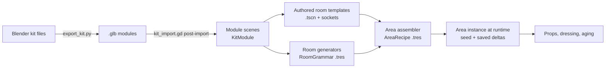

# Environment implementation plan (start here for level building)

**Status:** draft for review, 2026-10-18.
**Inputs:** `design/room-atlas.html` (20 room types, kit, build modes), the game
design foundation (`design/The_Eternal_Library_Game_Design_Foundation_v0.1 (1).docx`),
`ART_DIRECTION.md` and the current prototype.

## 0. Decisions already made

| Question | Decision |
|---|---|
| When do generated rooms exist? | **At runtime from a saved seed**, plus an **editor preview** that runs the same generator. A layout you like can be **baked** into a normal scene and finished by hand. |
| Where are module meshes made? | **Blender**, exported to `.glb`, with a Godot post-import script that adds collision, pixel materials and snap points. |
| How physical are props? | **Pick up plus light physics.** Props sleep as static objects until touched, then wake as rigid bodies. Moved, taken and broken props are saved per area. |
| First vertical slice | **R01 Reading Room** (authored from kit modules) joined to a generated **R02 Stack Gallery**. |

Language stays statically typed GDScript, matching the prototype and `AGENTS.md`.

---

## 1. Where the prototype stands, and what changes

The prototype builds everything in code at startup. `main.tscn` is nearly empty and
about 5,000 lines of GDScript (`world.gd`, `vista.gd`, `cavern.gd`, the `*_pass.gd`
files) create the geometry. That got the look right, but nothing can be selected,
moved or tweaked in the editor.

The new structure turns that around:

- **Geometry lives in scenes and Blender files.** Code only *assembles* scenes
  (generators) and *decorates* them (sockets, aging, dressing).
- **Every number a designer might tweak lives in a Resource (`.tres`)** shown in
  the Inspector, never as a constant buried in a script.
- **Authored and generated rooms use the same modules, sockets and connectors**,
  so a generated layout can be baked into an authored one and an authored room
  can sit inside a generated area.

What carries over from the prototype:

| Keep | Becomes |
|---|---|
| Pixel materials (`assets/textures/px`, `tools/pixel_materials*`) and the slot-name swap in `asset_factory.gd` | The material library the post-import script applies to modules. |
| World-triplanar 32 tx/m mapping | Default for architecture, so modules need no UV work and textures run across seams. |
| `art_direction.gd`, `atmosphere.gd` (grade, glow, fog, flicker) | A per-area `Atmosphere` node driven by an `AtmosphereProfile` resource. |
| `tools/build_props.py` Blender pipeline | Grows into `tools/export_kit.py`. |
| `vista.gd`, `cavern.gd`, `vista_cliff.gd` | Later, the R10 Chasm Spans generator (phase 5). |
| `tests/` capture, playtest and audit scripts | Reused as gates for every phase. |
| Hand-placed geometry in `world.gd` and the passes | Stays as the camp, which holds the gameplay loop. Authored rooms such as R01 are played alongside it (phase 1 step 6 decision); the camp is rebuilt from kit modules once props carry gameplay (phase 3). |

---

## 2. Layers



| Layer | What it is | Who edits it, and how |
|---|---|---|
| **Kit** | Modules: wall bays, arches, vaults, stairs, shelves, lamps | You, in Blender (shape) and the Inspector (metadata) |
| **Room** | An authored template scene, or the output of a room generator | Authored: you, in the editor. Generated: the rules, in `.tres` files |
| **Area** | A connected set of rooms (a few hundred metres), the unit of streaming and saving | `AreaRecipe` resource |
| **Stratum** | Style, ecology and rule set for a depth band | `StratumProfile` resource |

---

## 3. The kit: how modules fit together

### 3.1 Grid and conventions

- **Bay:** 4 m. **Storey:** 4 m. **Half bay:** 2 m. **Fine snap:** 0.5 m. Rotations in 90° steps.
- **Up is +Y; a room's "forward" is −Z** (Godot's default).
- **Three module shapes**, which is what lets pieces fit without hand alignment:

| Shape | Occupies | Origin | Examples |
|---|---|---|---|
| **Edge** | One cell edge, 4 m wide (or 2 m) | Floor level, at the left end of the edge, wall plane on the cell boundary, interior facing −Z | Plain wall, shelf-recess bay, arch opening, door, window |
| **Cell** | One or more whole cells | Floor-level corner of the cell | Floor tile, vault bay, dome cell, stair run, pool |
| **Post** | A grid corner | The corner point | Pier, column, corner block |

- **Wall thickness is split across the boundary** (half inside each cell), so two
  rooms built back to back share one wall without overlap or z-fighting.
- **Every module states its footprint** (`size_cells`, `storeys`) and its **edge
  signature**: one tag per side, from
  `solid | opening_3m | opening_full | door | open | none`. Generators match
  signatures; you never set them by hand on placed instances.
- **No scaling, ever.** Scaling breaks the 32 tx/m texel density. A 3 m arch and
  a 4 m arch are two modules.

### 3.2 Blender side (authoring and tweaking meshes)

- Sources live in `art_src/kit/` (with a `.gdignore`, so Godot doesn't import the
  `.blend` files directly and headless import never needs Blender). One file per
  family: `kit_walls.blend`, `kit_vaults.blend`, `kit_vertical.blend`,
  `kit_storage.blend`, `kit_dressing.blend`, `props.blend`.
- **One top-level object (or collection) = one module.** Naming:
  `M_<family>_<name>_<variant>`, e.g. `M_wall_shelfbay_4m_a`.
- Inside a module, child **empties** carry meaning by prefix:

| Empty prefix | Becomes | Purpose |
|---|---|---|
| `SNAP_<name>` | `Marker3D` connector | Where other modules or rooms attach (door, stair head, bridge end) |
| `SOCKET_<set>` | `VariantSocket` | A variation point, e.g. `SOCKET_recess_fill` inside a shelf bay |
| `LIGHT_<profile>` | `OmniLight3D` / `SpotLight3D` from a light profile | Lanterns carry their light |
| `ANCHOR_<kind>` | `Marker3D` in group `npc_anchor` | Seats, work spots, lookout points for future NPCs |

- **Collision** uses Godot's import name hints. Phase 0 modules put `-col` on the
  visible mesh (`wall_plain_4m__body-col`), which gives exact trimesh collision
  from the render mesh. For detailed meshes, add a separate low-poly child named
  `*-colonly` instead. A structural module with no collision gets an import
  warning.
- **Occluders** use the `-occonly` hint on thick walls, so occlusion culling is
  authored once per module.
- **Materials:** only the *slot name* matters (`ashlar`, `brick`, `plaster`,
  `tile_teal`, `wood`, …). The import script swaps in the matching pixel material.
- `tools/export_kit.py` (run by Blender headless, like `build_props.py`) writes one
  `.glb` per module into `assets/kit/<family>/`. A one-click `tools/export_kit.bat`
  wraps it. You can also export one file from inside Blender with the same script.

**Tweaking a mesh:** open the `.blend`, edit, run `export_kit.bat`, and switch back
to Godot. It reimports, and every room that uses the module updates, because
rooms reference the module scene, not a copy.

### 3.3 Godot side

- `tools/kit_import.gd` (an `EditorScenePostImport` script, set as the default for
  `assets/kit/`):
  1. assigns pixel materials by slot name and enforces texel density;
  2. converts `SNAP_`, `SOCKET_`, `LIGHT_` and `ANCHOR_` empties into real nodes;
  3. sets collision layers (see §6.4), visibility ranges and shadow flags;
  4. reads Blender custom properties (`size_cells`, `edges`, `tags`, `weight`) into
     metadata.
- `tools/kit_catalog.gd` (an editor tool) creates or updates one **wrapper scene**
  per module in `kit/modules/<family>/<name>.tscn`. Its root has a `KitModule`
  script exposing footprint, edge signature, style tags (`brick`, `plaster`,
  `tile`, `stratum_1` …) and a generator weight. Wrapper scenes are where you add
  Godot-only extras (a particle emitter, a sound) without touching Blender. The
  catalog never overwrites nodes you added.
- `kit/catalog.tres` (a `KitCatalog` resource) indexes every module by shape,
  signature and tags. Generators query it; you never edit it by hand.

---

## 4. Authored rooms: building and tweaking in the editor

### 4.1 Placing modules

Use **scene instancing with a small editor plugin**, not `GridMap`. GridMap only
stores meshes and collision, and would drop the sockets, lights, anchors and
connectors that live inside modules.

`addons/kit_palette/` (an `EditorPlugin`) adds:

- **A Kit dock** with module thumbnails, filtered by family and tags.
  Click a module, then click in the viewport to place it on the grid.
- **Shortcuts:** rotate 90°, flip, raise or lower a storey, and "repeat last along
  the edge" (lay a run of six shelf bays in one drag).
- **Connector snap:** dragging a room template near another snaps their `SNAP_`
  markers together.
- **Validate Room**, which checks that edges have no gaps, modules sit on the grid,
  nothing is scaled, collision is present, connectors are on cell boundaries, and
  every socket candidate fits its slot.

Godot's own grid snap (0.5 m, 90°) works alongside the plugin for free-form dressing.

### 4.2 Room template scene layout

```
ReadingRoom (RoomTemplate)              # id, footprint, stratum tags, age rules
├─ Shell        (Node3D)                # kit modules only; merged into one static batch at load
├─ Sockets      (Node3D)                # free-standing VariantSockets (module sockets live inside modules)
├─ Props        (Node3D)                # authored interactive props (WorldProp)
├─ Dressing     (Node3D)                # scatter volumes, shelf fills (MultiMesh at runtime)
├─ Lights       (Node3D)                # extra lights; lantern modules bring their own
├─ Connectors   (Node3D)                # SNAP markers exposed to the area assembler
├─ Atmosphere   (Atmosphere)            # optional override of the area's AtmosphereProfile
└─ Bounds       (Area3D)                # room volume for streaming, music, aging
```

### 4.3 Variant sockets (the "somewhat generated" part of authored rooms)

`VariantSocket` is an `@tool` `Node3D`. It references a **`SocketSet` resource**,
so a set like `recess_library.tres` is shared by every shelf recess in the game:
tune its weights once and they change everywhere.

| Socket mode | What it does | Example |
|---|---|---|
| `REPLACE` | Instance one candidate scene | Recess: shelves, tile panel, sealed door, collapsed |
| `TOGGLE` | Present or absent, by probability | A rug, a ladder, rubble |
| `SCATTER` | N props inside a box or along a line | Pots on a ledge, books on a table |
| `SHELF_FILL` | Fills a shelf volume with books as one MultiMesh | Every shelf in R01–R03 |
| `STATE` | Picks a state on a child | Lantern lit, failing or dark |

Each `SocketSet` entry has a scene, a weight, tags, and optional conditions
(`stratum`, `min_age_years`, `faction`, `settlement_state`).

**In the editor**, a socket shows a live preview. The Inspector has
**Prev / Next / Random** buttons and a **preview seed** field on the `RoomTemplate`
that re-rolls every socket in the room at once: the same thing the atlas's
"Reroll sockets" button does, but on the real scene. A **Pin** checkbox forces a
specific candidate for a hand-tuned spot.

**At runtime**, the pick is `hash(area_seed, room_id, socket_node_path)`, filtered by
conditions. Hashing by node path means adding a new socket never reshuffles the
others, so old saves keep their look.

### 4.4 Tweak workflows

| You want to… | Do this |
|---|---|
| Move a wall or add a bay | Open the room scene, select or place modules in the Kit dock, save |
| Change what recesses can contain | Edit `recess_library.tres`: add a scene, change weights |
| Force one recess to always be a sealed door | Select its socket, pick the candidate, tick **Pin** |
| See other variants of the room | Change the room's preview seed, or press **Random** |
| Make a one-off variant of a module | Duplicate the wrapper scene, add nodes; or duplicate the Blender object with a new `_b` suffix |
| Change a module's shape everywhere | Edit the `.blend`, run `export_kit.bat` |

---

## 5. Generated rooms: rules you can tweak

### 5.1 Two generation levels

1. **Area layout:** which rooms exist and how they connect (the `AreaRecipe`).
2. **Room layout:** for fully generated types (R02, R03, R06, R09, R11, R14, R15, R17,
   R10), fill a 3D cell grid using a `RoomGrammar`.

Both are plain data you edit in the Inspector:

| Resource | Holds | Example knobs |
|---|---|---|
| `StratumProfile` | Style tags, ecology, palette, atmosphere, which socket conditions apply | `styles: [brick, tile_teal]`, `lamp_density: 0.6` |
| `AreaRecipe` | Required authored rooms, counts of generated types, size, connector rules | `required: [ReadingRoom]`, `stack_galleries: 3–6`, `max_dead_ends: 2` |
| `RoomGrammar` (one subclass per generated type) | The layout rules for that type | R02: `max_straight_bays 6`, `side_passage_chance 0.11`, `collapse_chance 0.08`, `lamp_every_bays 2`, `lamp_falloff_by_distance` |
| `ModuleRules` | Which modules may fill which edge or cell signature, with weights and style tags | `edge solid + style brick → [wall_plain 3, wall_shelfbay 8, wall_niche 2]` |

### 5.2 Pipeline

1. **Graph.** The `AreaRecipe` places required authored rooms, then adds generated
   rooms and links (a spanning tree plus a few loops, so there's more than one way back).
2. **Place and route.** Authored templates are placed by their connectors.
   Corridors are routed on the 4 m grid by A*, with stair cells for level changes.
3. **Mark edges.** Every cell edge becomes `solid`, `opening`, `door` or `open`
   according to the grammar.
4. **Pick modules** by edge and cell signature from `ModuleRules`, weighted and
   seeded. This is a lookup table rather than full wave-function collapse; it is
   enough for corridor, grid, ring and lane rooms, and much easier to reason about.
5. **Resolve sockets** exactly as in authored rooms.
6. **Dress:** shelf fills, scatter, lamps by distance rule.
7. **Age:** apply `AgeRules` for time passed (see §6.3).
8. **Validate:** connectivity, plus a route audit with the real player capsule
   using `PhysicsServer3D.body_test_motion`, as `AGENTS.md` requires.

Generation runs on a worker thread and builds nodes off-tree, then adds them in
one go. A room of about 200 modules should take well under a frame budget per room
when spread across frames.

### 5.3 Editor preview and bake

`GeneratorPreview` (an `@tool` node; drop it in any scene) has slots for a
`RoomGrammar` or `AreaRecipe`, a seed, and buttons:

- **Generate:** builds the result live in the editor, as a temporary child.
- **Overlay:** draws the cell grid, edge types in colour, and socket picks as labels.
- **Step:** runs the pipeline one stage at a time, for debugging a rule.
- **Bake to scene:** writes a normal `.tscn` that uses the same module scenes and
  sockets. The baked scene is an ordinary authored room you can finish by hand,
  which is how a good generated layout becomes a landmark.

**Tweaking a rule:** select the `.tres`, change a number, press Generate. No play
mode needed.

### 5.4 Determinism and saves

- `area_seed = hash(world_seed, area_id)`. Every random choice comes from a
  sub-seed of that, keyed by what is being decided, never from call order.
- Saves store the seed, the **recipe version** and the player's deltas, not the
  geometry. If a recipe changes after release, the old version is kept for old saves.

### 5.5 Phase 2 design: R02 Stack Gallery off R01 (drafted 2026-10-19, awaiting approval)

R02 in the atlas: a corridor one bay (4 m) wide, any length, one storey plus a
pointed barrel vault. Every bay side is a shelf recess, with the odd side
passage or collapse. Lamps hang every second bay and get rarer with distance.
The atlas plan shows corners, T-junctions, dead-end alcoves and a far arch.

The kit already holds a straight corridor: `floor_4m`, `wall_shelfbay_4m`
(its `recess_library` socket gives shelves, tile panel, sealed door and
collapse), `wall_plain_4m`, `wall_arch_3m`, `vault_bay_4m` (springs from the
4 m wall tops, so it sits at storey 0 here), `wall_gable_4m`, `post_pier` and
`lantern_hanging`. Slice 1 needs **no new Blender modules**. Corners and
junctions need one (slice 2).

#### 5.5.1 The generated room is a `RoomTemplate`

`GeneratedRoom extends RoomTemplate` (`@tool`, `scripts/gen/generated_room.gd`)
holds `grammar: RoomGrammar`, `rules: ModuleRules`, `gen_seed` and a join
(`join_connector: StringName` on its parent room, see 5.5.5). Its `_ready`
first generates, then runs the normal `RoomTemplate` resolve. So everything
phase 1 built works on it unchanged: sockets, room pins, the style group,
claims, Atmosphere, Validate Room, `main.gd`'s room loading and the capture
tools. A baked room (5.5.7) is a plain `RoomTemplate`.

The generated modules go under `Shell`, named by grid key, never by order
(`wall_x-1_z2_W`, `floor_x0_z3`, `post_x1_z2`). Socket paths are then stable
for a given layout, so socket seeds and pins behave as in authored rooms. They
have **no owner** and carry the meta `generated`, so they are never saved:
the scene file holds only the root and its settings. (Internal children, as
sockets use, would hide them from `get_children()`, and with it from the
socket resolve and Validate Room.)

One small phase 1 change: `RoomTemplate.sockets()` and `KitValidateRoom` stop
descending at a nested `RoomTemplate`. A room owns its sockets and modules, not
those of a room placed inside it.

#### 5.5.2 Cell grid and edge marking

`CellGrid` (`scripts/gen/cell_grid.gd`, plain `RefCounted`, data only):

- **Cells** `Vector3i(x, storey, z)` in room-local 4 m units. Cell (x, s, z)
  spans x 4x..4x+4, y 4s.., z -4z..-4z-4 (the kit's cell convention). Each
  cell has a `kind` (`floor` in slice 1; `stair_down`, `collapsed` and `alcove`
  later) and a `run_dir` (the vault's barrel axis).
- **Edges** are keyed once per boundary, `(cell, side)` normalised to the
  lower cell, so neighbours share one record. Each edge gets exactly one mark:

| Mark | Meaning | What is emitted |
|---|---|---|
| `solid` | Room boundary, closed | An EDGE module from `ModuleRules` (shelf bay or plain wall) |
| `opening` | Walkable gap to another cell of *this* room through a wall line (side passage, alcove mouth) | An opening module (`wall_arch_3m`) |
| `door` | A connector edge. `owner = self`: this room emits the opening module and a `SNAP_` marker (an exit for later rooms). `owner = host`: the host room's module already stands there, so nothing is emitted | `self`: opening + connector. `host`: connector only |
| `open` | Interior edge between two cells of the run | Nothing; floor and vault continue |

- **Corners** are derived, not marked: a post goes on every grid corner where
  two marked wall edges meet, except corners on a host's wall line (the host
  already has its pier there).
- **Vault ends** are derived: a cell whose barrel ends at a `solid` or
  `door(self)` edge gets a `gable` there. A `door(host)` edge needs none,
  because the host's wall rises past the vault (R01's walls are 8 m; the
  corridor crown is about 6.4 m). Validate Room learns that rule (5.5.8).
- **Reserved cells:** the generator never places a cell where the host's
  CELL or EDGE module meshes reach more than 0.6 m into it. That covers the
  host's own cells and the iwan's 3.3 m back. Posts are left out: their
  corbels reach 0.85 m into every neighbouring cell by design.

#### 5.5.3 `ModuleRules` (`gen/rules/*.tres`)

Data, edited in the Inspector. `ModuleRules` holds `Array[ModuleRule]`; a rule is:

| Field | Example |
|---|---|
| `slot` | `edge:solid`, `edge:opening`, `edge:door`, `gable`, `cell:floor`, `cell:ceiling`, `post`, `lamp` |
| `styles` | `[brick]` (all must be in the room's styles; empty = any) |
| `choices` | `Array[ModuleChoice]`: a module scene (drag from `kit/modules/`) and a weight |

The first rule whose slot and styles match wins, and the pick is weighted and
seeded per grid key (5.5.6). A rule may only list modules whose `KitModule`
shape fits the slot (EDGE for edges and gables, CELL for floors and ceilings,
POST for posts). `ModuleRules.check(catalog)` reports a misfit, and
`gen_rules_test` runs it on every rules file.

`gen/rules/r02_brick.tres`, first version:

| Slot | Choices |
|---|---|
| `edge:solid` | `wall_shelfbay_4m` 8, `wall_plain_4m` 2 |
| `edge:opening`, `edge:door` | `wall_arch_3m` 1 |
| `gable` | `wall_gable_4m` 1 |
| `cell:floor` | `floor_4m` 1 |
| `cell:ceiling` | `vault_bay_4m` 1 (turned to the cell's `run_dir`) |
| `post` | `post_pier` 1 |
| `lamp` | `lantern_hanging` 1 |

The grammar decides *what* each edge is. The rules decide *which module* fills
it. So "more shelves, fewer blank walls" is a rules edit, and "more side
passages" is a grammar edit.

#### 5.5.4 The R02 grammar: `StackGalleryGrammar extends RoomGrammar`

`gen/grammars/r02_stack_gallery.tres`. `RoomGrammar` is the base (`styles`,
`rules`, `generate(grid, rng_for) -> void`), with one subclass per room type.

| Knob | Default | Slice | Effect |
|---|---|---|---|
| `min_bays` / `max_bays` | 6 / 12 | 1 | Total cells on the main run |
| `styles` | `[brick]` | 1 | Selects `ModuleRules` rules |
| `lamp_every_bays` | 2 | 1 | A lamp on every Nth bay's centre line |
| `end_kind` | dead end | 1 | Far end: `dead_end` (solid wall and gable) or `exit` (`door(self)` with a connector for a later room) |
| `max_straight_bays` | 6 | 2 | The longest straight stretch before a turn |
| `min_straight_bays` | 2 | 2 | No turn sooner than this after the last one |
| `turn_chance` | 0.5 | 2 | Chance to turn at each allowed bay |
| `side_passage_chance` | 0.11 | 3 | Per bay side: an `opening` into a one-cell dead-end alcove |
| `collapse_chance` | 0.08 | 3 | Per bay: a `collapsed` cell (rubble dressing; both recesses pinned to collapsed) |
| `lamp_lit_by_distance` | `Curve`, 0.9 at the entry to 0.35 at 12 bays | 3 | Lamp `lit` chance by bay count from the entry: the darkness says how far out you are |
| `alcove_lamp_chance`, `lamp_on_corners`, `lamp_failing_share` | 0.6, on, 0.3 | 3 (as built) | A lamp in an alcove; a lamp on every corner; of the unlit lamps, the share that flicker rather than go dark |
| `fill_every_bays`, `fill_colour`, `fill_energy`, `fill_range`, `fill_height` | 3, teal, 0.6, 7 m, 4.6 m | 3 (as built) | Cool shadowless fills, the teal archive light |
| `branch_chance` | 0 | later | T-junction off the main run (needs `vault_cross_4m`, like corners) |

`max_straight_bays` is a hard rule: the walk turns (left or right, whichever
fits) once it reaches that many straight bays. If neither side fits, the run
ends there.

#### 5.5.5 Joining to R01

R01's connectors (`rooms/authored/reading_room.tscn`, `Connectors`, group
`room_connector`): `SNAP_entrance` (6, 0, 0), `SNAP_door_west` (0, 0, -6),
`SNAP_door_east` (12, 0, -6). Each is centred on a 4 m bay edge, and its -Z
points out of the room.

- **The generated room's own frame** follows the edge-module convention. The
  entry edge runs from (0, 0, 0) to (4, 0, 0), and the room grows into -Z. Its
  `SNAP_entry` sits at (2, 0, 0), with -Z pointing out (back toward the host).
- **Join:** the room is placed so `SNAP_entry` meets the host connector face
  to face (same point, opposite facing). Because both connectors sit at a bay
  midpoint, the corridor's 4 m grid lands on R01's grid, and Validate Room's
  grid checks hold in both frames. The entry edge is marked `door(host)`.
- **The pair as a scene:** `rooms/test/reading_room_r02.tscn` *inherits*
  `reading_room.tscn` and adds one `StackGallery` (`GeneratedRoom`) child with
  `join_connector = "SNAP_door_west"`. `reading_room.tscn` itself is not
  touched. The root is still R01's `RoomTemplate`, so `main.gd` loads it as it
  is (spawn, HUD name, Atmosphere). Phase 4's `AreaRecipe` replaces this
  scene.
- **Style inheritance:** `GeneratedRoom.inherit_style_groups` (default
  `[gallery_build]`). The joined room takes the host's resolved pick for those
  groups (a new `style_overrides`, checked after pins and before the room's own
  roll), so stone galleries in R01 mean stone stairs in a generated room that
  has any. R02 slices 1-3 have no group sockets, so this is wiring only.
- **Light:** the corridor's `Atmosphere` defers to R01's environment (it
  already does when one exists). One environment per scene until phase 4. The
  atlas's teal corridor light comes from cool fills placed by the grammar
  later, not from a second environment.
- **Safety:** the corridor gets its own `TempSafetyFloor` under its cell
  bounds, as AGENTS.md requires (R01's 60 m one ends 24 m west of its wall).

#### 5.5.6 Sockets, seeds and the style group in a generated room

- `gen_seed`: at runtime `hash(area_seed, room_id)` once areas exist. Until
  then it is the exported `gen_seed`, which the game menu can override.
- **Every decision has its own key:** `hash(gen_seed, "layout")` for the walk,
  and `hash(gen_seed, "edge", key)`, `("cell", key)`, `("lamp", key)` for picks.
  Changing one wall's rule doesn't reshuffle the others.
- **Socket resolve** is exactly R01's: `RoomTemplate.resolve_sockets(gen_seed)`
  after the build, keyed by socket path (stable, from 5.5.1). Recesses, lamp
  states, wall stains, floor wear and seam debris all come with the modules.
- **Style group:** rolled once per generated room from its own seed, as in
  R01, unless inherited (5.5.5). Grammar features that place group sockets
  later (a stair-down bay using `stair_gallery_8m`) then match the rest of
  the room.
- **Grammar-driven picks** go through `socket_pins` on the generated room.
  A collapsed cell pins its two recesses to `collapsed`; a lamp beyond the
  falloff pins `dark`. So the grammar never reaches inside a socket.

#### 5.5.7 `GeneratorPreview` (editor)

§5.3 described a separate node. A simpler fit: the buttons live **on
`GeneratedRoom`**, and any scene can hold a `GeneratedRoom` with no join to
preview a grammar on its own.

- **Generate** rebuilds from the current grammar, rules and seed. **Reseed**
  rolls a new seed. Changing a grammar or rules `.tres` (its `changed`
  signal) regenerates live, so editing `max_straight_bays` updates the
  viewport.
- **Overlay** (checkbox): cell outlines at floor level and each edge as a
  coloured bar (solid grey, opening teal, door gold, open hidden), drawn as
  an internal unshaded `ImmediateMesh`, like `KitModule`'s outline. Labels
  show the bay index and lamp picks.
- **Bake to scene** writes `rooms/baked/<room_id>_<seed>.tscn`: a plain
  `RoomTemplate` with owned module instances, the same `room_id`,
  `preview_seed` and `socket_pins`, so it resolves to the same picks. From
  there it is an authored room.
- **Step** (stage by stage) is deferred until a rule needs debugging.

#### 5.5.8 Validation

- **Generator check** (`CellGrid.check()`, run after every generate, warnings
  in the Output panel): every cell has a floor and a ceiling, every boundary
  edge is `solid` or `door`, no reserved cell is used, and the run is
  connected from the entry.
- **Validate Room** runs on the generated room as on R01 (the Kit dock button
  works on the selected `GeneratedRoom` too). One new rule: a vault end on a
  `door(host)` edge counts as closed when its connector carries
  `meta host_closes_vault`.
- **Route audit, 20 seeds** (`tests/r02_route_test.gd`): for seeds 1-20 it
  builds R01 plus the joined corridor in memory and checks:
  - the capsule (radius 0.35, height 1.8, `body_test_motion`) goes from R01's
    spawn through the west door, down every cell centre to the far end, and
    back;
  - a floor ray hits under every cell centre;
  - pushes through every `solid` edge are blocked;
  - no overlap with R01, and KitValidateRoom has no errors;
  - the same seed gives the same module list, and different seeds differ.

  From slice 2 it also checks that every straight run is ≤ `max_straight_bays`,
  and that changing it changes the layout.
- **Playtest:** `tests/room_playtest.gd` gains a pass with the real `main.tscn`
  player walking from R01 into the corridor (one seed). Gates per step:
  AGENTS.md's 240-frame runs (camp, graybox, R01, the R01+R02 scene),
  `kit_test`, `reading_room_test`, `validate_room_test`, `socket_modes_test`,
  the new tests, and GPU captures (`tests/r02_capture.gd`).

#### 5.5.9 Slices (each one user-visible, reviewed before the next)

1. **A straight corridor off R01's west door, walkable and reseedable.**
   `CellGrid`, `ModuleRules` + `r02_brick.tres`, `RoomGrammar` +
   `StackGalleryGrammar` (length, lamps, dead end), `GeneratedRoom` (join,
   build, resolve), Generate/Reseed/Overlay, `reading_room_r02.tscn`. Esc menu
   → **Visit the stack gallery** and **Reseed the stack gallery** (or
   `-- --room=… --gen-seed=N`). Route audit on 20 seeds. Captures: looking
   down the corridor from the door, back toward R01, and the overlay.
2. **Turns and `max_straight_bays`.** A new cell module `vault_cross_4m` (a
   groin vault for corners, later T and cross) via an additive
   `tools/kit_add_r02.py`. Corner piers and gables follow. The phase 2
   done-when is met here: change `max_straight_bays`, press Generate, and the
   corridor visibly changes; the audit passes on 20 seeds.
3. **Features:** side passages into alcoves, collapsed bays, lamp falloff, an
   `exit` end with its connector, cool fills.
4. **Bake to scene**, plus generated `FloorWear` lanes (from connectors down the
   run, replacing R01's single-room limit) if slice 3 shows the floor too even.

**Risks to check in slice 1:**
- R01's upper west bay 1 is a shelf bay whose back sticks out 0.25 m past the
  wall line, at 4-8 m. That is inside the corridor's vault end. The capture
  will show whether it reads as a thicker end wall or as a box. The fallback is
  a joint lining module.
- `lantern_hanging`'s chain is 1 m (made to hang from a gallery soffit). Under
  the corridor vault it must hang from the crown, so it is placed at
  crown − 1 m. If the glass then sits too high, slice 1 adds a long-chain
  lantern.
- The corridor's walls meet R01's wall at the joint corners, where R01's
  shelf-bay backs reach 0.25 m out. They overlap inside solid wall only; the
  z-fight audit checks this.

---

## 6. Interactive objects

### 6.1 Four kinds of object

| Kind | Examples | Node | Interactive | Saved |
|---|---|---|---|---|
| **Architecture** | Walls, vaults, stairs | Module, merged static batch | No | No (regenerated) |
| **Dressing** | Most shelf books, rubble, wall pots out of reach | `MultiMeshInstance3D` | No | No |
| **Props** | Vases, loose books, stools, lanterns, crates | `WorldProp` | Yes: push, knock, pick up, break | Yes, as deltas |
| **Items** | Lore books, ingredients, tools | `WorldProp` + `ItemDef` | Yes: pick up into inventory | Yes |

### 6.2 `WorldProp`

- A `RigidBody3D` with `freeze = true` (static) at rest, so a room full of props
  costs about the same as static meshes.
- **Wakes** (unfreezes) on player contact, a hit, an explosion, or when something
  under it moves. It goes back to frozen once it has slept for a few seconds.
- An **active-body budget** (start with 48) re-freezes the oldest sleeping props if exceeded.
- **Breakable** props swap to pre-fractured pieces (made in Blender as
  `M_prop_vase_a_broken`). Pieces despawn after a while; a "broken" delta is saved.
- **Items** reference an `ItemDef` resource. Picking one up moves ownership to the
  inventory, so quick slots reference owned items instead of copying them.
  Dropping recreates the prop.
- Props use **local triplanar or UVs**, not world triplanar, so their texture
  doesn't swim when they move.

**Books** are the special case: thousands per room. Shelves are `SHELF_FILL`
dressing. When the player looks at a shelf, the nearest book slot can be
**promoted** into a real `WorldProp`: its MultiMesh instance is hidden and a prop
spawns in its place. Lore books are pinned slots that are always promotable.

### 6.3 Persistence and aging

- Every prop has a **stable id**: `area_id / room_id / node_path` for authored props,
  `area_id / room_id / generator_key` for generated ones.
- `AreaState` saves only deltas: `{id: {state: moved|taken|broken, transform}}`,
  plus spawned props (things the player dropped).
- **Load order:** generate the area from its seed, resolve sockets, apply aging for
  time passed, then apply player deltas. Player deltas always win.
- **Aging** (the design doc's "returning to a hometown after many years") is an
  `AgeRules` resource per stratum: lamps go out, recesses collapse, gardens
  overgrow, settlements change hands. It acts only on things the player hasn't touched.
- The persistence gate from `AGENTS.md` applies: save in one OS process, restore in
  a freshly launched one.

### 6.4 Collision layers (fixed now, so NPCs slot in later)

| Layer | Use |
|---|---|
| 1 | World static (architecture) |
| 2 | Interaction ray targets (already used by `interactable.gd`) |
| 3 | Props (`WorldProp`) |
| 4 | Player |
| 5 | NPCs and creatures (reserved) |
| 6 | Triggers and room bounds |
| 7 | Water volumes |

---

## 7. Ready for NPCs later, without building them now

- Modules carry `ANCHOR_` markers (seat, work, sleep, lookout, trade), so rooms are
  already annotated when NPCs arrive.
- Each room bakes a navigation mesh at load on a thread
  (`NavigationRegion3D.bake_navigation_mesh(true)`). Props on layer 3 are excluded,
  so a knocked-over vase doesn't trigger a rebake.
- Rooms keep their tags (faction, settlement, ecology) in `RoomTemplate`, for future
  spawn rules.

---

## 8. Streaming, performance, lighting

- **Streaming unit:** the area. Within an area, rooms load when the player is
  within two connectors of them and unload after leaving that range for a while.
  Loading uses `ResourceLoader.load_threaded_request`.
- **Static merging:** each room's `Shell` merges into a few batches per material at
  load, as the prototype already does with its merged static groups (keep under the
  playtest ceiling of about 100 per view).
- **Culling:** module occluders (`-occonly`) and `OccluderInstance3D`, with
  visibility ranges on dressing and small props.
- **Lighting:** runtime generation rules out baked lightmaps (`LightmapGI`). Use
  SDFGI (already on in the prototype) plus real-time lights. Lantern modules bring
  their own light with a **light budget**: only the nearest N cast shadows; the rest
  use cheap omni lights with no shadows.
- Keep the prototype's frame time (about 5.5 ms) as the target for a
  fully dressed room.

---

## 9. Folder layout

```
art_src/kit/*.blend            # Blender sources (.gdignore)
art_src/props/*.blend
assets/kit/<family>/*.glb      # exported modules (generated)
assets/props/*.glb
kit/modules/<family>/*.tscn    # wrapper scenes with KitModule (generated, then extended by hand)
kit/catalog.tres
kit/sockets/*.tres             # SocketSet resources
rooms/authored/*.tscn          # RoomTemplate scenes (R01, R05, R07 …)
rooms/baked/*.tscn             # generated layouts promoted to authored
gen/grammars/*.tres            # RoomGrammar per generated type
gen/rules/*.tres               # ModuleRules
gen/recipes/*.tres             # AreaRecipe
world/strata/*.tres            # StratumProfile, AgeRules, AtmosphereProfile
scripts/world/                 # KitModule, RoomTemplate, VariantSocket, WorldProp, AreaState, AreaAssembler
scripts/gen/                   # generators per room type
addons/kit_palette/            # editor dock, validate, preview
tools/export_kit.py|.bat, tools/kit_import.gd, tools/kit_catalog.gd
```

---

## 10. Roadmap (each phase is a playable slice)

Each phase passes the headless 240-frame gate, a GPU capture and, where relevant,
the route audit and the two-process persistence test.

| Phase | Builds | Done when |
|---|---|---|
| **0. Kit spike** | `export_kit.py`, `kit_import.gd`, `kit_catalog.gd`; one `kit_walls.blend` with about 8 modules (plain wall, shelf bay, arch 3 m, corner pier, floor, vault bay, gallery slab, lantern); the Kit dock with place and rotate | You edit a wall in Blender, run the export, and it updates in a graybox room in Godot with correct pixel materials and collision. Headless import works without Blender installed. |
| **1. Authored R01** | `RoomTemplate`, `VariantSocket`, `SocketSet`, `SHELF_FILL`; the Reading Room rebuilt in the editor from modules; Validate Room; atmosphere ported | R01 is playable in place of the code-built interior, a GPU capture is close to `previews/concept_v011.png`, and re-rolling the preview seed changes recesses, the iwan centrepiece and lamps. |
| **2. Generated R02** | Cell grid, edge marking, `ModuleRules`, the R02 `RoomGrammar`, `GeneratorPreview` with overlay and bake, and connector joining to R01 | Walking from R01 into a generated gallery works; changing `max_straight_bays` and pressing Generate visibly changes the corridor; the route audit passes on 20 seeds. |
| **3. Props and persistence** | `WorldProp`, wake and sleep, breakables, book promotion, `ItemDef` pickup, `AreaState`, aging rules | Knock over a vase, pull a lore book and take it, quit; in a new process both stay changed. Advancing the world clock darkens untouched lamps only. |
| **4. Areas and streaming** | `AreaRecipe`, graph and routing, threaded room streaming, light budget | An area of 6–10 rooms (R01, several R02, one baked room) streams without hitches at the frame target. |
| **5. Kit breadth** | R03 grid generator, R05 courtyard template, R09 ring generator, R11 (R03 plus water), and porting the Overlook and R10 from `vista.gd` | Each new type is added mostly through modules and `.tres` rules, with little new code. That is the test of the architecture. |

---

## 11. Risks and open items

- **Headless import.** Exporting `.glb` (rather than importing `.blend` directly)
  keeps CI and headless runs Blender-free. The cost is one export step after edits;
  `export_kit.bat` keeps it to a double-click.
- **Edge-signature tables may get too coarse** for organic spaces (R06 lanes, R15
  terraces). Those generators can place modules directly; the table stays the default.
- **World triplanar on architecture vs UVs on props.** Rules are in §6.2. Modules
  that move (doors, bridges that collapse) need UVs.
- **SDFGI with streaming** can pop when rooms load. Measure in phase 4; fallback is
  per-room `VoxelGI` for authored rooms.
- **Save size** grows with deltas. Cap dropped props per area and compact old deltas.
- ~~Missing references in `AGENTS.md`~~: resolved 2026-10-18. `AGENTS.md` had been
  copied from another project; it was rewritten for this one and no longer cites
  a `references/` folder.

---

## 12. Progress

### Phase 0: kit spike (done 2026-10-18)

**Try it:** open the project in Godot, open `rooms/test/kit_graybox.tscn`, and use
the **Kit** dock (bottom left) to place modules: click a module, then click in
the 3D view. R rotates, Page Up/Down changes storey, Ctrl snaps to 2 m, Shift
to 0.5 m, Esc stops. Placement is undoable.

**Edit a module:** open `art_src/kit/kit_walls.blend` in Blender, change it,
save, double-click `tools/export_kit.bat`. Godot reimports and every room using
the module updates.

| Piece | File |
|---|---|
| Starter `.blend` generator (one-time, refuses to overwrite) | `tools/kit_seed_walls.py` |
| Blender exporter, one `.glb` per `M_*` empty | `tools/export_kit.py` |
| One-click export, import and catalog refresh | `tools/export_kit.bat` |
| Post-import (materials, collision layer, markers, lights, metadata) | `tools/kit_import.gd`, set for all scenes in `project.godot` `[importer_defaults]`; it skips anything outside `assets/kit/` |
| Shared material library (editable `.tres`, built from the pixel maps) | `scripts/world/px_material.gd` → `kit/materials/` |
| Module wrapper root, catalog, builder, validator | `scripts/world/kit_module.gd`, `kit_catalog.gd`, `kit_catalog_builder.gd`, `kit_validate.gd` |
| Wrapper scenes and catalog (generated, then extended by hand) | `kit/modules/walls/*.tscn`, `kit/catalog.tres` |
| Kit dock editor plugin | `addons/kit_palette/` |
| Graybox room (1 × 3 bays, two storeys, vaulted) | `rooms/test/kit_graybox.tscn` (from `tools/build_graybox.gd`) |
| Gate and capture | `tests/kit_test.gd` (121 checks in phase 0; 129 now), `tests/kit_capture.gd` → `previews/kit_graybox_*.png` |

Nine modules: plain wall, shelf-recess bay, 3 m arch (with a `SNAP_door`
connector), pier, floor, pointed vault bay, vault gable, gallery slab with
balustrade, and a hanging lantern that carries its own light.

**Verified:** `tests/kit_test.gd` passes (catalog, every wrapper, library materials
only, collision on layer 1, markers in groups, a hand-added wrapper node
surviving a refresh, graybox validation, floor/wall/vault ray hits, and a player
capsule walking through the arch but stopped by the wall). The 240-frame
headless gate is clean for the graybox and the prototype. GPU captures look
right. A Blender edit (pier widened 25%) reached the graybox through one export.
Import never needs Blender (`art_src/` has a `.gdignore`).

**Not verified, and known gaps:**
- ~~Interactive placement in the Kit dock~~: the user confirmed click-to-place
  works in the editor (2026-10-18).
- The first import that creates a new library material prints "invalid UID"
  warnings until a second import; `export_kit.bat` imports twice.
- Shelf recesses use simple book blocks; real book dressing is phase 1
  (`SHELF_FILL`).
- `-occonly` occluders, visibility ranges and "repeat along edge" placement are
  not in yet.
- The shelf-recess bay's back protrudes 0.25 m past the standard wall face.
  That is fine against rock, but two recess bays back to back would overlap.

### Phase 1: authored R01 (in progress, started 2026-10-18)

**Done this session: the socket system.**

| Piece | File |
|---|---|
| Candidate list and entry (weights, labels, tags) | `scripts/world/socket_set.gd`, `socket_entry.gd` |
| Variation point: picks by seed, internal child never saved, Pin, "Next candidate" button | `scripts/world/variant_socket.gd` |
| Room root: resolves all sockets from `preview_seed` (key = seed + room_id + socket path), "Reroll sockets" button | `scripts/world/room_template.gd` |
| Book dressing as one MultiMesh (full, sparse or fallen), seeded by its socket | `scripts/world/shelf_fill.gd`, `kit/dressing/recess_books_*.tscn` |
| Recess socket set (full 6, sparse 3, collapsed 1) | `kit/sockets/recess_library.tres` (created by `tools/seed_sockets.gd`) |
| Importer turns `SOCKET_<set>` empties into `VariantSocket` linked to `kit/sockets/<set>.tres` | `tools/kit_import.gd` |

The shelf-bay mesh now has boards only; books come from the socket. The
graybox root is a `RoomTemplate`. Select it and press **Reroll sockets** in the
Inspector, or select one recess socket (inside a shelf-bay instance) and press
**Next candidate** or set **Pinned**.

**Verified:** `tests/kit_test.gd` passes 126 checks: 10 sockets in the graybox,
the same seed gives the same picks, different seeds vary, pinning holds, and
more than 300 books get built. Both 240-frame headless gates are clean. The GPU
capture `previews/kit_graybox_entrance.png` shows books on the shelves.
Reroll and Pin haven't been clicked in the editor yet.

**Step 0 done (2026-10-18): socket panel in the Kit dock.** The Kit dock now
has a lower **Sockets** half (drag the splitter to resize it):

- **Selection:** select a module (or anything inside one) to list its sockets
  with the current pick, where the pick comes from (seed, module pin or room
  pin), **Prev / Next / Random** (each pins the result) and a **Pin** box
  (untick to let the seed choose again).
- **Room:** every socket in the open `RoomTemplate`, the same controls, a
  **Clear all pins** button, and rows for stale pins (module renamed, moved or
  deleted) with their own **Clear**. Clicking a socket's path selects its
  module.

Pins are stored on the room, not the socket: `RoomTemplate.socket_pins`
(`{socket path: entry index}`), so no Editable Children is needed and the pin
is saved with the room. A room pin wins over the socket's own `pinned`, which
stays as the module-wide default. Every change goes through the editor undo
history. Files: `addons/kit_palette/socket_panel.gd`, `plugin.gd`,
`scripts/world/room_template.gd`, `variant_socket.gd`.

**Verified:** `tests/kit_test.gd` passes 129 checks (room pin beats seed and
module pin, clearing restores the seeded pick, stale pins reported).
`tests/socket_pin_persist.gd` saves pinned picks in one process (`-- save`)
and restores them in a fresh one (`-- load`) with no `[editable]` entries.
Both 240-frame gates are clean, and the editor loads the plugin headless
without errors. **Not verified:** clicking the panel in the editor (layout,
icons, undo/redo from Ctrl+Z).

**Step 1 done (2026-10-18): R01 modules.** Eight new modules in
`kit_walls.blend` (17 in the catalog), added by `tools/kit_add_r01.py`. That
script is additive: it opens the hand-edited `.blend`, adds only missing
modules and saves, so re-running never touches your edits. Shared Blender
helpers now live in `tools/kit_blender.py` (the seed script uses them too).

| Module | Shape | Notes |
|---|---|---|
| `vault_hall_12m` | cell 3×1 | Pointed barrel vault over 12 m (k 0.58), tiled crown strip, transverse rib on the bay boundary. Place it one storey up on two-storey walls: springs at 8 m, intrados crown at 14.55 m |
| `wall_gable_12m` | edge, 3 bays | Closes the vault end above the wall top (also one storey up) |
| `wall_iwan_12m` | edge, 3 bays × 2 storeys | 6 m pointed iwan, 3 m deep, tile-lined, mosaic frame, four blind tiled niches, back shelves with a `recess_library` socket, `ANCHOR_study` for the centrepiece. It protrudes 3.3 m behind the wall line, so use it against rock |
| `stair_gallery_8m` | edge, 2 bays | Masonry stair along a wall, up 4.15 m to the gallery slab lane; walkable `-colonly` ramp, balustrade, `SNAP_stair_foot` / `SNAP_stair_head`. Leave the gallery slab out over its two bays |
| `post_pier_corbel` | post | Pier with corbels under the gallery slab (use at storey 0; plain pier above) |
| `table_reading` | free | 1.4 × 4.4 m, six `ANCHOR_seat` markers |
| `lantern_cluster` | free | One big and four small lanterns, chain up to the 12 m vault crown, one `chandelier` light (new profile in `kit_import.gd`, casts shadows) |
| `rug_runner` | free | Three rugs end to end (13.4 m), UV-mapped `rug` map; the exporter now writes UVs (`export_texcoords=True`; the old modules exported byte-identical) |

`tests/kit_r01_capture.gd` assembles a 3 × 3 bay slice in memory (never saved)
and captures `previews/kit_r01_hall.png`, `kit_r01_iwan.png` and
`kit_r01_gallery.png`. Catalog refreshes now keep `kit/catalog.tres`'s UID (read from
the file header, since `get_resource_uid` returns -1 in headless runs).

**Verified:** `tests/kit_test.gd` passes 241 checks: every new module's
materials, collision and markers, the iwan socket, the chandelier light, rug
UVs, and a player capsule (`move_and_slide` with gravity) climbing the stair
onto a gallery slab. Both 240-frame gates are clean, with no import warnings.
The GPU captures show the iwan, vault crown tiles, ribs, gallery, stair and
chandelier as intended. **Caveats:** the iwan's tile lining is one
uniform pattern, which is busy and has no ochre/lapis variation yet. The small
cluster lanterns barely read at hall scale. The 13.4 m runner overhangs a
3-bay hall, so for R01 (5 bays) place it with tables and lanterns in mind.
Nothing has been placed in the editor yet.

**Step 2 drafted (2026-10-18): `rooms/authored/reading_room.tscn`.** At the
user's request the first draft comes from a script, `tools/build_reading_room.gd`.
It refuses to overwrite the room unless given `--force`; from here on the scene
is edited by hand in the editor. It is a `RoomTemplate` (`room_id` `reading_room`), 3 × 5
bays (12 × 20 m), two storeys under `vault_hall_12m`, built from 92 kit
modules under `Shell / Sockets / Props / Dressing / Lights / Connectors /
Bounds`.

- **Layout (after step 2b):** entrance arch in the south middle bay, iwan and
  gable at the north end, side doors in bay 1 on both sides. Both stairs run
  over bays 2-3 and rise toward the entrance (the east one is
  `stair_gallery_8m_r`) onto side galleries over bays 0-1. Those galleries are
  joined along the entrance wall by `gallery_end_12m` into one U-shaped walk.
  A 2-bay stair along a side wall always crosses the middle bay, so the side
  doors moved off it (the atlas plan had them in the middle). Bays behind the
  stairs get plain walls. **16 recess sockets**, matching the atlas (the
  upper south recess opens onto the end gallery).
- **Dressing and lights:** rug runner, four reading tables, two chandeliers,
  four lanterns under the galleries and one at the iwan apex.
- **Connectors:** `SNAP_entrance`, `SNAP_door_west` and `SNAP_door_east`
  (Marker3D, group `room_connector`, -Z points out of the room).
- **Temporary:** `TempSafetyFloor` (invisible, 0.25 m under the floor; delete
  it once the room sits in an area) and `PreviewEnvironment` (replaced by the
  Atmosphere node in step 4, which defers to any environment the game or an
  area already supplies).

**Verified:** `tests/reading_room_test.gd` passes 28 checks: KitValidate
clean, 16 sockets, floor in all 15 cells, the three doors open, walls closed,
and a capsule walking the hall into the iwan, up each stair, around the whole
U gallery (west, end, east), and out a side door onto the safety floor. The
rails still hold mid-run and along the end gallery. The 240-frame gate is
clean. `tests/reading_room_capture.gd` captures `previews/reading_room_*.png`
(entrance, iwan, gallery, stair, vault, end_gallery). **Caveats:** the side
doors open onto darkness. The room is dim until step 4's grade. The iwan
centrepiece spot is empty until step 3. The solid masonry stairs look heavy
from the entrance; an open-stringer variant would lighten them. The user
approved the step 2 draft in the editor; the 2b rebuild (`--force`, no hand
edits existed yet) was checked in the editor by the user.

**Step 2b done (2026-10-18): joined galleries.** Four modules, added through
the same additive `tools/kit_add_r01.py` (21 in the catalog):
`gallery_end_12m` (end-wall gallery between the side lanes, newel posts that
swallow the meeting rail ends, wall corbels clear of a central 3 m arch),
`gallery_slab_4m_open_end` / `_open_start` (side slab whose rail stops 1.6 m
short of that end, for the corner square), and `stair_gallery_8m_r` (the
stair mirrored, so it rises toward its origin). `kit_test` passes 312 checks,
including rail extents and the reversed stair's head position.

**Step 3 done (2026-10-18): socket sets and modes.**

| Piece | File |
|---|---|
| `SCATTER` mode (N weighted items in a box, kept `scatter_spacing` apart; a pin makes every item that entry) and `STATE` mode (the entry label is a state applied to the socket's parent) | `scripts/world/variant_socket.gd` |
| Lamp states `lit` / `failing` (dimmed, flickering internal node) / `dark` (light off, glass unlit) on every light and `emit_*` surface of a lamp module | `scripts/world/lamp_state.gd` |
| An entry without a scene is now a valid pick ("nothing", or a state) | `scripts/world/socket_set.gd` |
| Blender properties `socket_mode`, `scatter_count`, `scatter_extent`, `scatter_spacing` on `SOCKET_` empties configure the socket | `tools/kit_import.gd` |
| New family `dressing` (13 modules): recess boards (whole and broken), tile panel with bench, sealed door, iwan lectern (with rug), reading tree in a tiled planter, fountain, and six table props | `art_src/kit/kit_dressing.blend` via the additive `tools/kit_add_dressing.py` → `kit/modules/dressing/` |
| Sets: `recess_library` (+ tile panel 1, sealed door 0.7), `iwan_centre` (lectern, reading tree, fountain), `lamp_state` (lit 6, failing 2, dark 1), `table_props` (book stack, open book, pot, oil lamp, scroll, inkwell) | `kit/sockets/*.tres`, from the additive `tools/seed_sockets.gd` |
| `water` library material (hand-written; no pixel map) | `kit/materials/water.tres` |

**Shelf boards moved out of the shelf-bay and iwan meshes** into the recess
candidates (`Boards` child in `kit/dressing/recess_books_*.tscn`), so a tile
panel or sealed door can replace them. `tools/kit_add_r01.py` gained an
idempotent upgrade pass that removes the baked boards and adds the new sockets
to existing modules: `SOCKET_iwan_centre` in the iwan, `SOCKET_table_props`
(scatter, 2-5 items) on the reading table, and `SOCKET_lamp_state` in both
lantern modules. The seed scripts match for fresh builds. The reading room now
has 28 sockets: 16 recesses, the iwan centrepiece, 4 table tops and 7 lamps.
Order matters when rebuilding: export `kit_dressing.blend`, then run
`seed_sockets.gd`, then export `kit_walls.blend` (the importer links sets that
already exist).

**Verified:** `tests/socket_modes_test.gd` passes 56 checks: set contents,
every candidate instancing, boards in shelf candidates, lamp lit/failing/dark
(energy, visibility, glass material, flicker cleanup), scatter count, bounds,
spacing, determinism and pinning, and the iwan centrepiece varying by seed.
`kit_test` passes 443 checks and `reading_room_test` 28 (socket counts by
set; the hall walk now steps around the centrepiece, which has collision).
Pin persistence holds across processes, and all three 240-frame gates are
clean. Captures: `previews/reading_room_iwan_{tree,lectern,fountain}.png`
(seeds 1-3), `reading_room_table.png`, `reading_room_recesses.png`.
**Caveats:** at these weights about a third of the lamps fail or go dark,
which makes the room noticeably dimmer; the plan wants that only with age, so
weights should drop once age conditions exist. Table props are small and read
poorly at hall distance. The sealed door hasn't shown up in a capture yet
(the test instances it). Age, stratum and faction conditions are still unused. The user checked Reroll and the Sockets panel in the editor.

**Step 4 done (2026-10-19): Atmosphere.**

| Piece | File |
|---|---|
| `AtmosphereProfile`: tonemap, exposure, ambient, glow (levels, threshold, bloom), haze, SSAO, contrast/saturation, split-tone grade, SDFGI and lantern sway. `apply(env)` sets exactly what `art_direction.gd` used to; `build_environment()` makes a whole room environment | `scripts/world/atmosphere_profile.gd` |
| `Atmosphere` node: adds an internal `WorldEnvironment` from its profile only when nothing else supplies one (in the editor: only a saved `WorldEnvironment` counts), sways lit lanterns, and offers a deterministic `tick(t)` | `scripts/world/atmosphere.gd` (the prototype's `scripts/atmosphere.gd` is a different, older file) |
| Profiles: `prototype_v011.tres` (the script defaults are the v0.11 numbers) and `reading_room.tres` (exposure 1.25, haze 0.012, darker background) | `kit/atmosphere/`, from `tools/seed_atmosphere.gd` |
| The prototype now takes its look from `prototype_v011.tres` | `scripts/art_direction.gd` (look constants removed; light constants stay) |

**Reading room:** `PreviewEnvironment` is replaced by an `Atmosphere` node
(patched in place, no other node touched). Both chandeliers are pinned `lit`
in the room's `socket_pins` (the hero lights are authored; smaller lanterns
still vary). Authored fills under `Lights` follow the warm/cool rule:
`IwanGlow` low in the iwan, plus `CoolFillWest` / `CoolFillEast` (teal) over
the back half. The builder makes the same.

**Kit fixes found while tuning:** the chandelier lit almost nothing. Its glass
shared a mesh with the brass, so it cast shadows, and its solid bottom cap
0.3 m under a shadowed light threw a ~10 m shadow disc on the floor.
`lantern_cluster` is now rev 2: glass as its own non-shadow mesh and open
ring caps, rebuilt by a `kit_rev` rule in `tools/kit_add_r01.py`. The
`chandelier` light profile gets `light_size` 0.35, so the frame posts no
longer throw hard bands across the vault.

**Verified:** the prototype is pixel-identical within render noise. Two
before-captures differ by mean 0.143 (0-255); after vs before is 0.104 and
0.198 (`tests/image_diff.gd`). `tests/room_atmosphere_test.gd` passes 32
checks: prototype profile values, the room builds and activates its own
environment, defers to an existing one, sways only lit lamps
deterministically, pins, and fills. Every other gate passes (socket modes 56,
kit 444, room 28, prototype atmosphere test), and the three 240-frame gates
are clean. The editor loads the room headless without errors. Luminance
(`tests/luma.gd`) of the entrance view went from 37 (21% near-black) before
the step to 47.6 (2%); gallery 40.0 (12%); iwan 29.5. **Caveats:** the iwan
view's lower corners (bay-4 lower recesses) stay dark teal (luma ~12-15);
ambient and SDFGI energy barely move them, so a lantern there would be the
fix. The user checked the look in the editor viewport.
Fog volumes, the prototype's foliage wind shader and water ripples were not
ported (no room uses them yet).

**Next steps for phase 1, in order:**
0. ~~**Socket panel in the Kit dock**~~ (done, see above).
1. ~~**More modules for R01**~~ (done, see above).
2. ~~**Build `rooms/authored/reading_room.tscn`**~~ (drafted by script, see above; tweak it by hand).
2b. ~~**Gallery corner / end-wall gallery**~~ (done, see above).
3. ~~**More socket sets**~~ (done, see above). Follow-up: age conditions on lamp and recess weights.
4. ~~**Atmosphere**~~ (done, see above).
5. ~~**Validate Room**~~ (done, see below).
6. ~~**Swap R01 into the game**~~ (done as a selectable room by decision, see below).

**Step 5 done (2026-10-19): Validate Room.** The Kit dock's button is now
**Validate room**. On any scene it runs the existing module checks (grid,
rotation, scale). On a `RoomTemplate` it adds the room checks below. Errors
go to the Output panel as errors and warnings as warnings, with a count in
the dock.

| Check | Severity | How |
|---|---|---|
| Open edges | error | Cells come from CELL modules per storey (floors give storey 0; the hall vault, placed one storey up, gives storey 1). Every perimeter edge, in 2 m segments, needs a *closing* EDGE module (anything but `gallery`, `gallery_end`, `stair`, `gable`) or a room connector marker on it. Multi-storey edges (the iwan) cover each storey. |
| Vault ends | error | A ceiling CELL's ends (edges across its barrel, with no vault beyond) need a `gable` edge module |
| Connectors | error | Markers under `Connectors` must lie on a cell-boundary line (x or z a multiple of 4 m) |
| Candidate fit | error | `SocketSet.slot_bounds` (new): every candidate's visual bounds must fit; ShelfFill is built with a fixed seed to measure it |
| Slot clearance | warning | Each socket's slot must not run into another module's collision |

Files: `scripts/world/kit_validate_room.gd` (`KitValidateRoom.run(root)`),
`scripts/world/socket_set.gd` (`slot_bounds`), and
`addons/kit_palette/plugin.gd`. Slots for `recess_library`, `iwan_centre` and
`table_props` are set by `tools/seed_sockets.gd` (only when empty).
`tools/kit_blender.py` gains the shared `rebuild()` for `kit_rev` bumps.

**What it found right away:** (1) a real misfit: a fallen board in the
"collapsed" recess candidate stuck 8 cm past the 3 m opening into the wall
(`recess_shelves_broken` is now rev 2). (2) Warnings, also real: in
upper-storey recesses fronted by a gallery (or a stair near its head), a
collapsed recess's spill (books and boards on the recess floor at 4.0 m)
sinks into the gallery slab, whose top is at 4.15 m. 9 in the reading room,
7 in the graybox. These are left as warnings; the fix is the first item of
the weathering slice below.

**Verified:** `tests/validate_room_test.gd` passes 17 checks. Both rooms
show no errors, and every warning is spill vs gallery or stair. Broken copies
fail as they should: a removed 4 m wall gives exactly two open 2 m segments; a
gallery slab on that edge still leaves it open; a removed gable gives both
halves of the vault end; removing the west door arch leaves only the half
the door connector doesn't mark; an off-grid connector is reported; and an
oversized candidate is flagged. All other gates pass (kit 444, socket modes
56, room 28, atmosphere 32, room playtest 11, camp playtest 43), the
240-frame gates are clean, and the editor loads the room headless without
errors.

**Found in the editor, missed headless (fixed 2026-10-19):** the first
click of Validate room in the editor reported "collapsed does not fit its
slot", which the headless test had passed. `MultiMesh.get_aabb()` and the
instance transforms live in the rendering server, which reads back empty
under the headless dummy renderer, so the test never saw the fallen books.
Now `ShelfFill` keeps `built_transforms` on the CPU and Validate Room
measures those, over 16 seeds since the spill varies. That showed the spill
reaching x ±1.6 (past the 3 m opening) and 1.3 m into the room. Fixes: the
spill is inset by a rotated book's reach (`ShelfFill`), and the recess slot
now reaches 1.35 m into the room (`recess_library.tres`, intended spill). The
test checks that the spill is measured. **Lesson:** any bound read back from
the renderer is invisible to headless gates; measure on the CPU. The user
re-ran Validate room in the editor: no errors, only the spill warnings.

**Phase 1 is complete** (steps 0-6, 2b).

**Step 6 done (2026-10-19): the reading room is playable in the game.**
**Decision (user, 2026-10-19):** R01 does *not* replace the code-built camp.
The camp (`world.gd`) holds the whole gameplay loop (hearth, cooking pot,
gathering, vista balcony), and R01 is a different place: the atlas reading
hall, not the campfire concept. So `previews/concept_v011.png` doesn't apply
as R01's target. Instead the game can boot either one:

- **How to play it:** Esc menu → **Visit the reading room** (and **Return to
  the camp**), or start with `-- --room=res://rooms/authored/reading_room.tscn`.
  The camp stays the default.
- `scripts/main.gd` loads any `RoomTemplate` scene as the world, spawns at its
  `PlayerSpawn` marker, shows its `display_name` in the HUD, and skips the
  camp-only logic (warmth, harvesting, zones, balcony) in rooms. The choice
  is a static `room_override`, so it survives `reload_current_scene()`.
  `player.gd` gains `respawn_point` (a fall puts you back at the room's spawn).
- `RoomTemplate.display_name`. The reading room gets "The Reading Room" and a
  `PlayerSpawn` (patched in place; the builder makes both).

**Verified:** `tests/room_playtest.gd` passes 11 checks with the real
`main.tscn` player driven by input actions. It boots into the room on the
spawn with the room's environment, then walks the hall into the iwan, climbs
the west stair, rounds the whole U gallery, and comes down the east stair. It
never drops below the floor, and the menu offers the way back. The camp
playtest still passes (43 checks), as do the prototype atmosphere test and
every room and kit gate. The 240-frame gates are clean for the camp, the
graybox, the room scene and `main` with `--room`. GPU captures of the real
game with HUD: `previews/game_reading_room_{spawn,gallery,iwan}.png`
(`tests/room_game_capture.gd`). The menu round trip in a
real window was checked by the user (Esc → Visit the reading room).

**Phase 1 status:** done except step 5 (Validate Room in the Kit dock). Of
the roadmap's "done when": R01 is playable in the game (as a selectable room,
by decision), and re-rolling the preview seed changes recesses, the iwan
centrepiece and lamps. The capture-vs-concept criterion was dropped with the
decision above.

### Next: the weathering slice (planned 2026-10-19, after step 5)

0. ~~**Spill lands on the floor that is there**~~ (done 2026-10-19). Three
   cases turned out to be wrong, not one: spill sank 0.15 m into gallery
   slabs, intersected stairs, and **floated 4 m up** in front of upper recesses
   with nothing in front (reading room bay 4). That last one no check had
   caught.
   - **Runtime:** `ShelfFill` rests each spilled book in front of the wall
     face on the first collision surface below it. It waits two physics
     frames so the room's bodies are registered, then casts from the top of
     the spill zone, so spill can land under furniture but never on top of
     tall things. Books inside the recess stay put. Child meshes named
     `*__spill*` settle the same way: `recess_shelves_broken` rev 3 splits its
     two floor boards out as `__spill_a` / `__spill_b`, with b moved 0.15 m
     forward. The random draw order is unchanged, so existing seeds keep
     their layout.
   - **Validate Room:** `SocketSet.spill_bounds` (new) separates the settling
     zone from the rigid `slot_bounds`. The recess slot is now just the recess
     depth; the spill zone is the 0.6 m band up to 1.35 m in front. Validate
     Room probes the spill zone straight down against the modules' collision
     triangles (host included: the iwan's alcove floor counts). It warns if a
     column has nothing to land on, or if a probe starts inside another solid
     (odd crossings on an upward ray), e.g. a pier standing in the zone.
   - **Verified:** `tests/spill_settle_test.gd` (6 checks) pins all 16
     reading-room recesses to collapsed. Every settled book rests on the
     surface right under it, probed independently: 114 on the hall floor, 115
     on gallery slabs, 75 on stairs, and 51 dropped a storey from bay-4 upper
     recesses. The broken boards settle too. `validate_room_test` now has 21
     checks: the reading room has **no warnings** (was 9), the graybox keeps
     its two genuine ones (its side galleries run into the end-wall recess), a
     table over the zone is fine, a pier in it is reported, and a missing
     floor is reported. Every other gate passes. GPU:
     `previews/reading_room_collapsed_{gallery,recesses}.png` show books lying
     on the gallery. The dropped books in the dark bay-4 corner didn't read in
     a capture (checked numerically only), and books on the stair rest on its
     walkable ramp, so they may sit up to ~0.1 m off a tread edge. The user
     checked a collapsed upper recess in the editor: the spill lands right.

Agreed scope: only the parts that existing tools carry, so phase 3's
`AgeRules` can later just shift their weights. Order:

1. ~~**Edge scatter**~~ (done 2026-10-19, first with debris; plants are item 2).
   - **`EDGE_SCATTER` mode** (`VariantSocket`): items along local +X for
     `edge_length`, up to `edge_depth` out into the room, `scatter_spacing`
     apart, with random yaw. Picks without a scene leave gaps, so the set's
     weights set the density. `SCATTER`'s random draw order is unchanged, so
     tables keep their layout.
   - **Generic settle** (`settle`, `settle_max_drop`) for scatter modes: after
     two physics frames each item rests on the surface below, or is removed
     if nothing is within reach. Seams in front of upper walls sit on the
     gallery (4.15) and never float.
   - **First candidates:** `debris_rubble` and `debris_brick` (dressing
     family, 36 modules) in `kit/sockets/seam_debris.tres` (nothing 6,
     rubble 2, fallen brick 1).
   - **Seam sockets:** `SOCKET_seam_debris` on `wall_plain_4m` (from 0.85 m,
     2.3 m long, clear of the corner piers) and on both iwan flanks. The
     importer reads `edge_scatter`, `edge_length`, `edge_depth`, `settle` and
     `settle_max_drop`. The upgrade pass in `kit_add_r01.py` now also keeps
     script-owned markers in sync (position and properties), so retuning a
     socket reaches an existing `.blend`.
   - **Validate Room:** an `EDGE_SCATTER` slot is the strip the items can
     reach (the line plus an item footprint, room side only). Settling
     sockets get the spill-style probe ("items would rest inside X"), with
     nothing-below allowed by design. Sockets pinned to a scene-less entry
     are skipped.
   - **Reading room:** the four plain walls hidden behind the stairs have
     their seams pinned to "nothing" (`build_reading_room.gd`
     `pin_hidden_seams()`, patched in place). It validates with no warnings
     again, and now has 38 sockets (10 seams).
   - **Verified:** `socket_modes_test` has 71 checks: items on the strip,
     spacing, gaps, determinism, and settling on the floor (0.00), on a
     gallery slab one storey up (4.15), and removed over nothing. Kit test
     463, room 28, validate room 21, spill 6, atmosphere 32, room playtest
     11, camp playtest 43, and all three 240-frame gates are clean.
     `previews/reading_room_seams.png` (capture option `seams` pins every
     seam to rubble) shows chips along the wall base on the floor. The user
     checked the seams in the editor; the rubble is small and subtle by design.
2. ~~**Plants as dressing**~~ (done 2026-10-19).
   - **Swaying foliage:** `shaders/kit_foliage.gdshader` is the prototype's
     wind shader on engine `TIME`, so no script drives it. The card library
     materials (`tree_leaf`, `leaf`, `ivy_leaf`, `fern`) are now
     ShaderMaterials on it (`tools/seed_foliage.gd`; additive, keeps UIDs),
     so the iwan's reading tree sways too. The prototype's own materials are
     untouched.
   - **Plants** (dressing family, 40 modules): `plant_crack_tuft` (grass
     blades over a moss line, as in the prototype), `plant_moss_cushion`,
     `plant_fern`, and `plant_ivy_hang`, which drapes over a rail top and
     hangs 0.12 m out on the hall side. Cards use the `add_card()` helper in
     `kit_blender.py`.
   - **Sets:** the wall-base seam set keeps its name `seam_debris` (renaming
     would churn socket names and room pins) and now holds what gathers at a
     wall base: crack tuft 2, moss 1.5, fern 1, plus the debris. Its slot is
     0.4 m tall for the fern. New `rail_growth` (nothing 5, ivy 2) as a
     non-settling `EDGE_SCATTER` on every gallery rail: `gallery_slab_4m`,
     both corner slabs and `gallery_end_12m`. Sockets stay 0.65 m from slab
     ends that meet a wall and clear of corner newels; Validate Room found
     both (graybox end walls, the reading room's west newel).
   - **Verified:** `socket_modes_test` has 86 checks (set contents, rail
     socket on the rail top, ivy pinned and hanging down the gallery edge,
     and plant cards using the swaying material). Kit test 493, room 28 (now
     43 sockets incl. 5 rails), validate room 21 (the reading room has no
     warnings), spill 6, atmosphere 32, both playtests and the prototype
     atmosphere test pass, and all three 240-frame gates are clean. GPU
     (capture option `growth`): `previews/reading_room_growth_{seam,gallery,end_gallery}.png`
     show ferns at the wall base and ivy trailing over both galleries'
     balustrades. **Caveats:** at hall distance the ivy is a modest accent,
     and it trails over the balustrade rather than below the slab; longer
     strands would read more. The user checked the plants in the editor. **Not done:**
     the root clump for collapsed recesses (deferred, it needs a recess
     candidate change; done in polish B item 6).
3. ~~**Decals**~~ (done 2026-10-19).
   - **Maps:** 8 pixel decal maps in `assets/textures/decals/`, written by a
     `decals` pass in `tools/pixel_materials_ext.gd` (`-- decals` runs only
     that pass). They follow the px rules: 32 tx/m, small palettes, Bayer
     dithering, and alpha in 5 dithered steps, so edges stay texel steps.
     - Walls, 40 × 80 px (1.25 × 2.5 m): two water stains (seep in at the top,
       drips, tide line, salt bloom at the foot) and damp with a moss cushion.
     - Floors, 40 px (1.25 m): two cracks, with the groove in a normal map
       because floor decals spin, plus a dried puddle and moss.
     - Lamps: one soot plume, 1.25 m, so a lamp 1 m out clears the wall line.
     - Imported lossless with mipmaps; the normal maps are flagged as normal
       maps. `rendering/textures/decals/filter` is nearest-mipmap-anisotropic.
   - **Only architecture takes decals:** render layer 20
     (`KitModule.DECAL_LAYER`, named `decal_receivers`) is added at import to
     the meshes of edge, cell and post modules. Every decal's `cull_mask` is
     that layer alone, so rugs, tables, lanterns, books and plants never take
     a stain (the GPU captures show a clean rug over cracked cells).
     `normal_fade` is 0.8, so faces turned away don't smear.
   - **Scenes and sets** (`tools/seed_sockets.gd`, additive): `kit/decals/*.tscn`
     is a Node3D with a Decal child.
     - `wall_stains`: nothing 3, water stain 2, water stain b 2, damp and moss 1.5.
     - `floor_wear`: nothing 4, crack 2, crack b 2, damp patch 1.5, moss 1.
     - `lamp_soot`: soot 3, faint soot 2 (same map at 55%), nothing 1.
     - New `SocketSet` flags: `slot_is_item` (the slot is one item; Validate Room
       widens it by a SCATTER socket's `scatter_extent`, so one set serves sockets
       of any size) and `decals`.
   - **Sockets** (`kit_add_r01.py` ADD_MARKERS, which now sync rotation too):
     - Wall sockets on `wall_plain_4m` and `wall_gable_12m` are turned -90° about
       X, so the socket's Y comes out of the wall and Z points up. SCATTER places
       0-2 items with the new `VariantSocket.scatter_spin` off (imported from
       `scatter_spin`). The scene turns the Decal half a turn so the image top is up.
     - `floor_4m` gets a spun SCATTER (0-2).
     - Lanterns get a REPLACE socket turned half a turn, projecting up from the
       chain top: 4.0 m in the gallery slab for `lantern_hanging`, 14.6 m at the
       vault crown for `lantern_cluster`.
   - **Validate Room** (decal sets): a decal is meant for one surface, the
     facing surface nearest the socket's plane. It warns when the box a socket's
     decals can cover also reaches a facing architecture surface of another
     module more than 0.1 m off that plane, such as a crack climbing a stair
     tread or a stain over a pier face. Facing uses the collision triangles'
     outward normal (`-(b-a)×(c-a)`), dot ≥ 0.6. It caught the soot plume
     catching lintel undersides in the wall line, then a gallery-end corbel; the
     plume was shrunk to 1.25 m and the hanging socket moved up to the chain top.
     The graybox has one more known warning (a side-gallery baluster stands in
     front of its upper plain end wall).
   - **Reading room:** 75 sockets, adding 10 wall stain, 15 floor and 7 soot
     sockets. It validates with no warnings. No pins were needed: the
     stair-covered walls show their stains above the stair.
   - **Verified:**
     - Headless: `socket_modes_test` 149 checks (sets and flags; every decal on
       the decal layer at 32 tx/m; wall stain upright, projecting into the wall
       at mid-wall; floor crack down with a normal map; soot up at the chain
       top; architecture meshes on the layer, furniture and dressing not).
       `validate_room_test` 22 (new: a floor raised 0.12 m into a cell's reach
       is reported). Kit test 498 (graybox 35 sockets), room 28, spill 6,
       atmosphere 32, room playtest 11, camp playtest 43 and the prototype
       atmosphere test pass. All three 240-frame gates are clean.
     - GPU: the capture option `decals` pins stains, cracks and soot, and
       `nodecals` pins all three to nothing (for image_diff). New views `soot`
       and `crown`. Files: `previews/reading_room_decals_{entrance,end_gallery,seam,soot}.png`
       and `reading_room_weathered_{end_gallery,table}.png` (default seed).
   - **Caveats:**
     - The first stain colour vanished on lamp-lit sandstone (as in vista slice
       8), so the body palette is now near-black umber at 40-85% alpha. The
       stains read as streaks with tide lines, but they're modest at hall distance.
     - Chandelier soot lands on the dark tiled crown and doesn't register
       (image_diff stays at noise). It's honest, but invisible.
     - Under the galleries the camera sits inside the plume, so the soot reads
       as darker wood, not a plume shape.
     - Changing `tools/kit_import.gd` doesn't reimport unchanged `.glb` files.
       Delete their `.godot/imported/<name>.glb-*` caches and run `--import`
       twice (done here for the decal layer).
4. ~~**Open wooden stair**~~ (done 2026-10-19), built as a stair *look*.
   - **Decision (user):** the stair look is a variant you cycle in the editor,
     like the recesses, not a separate module. A first cut made
     `stair_gallery_8m_open` and `_open_r` as twin modules; they were never
     committed and are gone.
   - **Socket:** `stair_gallery_8m` and `_r` lost their built-in steps mesh
     and gained `SOCKET_stair_style` (REPLACE) mid-footprint: Blender
     (4.0, 0.95, 0), Godot (4, 0, -0.95). The module keeps everything a
     route needs: the walkable ramp collision, the balustrade and the foot and
     head snaps. A pick never changes collision, snaps or validation. Both
     looks are symmetric across the lane, so `_r` turns its socket half a turn
     (`STAIR_TURN`) instead of needing mirrored candidates.
   - **Candidates** (`kit_add_dressing.py`, dressing family; kit 42 modules):
     - `stair_steps_masonry`: the old 20 stone steps.
     - `stair_steps_open`: two sloped wooden stringers (8 cm thick, 0.3 m
       deep, top edge 8 cm above the nosings, foot on the floor) and twenty
       5 cm treads with a 3 cm nosing and open risers.
     - Set `stair_style`: masonry 2, open wood 1, so the seed varies generated
       rooms. No slot bounds: the module owns its footprint, and the steps
       have always run past the pier at the stair's middle.
   - **Upgrade:** `kit_add_r01.py` gained `REMOVE_MODULES` (deletes a module
     with its children) and removes the two `__steps` meshes. `stair()` adds
     the socket on fresh builds. Stale `.glb` and wrapper files of deleted
     modules have to be removed by hand: the export doesn't delete them.
   - **Reading room:** both stairs are pinned to masonry (two lines added to
     `socket_pins`; `build_reading_room.gd` gets `pin_masonry_stairs()` for
     fresh builds), so it looks as before. An image_diff of the `table` view
     against the item 3 preview gives mean 0.21 (noise floor 0.14). To try
     the wooden look, select a stair and use **Next candidate** or the
     Sockets panel. The four stair-hidden wall seams stay pinned bare.
   - **Gotcha:** re-saving `reading_room.tscn` from a headless script
     strips every UID, the scene's own included (`get_resource_uid` is -1
     headless). The pins were added as text instead.
   - **Verified:**
     - `kit_test` 524: neither stair carries steps of its own; each has one
       stair_style socket mid-footprint; both looks fill the footprint
       (x 0..8, z -1.6..-0.3) on both stairs and start at the foot snap.
     - `reading_room_test` 56: the full audit runs as saved and again with both
       stairs pinned to open wood, with the capsule climbing both.
     - `validate_room_test` 23: clean with open wood. `socket_modes_test` 153
       (set contents).
     - Spill 6, atmosphere 32, room playtest 11, camp playtest 43, the
       prototype atmosphere test, the two-process pin persistence gate and all
       three 240-frame gates pass.
     - GPU (capture option `open_stairs` pins open wood, view `west_stair`):
       `previews/reading_room_open_stairs_{west_stair,entrance}.png`.
   - **Caveats:**
     - The collision is the solid ramp wedge for both looks, on purpose. Under
       the open stair it looks walkable but is blocked. A walk-under version
       would need a sloped-slab ramp and headroom rules.
     - Wall seams behind a stair don't follow its look. Making them follow
       (filled behind open wood) would need the stair to tell the seam sockets
       its pick, so it's left for later.
     - The candidates are dressing (layer 1 only), so floor decals don't mark
       stone steps.

**The weathering slice is complete (items 0-4).**

Deferred, on purpose: a material-level wear/grime shader and age-driven
overgrowth (phase 3, `AgeRules`); floor-cell garden sockets and the R05
courtyard (phase 5); stair *layout* variants as seeded sub-assemblies
(phase 2, with stair cells in generators).

**Known issues to keep in mind:**
- Saving a `kit/dressing/*.tscn` from the editor while a `ShelfFill` has run
  will store its generated MultiMesh in the file. Harmless, but it bloats the
  file; consider clearing `multimesh` before saving, or not exporting it.
- `VariantSocket` instances are internal children, so they don't appear in the
  Scene dock. That's intended (never saved), but it may surprise you.

### Next: the R01 polish slice (planned 2026-10-19, before phase 2)

**Why now:** the user's call. Getting the first room right makes later rooms
cheaper, because every fix lands in the kit, the sockets and the material
maps that R02 and later rooms reuse. None of the items below were in the plan
before. The phase 3 "wear/grime shader" is a different thing: that is
age-driven change over game time, not static surface relief. Each item is
reviewed in the editor before the next one starts.

**A. Stairs** (done 2026-10-19)
1. ~~**Masonry railing for the masonry look.**~~
   - The stair modules (`stair_gallery_8m`/`_r`, rev 2) now carry no visible
     mesh. They keep a walkable ramp slab, an invisible rail strip on the open
     edge (`__rail-colonly`, handrail height) and the snaps.
   - Each look brings its railing. Masonry: a sloped parapet, 0.2 m thick on
     the open edge, 0.85 m above the nosings, with a coping and a foot newel,
     all in `arch_stone` like the steps (rev 3: a brick body was tried first
     and didn't match the steps). Open wood keeps the wooden posts and
     handrail, moved over from the module.
   - The railing sits on the open side, so the looks aren't symmetric any
     more. The reversed stair's socket uses a mirrored set, `stair_style_r`
     (`stair_steps_masonry_r`, `stair_steps_open_r`), with the same labels
     and order, so a pin means the same look on either stair. The half-turn
     socket from item 4 is gone.
2. ~~**Walk under the open stair.**~~
   - The ramp is a 0.3 m slab (measured vertically) with the same top surface
     as before. The masonry look adds `__fill-colonly` under the slab (a
     dressing candidate with collision), so masonry stays solid.
   - Open wood has no collision of its own. Under its high end the capsule
     walks to the wall.
3. ~~**Claims.**~~
   - Candidates carry `CLAIM_` empties (Blender property `claim_size`).
     `kit_import` turns them into Marker3D nodes (group `kit_claim`, meta
     `claim_box` in Godot axes).
   - `RoomTemplate.resolve_sockets()` ends with `apply_claims()`: every other
     socket drops items whose origin is in a claim
     (`VariantSocket.claims()` / `release_claimed()`). A pending settle now
     checks a resolve counter, so a claim removal doesn't cancel the settle.
     In the editor, a socket change inside a room re-resolves the whole room,
     so claims follow the pick.
   - Masonry claims the whole 8 m wall base behind it (0.6 m high). Open wood
     claims its 1.6 m low end, where nothing fits under the slab.
   - Validate Room works the picks out statically (pin first, else the room's
     preview seed) and skips probe points and slots inside other sockets'
     claims.
   - The four "nothing" pins on the hidden seams and `pin_hidden_seams()` are
     gone.
   - **Verified:**
     - `kit_test` 572 (each stair and look: no own mesh, slab open underneath,
       socket set and placement, footprint, foot snap, railing on the open
       edge, collision only under masonry, one claim each).
     - `reading_room_test` 62 (both looks: routes, masonry solid underneath,
       capsule walks under both open stairs to the wall, seams behind the
       stairs cleared by masonry and present with open wood).
     - `validate_room_test` 25 (claims: 8 m for masonry, 1.6 m for open; the
       room validates clean either way).
     - `socket_modes_test` 157, spill 6, atmosphere 32, room playtest 11,
       camp playtest 43, the prototype atmosphere test, pin persistence and
       all three 240-frame gates pass.
     - GPU: `previews/reading_room_stair_{masonry,open}_{west_stair,stair}.png`.
   - **Caveat:** dressing candidates aren't on the decal layer, so the stone
     stair takes no floor decals (unchanged from item 4).
1b. ~~**A stone balustrade, not a solid parapet**~~ (user review 2026-10-19,
   done the same day).
   - `stair_steps_masonry(_r)` rev 4 (`kit_add_dressing.py`): the parapet and
     coping are replaced by `__plinth` (sloped, floor to 0.18 m above the
     nosings), `__balusters` (18 turned columns, one per tread, the prototype
     gallery's lathe profile with radii x0.85, sunk 7 cm into plinth and rail),
     `__handrail` (0.8-0.92 m above the nosings, flat over the top tread) and
     `__newels` (foot and head: square shaft, overhanging cap, ball finial).
     All in `arch_stone`. Collision is unchanged (module rail strip + fill).
   - Only the balustrade is kept. The solid parapet (rev 3) is in git history
     if a third look is ever wanted.
   - **Verified:** `kit_test` 588 (new: masonry has balusters, handrail and
     newels and no parapet; 18 separate balusters clear of the newels; newels
     at both ends; on the open edge), `reading_room_test` 62,
     `validate_room_test` 25, `socket_modes_test` 157, all three 240-frame gates.
   - GPU: `previews/reading_room_stair_balustrade_{stair,west_stair,stair_foot}.png`
     (new capture view `stair_foot`).
   - **Caveat:** the world-triplanar `arch_stone` map puts its mortar lines
     across the balusters as dark bands. It reads as turned rings at play
     distance; a plain-stone variant would need a separate material.

1c. **Masonry galleries on an arcade** (user request 2026-10-19). The
   galleries get a masonry look with the stair's stone balustrade. The heavy
   stone platform has to read as carried. The user chose an arcade on columns
   over wall-only arches.
   - **Look socket:** `gallery_style` on `gallery_slab_4m`,
     `_open_end`, `_open_start` and `gallery_end_12m` (masonry, wood). As
     with the stairs, the modules keep only collision (`__slab-colonly`,
     `__rail-colonly`, renamed in place so hand edits survive), and each look
     brings its visuals. Wood is today's slab and balustrade. Masonry is a
     stone slab, the stone balustrade (plinth, balusters on a 0.4 m pitch,
     handrail, corner newels) and the **arcade**: one arch per span along the
     open edge, brick spandrels and `arch_stone` voussoirs.
   - **Supports:** two new post modules stand at every column point.
     `post_gallery_column` carries one transverse arch to its wall and
     `post_gallery_column_corner` carries two, one to each wall. Both have a
     `gallery_support(_corner)` socket (masonry: column and arches with a wall
     respond; wood: nothing). The column is 0.5 m square at base and abacus
     with a turned shaft, centred 1.4 m from the wall line. All arches spring
     at 1.85 m (capsule 1.75 m). The arcade reaches 3.55 m: 4 m bays are
     round, shorter spans pointed. The transverse arches are stilted to
     3.3 m, so the pier corbels stay buried in their spandrels.
   - **One build per room:** `SocketSet.style_group`. Sets in a group share
     their entry order (0 masonry, 1 wood). The room picks one index per
     group from its seed, and every unpinned socket in the group takes it, so
     a gallery run never mixes stone and wood. stair_style(_r) joins the
     group. Pins still win. Validate Room follows the same rule.
   - **Stair heads:** a masonry stair's solid end carries the arcade's last
     arch. Its look gets a `head` claim, so the column placed there is cleared.
     An open wood stair keeps the column.
   - **Reading Room:** 8 support points: corners (1.4, -1.4) and (10.6, -1.4);
     sides x 1.4 / 10.6 at z -4 and -8; end wall x 4 and 8 at z -1.4
     (clear of the entrance arch). The galleries and supports are pinned to
     masonry. The stairs keep their pins (west masonry, east open wood).
   - **Done 2026-10-19.** How it landed:
     - Candidates in `kit_add_dressing.py`: `gallery_{wood,masonry}_{slab,
       open_end,open_start,end}` and `gallery_column(_corner)`. The masonry
       spandrels are brick, with `arch_stone` voussoir rings 2 cm proud. The
       stone slab is `floor_stone` with an `arch_stone` cornice on the edge.
       Spandrels and columns have collision. The arcade's 4 m bays come out
       round (crown 3.53 m). The 2.6 m spans and the wall arms are k 0.75
       arches stilted to 3.55 / 3.3 m.
     - `post_gallery_column(_corner)` are `free` modules whose origin is on the
       wall line (or the corner of two wall lines), so they sit on the grid like
       piers. The socket stands 1.4 m out. They draw nothing of their own.
     - The gallery modules' `__slab-col` / `__rail-col` were renamed in place
       to `-colonly` (`kit_add_r01.py` `RENAME`; `kit_seed_walls.py` seeds the
       new names). The masonry stairs are rev 5 with the `head` claim.
     - Style group: `SocketSet.style_group`, `RoomTemplate.style_picks()`,
       `VariantSocket.resolve(seed, room_pin, style_pick)`, and
       `KitValidateRoom._pick_of` follows it. Precedence: room pin, socket
       pin, group pick, own roll. `seed_sockets.gd` makes the six sets and
       puts all eight in `gallery_build` (masonry 2, wood 1).
     - Reading Room: 8 column points as text in the `.tscn`; the 5 gallery
       looks and 8 supports are pinned to masonry. The stairs keep their pins
       (west masonry, east open wood: an editor change by the user, committed
       with 1b), so the east stair-head column stands and the west one is
       claimed. `build_reading_room.gd` places the same 8 points, and
       `pin_masonry()` pins the whole group (checked with a fresh build to
       `user://`: 15 pins, KitValidate clean).
   - **Verified:**
     - `kit_test` 779 (new: each gallery module draws nothing but corbels and
       keeps its collision; set, group and order; wood without collision;
       masonry arcade spans the column points on the column line from 1.85 to
       3.85 m; supports on the wall line with the column 0-1.85 m and arches
       reaching the wall; masonry stairs claim 2 boxes).
     - `reading_room_test` 71: the first pass now pins both stairs to masonry
       explicitly. New: through the west and east arcades to the wall, under
       the end arcade to the entrance, and the stair-head columns are claimed
       by masonry and kept with open wood.
     - `validate_room_test` 25 (claim spans 0.6, 0.6, 8, 8).
     - `socket_modes_test` 196 (new sets; 12 seeds each build all 15 group
       sockets alike, both builds occur, and a pin beats the group).
     - Spill 6, room atmosphere 32, room playtest 11, camp playtest 43,
       prototype atmosphere 9, two-process pin persistence, and all three
       240-frame gates pass.
     - GPU: `previews/reading_room_masonry_gallery_{end_gallery,entrance,gallery,
       arcade,under_gallery,stair}.png`. New capture views: `arcade` and
       `under_gallery`.
   - **Caveats:**
     - Along the wall, the walkway under a gallery narrows to about 0.65 m at
       each column (base to pier or respond). The test capsule (radius 0.35)
       can't pass and the player (0.32) barely fits. Recesses are reached
       through the arcade instead.
     - The old `stair` capture view now stands beside the x 8 column, so it's
       mostly column. Use `arcade` or `entrance` for that side.
     - The wood look reproduces the old geometry, but it wasn't image-diffed
       against the pre-1c previews.
     - The `rail_growth` ivy still hangs on the stone handrails (item 4 removes
       those sockets).
     - **Fixed after review (user playtest):** the west slab over the side door
       (z -8..-4) walked as an invisible slab. Its look socket sits at the
       module origin, on the wall line at the stair head, which was the corner
       of the masonry stair's `under` claim, so the claim cleared the look and
       left the collision. `stair_claim()` now starts 0.1 m off the wall line
       (the seams it hides are 0.3 m out). Stair candidates are masonry rev 6
       and open rev 3. `reading_room_test` 73 adds "every gallery draws its
       look" in both stair passes; it fails on the old exports and names that
       slab. Capture: `previews/reading_room_1c_fix_arcade.png`.
     - Gotcha (again): new socket sets must exist before `kit_walls.glb`
       imports. After seeding, delete the module's `.godot/imported/<name>.glb-*`
       files and run `--import`, or the socket comes in without its set.

**A is complete (items 1-3, 1b, 1c).** Next session: B (growth), starting with item 4.

**B. Growth where it grows (matching the prototype's Reading Garden, `previews/garden_v011.png`)**
4. **No vines on the wooden gallery rails.** The `rail_growth` sockets are
   removed from the gallery modules. The set stays for reuse elsewhere.
   - **Done 2026-10-19.** `kit_add_r01.py` has a new `REMOVE_MARKERS` list
     (module, marker name prefix) that deleted the four `SOCKET_rail_growth__*`
     markers from `kit_walls.blend`. The ADD_MARKERS entries, the fresh-build
     markers and `rail_socket()` are gone, and `kit_seed_walls.py` no longer
     seeds one. `seed_sockets.gd` still makes `rail_growth`.
   - **Verified:** `kit_test` 775 (graybox 35 sockets), `reading_room_test`
     71 (no rail sockets), `validate_room_test` 25, `socket_modes_test` 195
     (the old rail-ivy check now asserts that no gallery module carries
     `rail_growth`), and all three 240-frame gates. The `growth` capture
     option pins ferns only. GPU: `previews/reading_room_b4_{entrance,
     gallery,end_gallery}.png` show bare balustrades. The garden's
     balustrade ivy comes back through `parapet_growth` (item 5).
5. **New growth sockets and candidates** (dressing family, swaying foliage
   material). They're built like the prototype's `arch_head_ivy`,
   `pier_ivy` and clinging `vine()`: a thin vine tube that traces the stone,
   dense ivy leaf clumps, and long hanging strands.
   - **`arch_growth`** over arches: `wall_arch_3m` (side doors, entrance) and
     the iwan arch. The vine follows the extrados, with clumps near the apex
     and strands hanging into the opening. Picks: nothing, light, heavy.
   - **`cornice_growth`**, an EDGE_SCATTER along the line where the walls meet
     the vault (the tile band at 8 m on the side walls). Curtains of ivy hang
     from the springing line, the "between ceiling and walls" look.
   - **`parapet_growth`** on the masonry stair parapet. The socket is pitched
     to the stair slope, and strands grow from a crack in the coping and hang
     down the open face. Only the masonry look carries it.
   - **Done 2026-10-19.** How it landed:
     - Candidates in `kit_add_dressing.py` (`growth_*`): `leaf` cards on
       `ivy_leaf` (swaying), a `vine` tube (`kit_blender.add_tube`, new
       `vine` library material from the px map), plus `clump`, `strand` and
       `clinging` helpers. `growth_arch_{3m,iwan}_{light,heavy}` trace the
       extrados (`arch_point` follows `arch_outline`). Counts and reach scale
       with the span. `growth_cornice_{short,long}` are 3 or 4 strand
       curtains. `growth_parapet_strands` and `growth_parapet_stair(_r)` are
       2-4 strands from a crack.
     - Sets (`seed_sockets.gd`): `arch_growth` and `arch_growth_iwan`
       (REPLACE: nothing 3, light 2, heavy 1; one set per arch size, like the
       stair looks), `cornice_growth` (nothing, short, long curtain),
       `parapet_growth` and `parapet_growth_stair(_r)` (nothing 4, strands 2).
       Their slots keep clear of the piers and the gallery soffit (3 m arches
       stop at 3.8 m, strands at 2.2 m above the floor).
     - Sockets (`kit_add_r01.py` ADD_MARKERS): `wall_arch_3m` and the iwan at
       the arch centre on the room face. The cornice sockets are on
       `vault_hall_12m`, not the wall modules, so they exist only where a
       hall vault springs (a lower-storey wall top is under the gallery). They
       sit at both springing lines and are turned so the strip runs along the
       bay, 1.35-2.65 m in, clear of the piers. Copings: the four gallery
       modules and both stairs on the handrail centre line, 0.35 m clear of
       walls and neighbouring lanes. The stair sockets are pitched with the
       slope (27.4 deg); their candidates are built level and turned back by
       the pitch, so strands hang plumb.
     - **Masonry gate:** a candidate can't carry sockets (spawned looks are
       internal children and `RoomTemplate.sockets()` doesn't see them). So
       the coping sockets live on the modules with the new
       `VariantSocket.needs_look = "masonry"` (Blender property `needs_look`):
       the socket spawns nothing unless a sibling socket picked an entry with
       that label. `RoomTemplate.resolve_sockets` resolves gated sockets after
       the rest. A module previewed on its own re-resolves gated siblings
       after its look changes, and `KitValidateRoom` skips the slot check when
       the look's pick (pin, group or roll) isn't masonry.
   - **Verified:** `kit_test` 851 (graybox 42 sockets; the iwan has arch
     growth), `reading_room_test` 71 (3 + 1 arches, 10 cornices, 7 copings),
     `validate_room_test` 25 (the room is clean with masonry and with open
     stairs), `socket_modes_test` 244 (new `check_growth`: every candidate is
     swaying ivy with a vine where it clings; masonry gives strands and wood
     none; stair strands hang plumb, under 0.75 m wide in world; the cornice
     sockets face the hall from 8 m), spill 6, room atmosphere 32, room
     playtest 11, and all three 240-frame gates.
   - GPU: `previews/reading_room_b5_growth_{entrance,gallery,end_gallery,iwan,
     west_stair,side_arch}.png` (capture option `growth` pins every growth
     socket to its heaviest pick; new view `side_arch`) and
     `reading_room_b5_{entrance,gallery}.png` (the default roll).
   - **Against `garden_v011.png`:** the iwan head, the coping strands and the
     cornice curtains read like the garden's arch ivy and gallery trailing ivy.
   - **Caveats:**
     - The ivy is darker than the garden's because lamplight is not daylight.
     - The leaves have no per-leaf tint (the prototype varies the colour per
       leaf; there are no vertex colours in the kit glTF yet).
     - The 3 m arches under a gallery can't grow above their apex (soffit at
       3.85 m), so their clumps stay on the haunches.
     - The default roll is sparse by design (weights favour nothing).
6. **Root clump for collapsed recesses** (the loose end from item 2). Roots
   push through the broken recess and creep over the fallen boards, using the
   same vine tube.
   - **Check:** GPU captures from the hall and the galleries, compared against
     `garden_v011.png` for density and how the growth reads. The validator
     covers the new slots.
   - **Done 2026-10-19.** The roots are part of the collapsed candidate's
     boards module, `recess_shelves_broken` (rev 5, rebuilt in place). A
     gnarled clump of six stubs bursts from a crack in the recess back above
     the top board. Two roots run down the back wall, over the top board and
     down the shelf fronts to the floor. A third creeps along the dropped
     board, downhill, and off its low end. They use `add_tube` with tapering
     radii and a new `wander` helper (subdivided, jittered along the wall),
     on `bark` like the prototype's garden roots (the `root` map read as
     striped rope). The runs over the two floor boards are part of those
     boards' `__spill` meshes (second material), so ShelfFill settles each
     root with its board onto a gallery slab or a stair. `board_top` and
     `dropped_top` keep the runs on the board surfaces.
   - **Verified:** `socket_modes_test` 246 (new: the collapsed fill has a
     bark root mesh and both spill boards carry wood + bark), `kit_test` 855,
     `reading_room_test` 71, `validate_room_test` 25 (the candidate still
     fits its slot and spill), spill 6, room atmosphere 32, room playtest 11,
     and all three 240-frame gates. GPU (capture option `collapse`):
     `previews/reading_room_b6_collapse_{roots,recesses,gallery}.png`, with
     a new close view `roots` on the lower west recess.
   - **Caveats:**
     - In an upper recess the spill boards (and their roots) rise 0.15 m onto
       the gallery slab, while the in-recess roots stay on the recess floor.
       So there is a small step at the slab edge, as the boards already had.
     - At hall distance the roots are a quiet accent; they read up close.
     - The floor runs are hard to see behind the book spill.

**B is complete (items 4-6).** Next: C (surface relief, items 7-9) or phase 2.

**C. Surface relief (shader-only: no collision change, no extra polygons)**
7. **Kit-only material maps.** The room maps (`brick`, `arch_stone`,
   `floor_stone`, `vault_plaster`) come from `tools/pixel_materials.py`, which
   needs Python and numpy, and the prototype shares them. The ashlar,
   flagstone and mottled generators get ported to the GDScript generator
   (`pixel_materials_ext.gd`) as kit variants (`*_kit`), so the prototype
   stays pixel-identical. Same palettes, texel scale and dithering.
   - **Done 2026-10-19.** `kit_room()` in `pixel_materials_ext.gd` writes
     `brick_kit`, `arch_stone_kit`, `floor_stone_kit` and `vault_plaster_kit`
     with `ashlar_kit`, `flagstones_kit` and `mottled_kit`, line-for-line
     ports of the .py generators (same palettes, parameters, Bayer dithering
     at 0.35, normals at strength 2). Godot's RNG isn't numpy's, so the block
     and flag layouts differ but read the same. Brick tiles at 72 texels
     (2.25 m, `uv1_scale` 0.444) so its 9-texel courses close; the .py's 64
     leaves a stray unjointed row at every 2 m seam. The four
     `kit/materials/*.tres` now load the `_kit` maps; the `.import` files copy
     the originals' settings (lossless, mipmaps, normal-map flag). Re-running
     the generator leaves every existing map byte-identical.
   - **Verified:** prototype `capture.gd` concept/paving/archive against the
     pre-change captures: mean diff 0.24/0.17/0.01 against run-to-run noise
     0.37/0.13/0.01 (within noise). `kit_test` 855, `reading_room_test` 73,
     `validate_room_test` 25, `socket_modes_test` 246, all three 240-frame
     gates. GPU: `previews/reading_room_c_{before,c7}_{relief_floor,
     relief_wall,arcade,vault,entrance}.png` (new views `relief_floor` and
     `relief_wall` in `reading_room_capture.gd`, which now also prints frame
     time over 240 frames, vsync off). Frame time 1.6-1.9 ms before and after.
   - **Caveat:** no relief yet, by design: the kit maps reproduce the flat
     look so item 8 starts from a like-for-like base.
8. **Relief baked into normal and roughness.** Pixel rule: each texel keeps
   one flat colour; relief comes through light.
   - **Flagstones:** each stone tilted a few degrees, with dished wear at
     centres, chipped arrises, deeper joints and a few sunken or raised stones.
   - **Brick and ashlar:** per-block bulge or inset, recessed mortar,
     spalled faces.
   - **Plaster:** low-frequency trowel undulation.
   - **Roughness:** polished walking lines down the hall and around the
     tables, glossier at the joints where damp collects, matte where dry.
     Lantern light then gives the specular glints the room lacks.
   - Higher `normal_scale` for the kit materials. Damp floor decals get an
     ORM map (lower roughness), so damp patches catch the light.
   - **Done 2026-10-19 (walking lines moved to item 9).** All relief comes
     from a second RNG (`seed + 11`), so the item 7 albedo is unchanged.
     - **Flagstones:** each stone tilts 1.7-4 degrees in a random direction,
       is dished 0.08-0.3 at the centre, and one in ten sinks (one in fourteen
       rises). Joints sit deeper (-0.25), arrises are rounded and chipped
       where a 2-texel noise passes 0.72. Roughness: joints 0.42-0.52 (damp),
       arrises 0.6-0.7, chipped arrises 0.95, faces 0.8-0.95 polished down by
       up to 0.45 in the worn dish.
     - **Brick and arch stone:** each block bulges up to 0.3 or sits up to
       0.12 inset (a dome falling to 0 at the arrises), mortar is recessed to
       -0.1, arrises are rounded and 5-texel spalls (noise > 0.74) are cut
       0.2 deep. Roughness: mortar 0.9+, spalls and chips 0.97, faces ±0.05
       per block, smoother on proud crowns.
     - **Plaster:** a 0.5 m (16-texel) two-octave swell at 3x the grain, with
       the crests smoother than the hollows (±0.1 roughness).
     - The four kit materials go from `normal_scale` 0.55 to 1.0.
     - `damp_floor_orm.png` (written by `damp_floor()`): AO 1, metal 0,
       roughness 0.05-0.3 in the patch (wettest at the centre) and 0.7 on the
       salt rim. `kit/decals/damp_floor.tscn` sets it as `texture_orm`.
   - **Verified:** prototype concept/paving/archive mean diff 0.23/0.13/0.004
     (noise 0.37/0.13/0.01). Every existing map and decal stays
     byte-identical. `kit_test` 855, `reading_room_test` 73,
     `validate_room_test` 25, `socket_modes_test` 246, all three 240-frame
     gates. GPU: `previews/reading_room_c_c8_{relief_floor,relief_wall,
     arcade,vault,entrance,relief_damp}.png` against `_c7_` / `_before_`,
     and `reading_room_c_c8_damp.png` (new capture option `damp`, new view
     `relief_damp` on the floor-wear socket at (10, -2)). Frame time is
     unchanged: 1.63-1.95 ms before and after.
   - **Caveats:**
     - **Walking lines:** they can't go in a tiling map, because the map
       repeats every 2 m wherever the floor is. Polished paths down the hall
       and around the tables need world position, so they move to item 9's
       world-space roughness. For now the polish is per stone (the worn
       dish).
     - **Glints:** specular glints are rare. Lanterns hang at the walls or
       stand on the floor, so few views put a light opposite the camera. The
       relief shows mostly as per-stone shading and darker joints.
     - **Vault:** the vault swell is soft at hall distance, because the
       vault is lit steeply from below.
     - **Damp decal:** the gloss is hard to see in the captures. The decal
       blends its ORM by its albedo alpha (0.25-0.5 in the patch), so the
       salt rim reads more than the sheen.
9. **Optional macro variation.** If tiling still shows: a kit ShaderMaterial
   (world triplanar like now) that adds world-space tint and roughness
   variation, snapped to the 32 tx/m grid so it stays pixel-art.
   - **Done 2026-10-19, with the walking lines from item 8.**
     - **Shader:** `shaders/kit_px_world.gdshader` is a hand port of the
       StandardMaterial3D world-triplanar path (same tangent frame,
       `vec3(1, -1, 1)` flip, nearest-mipmap-anisotropic sampling, roughness
       from R, specular 0.65). The four kit `.tres` are now ShaderMaterials
       with the same maps and `uv1_scale`. With the extras off it matches
       item 8 within noise (mean diff 0.27-0.44).
     - **Macro tint and roughness:** value noise at 1.5 m and 5 m, read at
       the centre of each 32 tx/m texel. It is quantised to ±4 steps with a
       4x4 Bayer on the face's texel grid, so a texel stays one flat colour.
       Darker steps lean warm. Strength ±0.12 on brick, arch stone and
       floor, ±0.08 on the vault plaster. A third noise varies roughness by
       ±0.12 (±0.08 on the vault).
     - **Walking lines:** `FloorWear` (`scripts/world/floor_wear.gd`) bakes
       an R8 wear map at 32 tx/m on `_ready` (67 ms for R01's 12 x 20 m). It
       hands the map to the shader through three new project shader globals,
       `kit_wear_map`, `kit_wear_rect` and `kit_wear_y`. The map holds
       authored polylines with weights, plus a lighter ring around each
       `ring_nodes` footprint (the four tables), broken up by noise and
       dithered to 4 steps. `floor_stone` (`wear_strength` 1) blends toward
       roughness 0.3 and darkens 5 % on full wear, on up-facing texels inside
       the rect and the y range only, so the galleries stay unworn. A room
       without a FloorWear has no wear (the rect stays zero), and leaving the
       tree clears it.
     - **R01's paths:** both lanes beside the rug (x 4 and 8), the entrance
       and iwan aprons, spurs to both side doors around the tables, and both
       stair feet.
   - **Verified:**
     - `reading_room_test` 79 (new: the wear map is baked, both lanes are
       worn, there's no wear mid-rug, and `floor_stone` takes wear),
       `kit_test` 855, `validate_room_test` 25, `socket_modes_test` 246,
       and all three 240-frame gates.
     - Prototype mean diff 0.23/0.12/0.004 (noise 0.37/0.13/0.01).
     - GPU: `previews/reading_room_c_c9_{relief_floor,relief_wall,arcade,
       vault,entrance,relief_damp,relief_lane}.png`, plus
       `reading_room_c_c9_relief_lane_nowear.png` (same view, wear off). New
       view: `relief_lane`.
     - Frame time 1.66-1.99 ms (item 8: 1.63-1.95), about +0.03 ms.
   - **Caveats:**
     - **Wear look:** worn lanes read as smoother and slightly darker, with
       an odd glint, not as a bright sheen. Glints need a lantern opposite
       the camera, and few views have one.
     - **Macro tint:** it is subtle at hall distance. It shows most on the
       vault and on long brick runs.
     - **FloorWear limits:** paths are authored per room (phase 2 will need
       to generate them from connectors and furniture). The room may move
       but not turn, and only one room's wear is live at a time.
     - **Editor:** wear only shows at runtime; the editor viewport has none.
   - Parallax is out for now: `StandardMaterial3D` height maps don't work
     with world triplanar. A custom triplanar parallax shader is a later
     option if relief is still too flat.
   - **Check:** before/after GPU captures with grazing lantern light (floor,
     walls, vault), and image_diff of the prototype (must stay within noise).
     Frame time is reported.

**Suggested order:** A (stairs: 1, 2, 3), then B (growth: 4, 5, 6), then C
(relief: 7, 8, 9). C is independent, so it can move first if the flat look
matters most. Phase 2 (generated R02) starts after this slice.

**The R01 polish slice is complete (A, B, C).**

### Phase 2: generated R02 Stack Gallery (design drafted 2026-10-19; slices 1-3 done)

The design is §5.5, approved by the user 2026-10-19.

**Slice 1 done (2026-10-19): a straight corridor off R01's west door.**

**Try it:** Esc menu → **Visit the stack gallery**, then **Reseed the stack
gallery** (the menu shows the current seed). Or start with
`-- --room=res://rooms/test/reading_room_r02.tscn --gen-seed=7`. In the
editor, open `rooms/test/reading_room_r02.tscn`, select `StackGallery`, and
use **Generate**, **Reseed**, `gen_seed` or **Overlay**. Editing
`gen/grammars/r02_stack_gallery.tres` (e.g. `max_bays`) or
`gen/rules/r02_brick.tres` (wall weights) regenerates live.

| Piece | File |
|---|---|
| Cell grid, edge marks, transforms, layout check, signature | `scripts/gen/cell_grid.gd` |
| Rules: slot + styles → weighted module scenes, with a shape check | `scripts/gen/module_rules.gd`, `module_rule.gd`, `module_choice.gd` → `gen/rules/r02_brick.tres` |
| Grammar base and R02 (length, lamps, dead end or exit) | `scripts/gen/room_grammar.gd`, `stack_gallery_grammar.gd` → `gen/grammars/r02_stack_gallery.tres` |
| Grid → modules: floors, vaults, edges, gables, piers (none on the host's wall line), lamps; picks keyed by slot + grid key | `scripts/gen/room_builder.gd` |
| The room: join, host blockers, build, connectors, safety floor, inherited style groups, resolve, overlay, Generate / Reseed | `scripts/gen/generated_room.gd` |
| R01 + gallery (inherits `reading_room.tscn`, which is untouched) | `rooms/test/reading_room_r02.tscn` |
| Data seeding (writes only missing files) | `tools/seed_gen.gd` |
| Game: visit, reseed, `--gen-seed=N` | `scripts/main.gd` |

**Phase 1 changes:** `RoomTemplate.sockets()` and `KitValidateRoom` stop at a
nested room. `RoomTemplate` gains `style_overrides`, `style_choice()` and
`current_seed()`, which Validate Room now uses for its static picks (unchanged
for authored rooms). A connector with meta `host_closes` closes its whole bay
and its vault end.

**As built, vs §5.5:** generated nodes are unowned rather than internal
(§5.5.1). Host posts don't block cells: R01's pier corbels reach 0.85 m into
the corridor's first cell, and the first run found nothing to place. Lamps sit
at 2.0 m, so `lantern_hanging`'s chain top meets the crown (intrados measured
at 6.01 m); no long-chain lantern is needed. With the default grammar
(6-12 bays, a lamp every 2nd bay, dead end), seed 1 is 10 bays: 67 modules
and 44 sockets (recesses, lamp states, stains, floor wear, seams, soot).

**Verified:**
- `tests/r02_route_test.gd`, 304 checks. The rules check (and a floor
  offered for a wall is caught). Then for each of seeds 1-20:
  - the layout check, lengths within 6-12, and the lamp count;
  - Validate Room clean (no errors or warnings) and KitValidate on the
    corridor, R01 still error-free with exactly its own 106 sockets;
  - regenerating gives the same build, and the entry meets R01's west door
    face to face;
  - floor collision under every cell, both side walls block in every bay,
    the dead end blocks;
  - a capsule walks from R01 to the end of the corridor and back.

  Across the 20 seeds, at least 18 builds differ (the test's bar), and all
  7 lengths from 6 to 12 occur.
- `room_playtest` 18 (new: `main` boots R01 + gallery at seed 3, and the real
  player walks from the spawn to the end of the 12-bay gallery and back,
  never below the floor; the menu offers a reseed).
- `kit_test` 855, `reading_room_test` 79, `socket_modes_test` 246,
  `validate_room_test` 25, spill 6, room atmosphere 32, camp playtest 43,
  prototype atmosphere 9, and two-process pin persistence all pass.
- 240-frame gates clean: camp, graybox, R01, the R01 + R02 scene, and `main`
  with `--room=… --gen-seed=7`.
- GPU (`tests/r02_capture.gd`, views door / corridor / back / joint / plan,
  an `overlay` option): `previews/r02_s1_{door,corridor,back,joint,
  plan_overlay,corridor_seed7}.png`.

**Caveats:**
- **Joint:** looking up at the vault end against R01, the R01 shelf-bay back
  reads as a thicker end wall with a ledge, not a stray box. No joint lining
  is needed for now.
- **Light:** the corridor is darker than R01, with near-black floors between
  lamps and dark recesses. Lamps hang at the crown and light the vault more
  than the shelves. That suits the atlas's "darkness says how far out you
  are", but the teal fills and lamp falloff (slice 3) should be judged
  together with it.
- **No transverse ribs:** the vault is one smooth barrel. The atlas mock has
  a rib at every bay, and the kit has no rib module yet.
- **Overlay:** the `plan` capture is from 30 m up, so labels are small. It's
  meant for the editor viewport.
- **Found in R01, not caused by this slice:**
  - From the hall, R01's west door bay is reached only through a ~0.65 m gap
    between the reading table (x 2.3) and the gallery columns at x 1.4 (z -4
    and -8). The player (radius 0.32) passes, and the playtest now walks that
    gap, but it is tight. Moving the tables 0.5 m toward the rug, or widening
    the aisle, would fix it.
  - Validate Room on R01 *in the tree* (sockets spawned) warns twice that the
    corner recesses' slots run into the spawned corner columns. Run on an
    unresolved instance (as `validate_room_test` does), it's clean. The
    editor's Validate room button probably shows those two warnings.

**Slice 2 done (2026-10-19): turns and `max_straight_bays`.** This meets the
phase 2 done-when: walking from R01 into a generated gallery works, changing
`max_straight_bays` and pressing Generate visibly changes the corridor, and the
route audit passes on 20 seeds.

**Try it:** in `rooms/test/reading_room_r02.tscn`, select `StackGallery`, open
its grammar and set `max_straight_bays` to 2. The corridor regenerates as a
zigzag. Seed 5 runs 6 bays straight at the default and becomes a 7-bay U at 2.

- **`vault_cross_4m`** (`tools/kit_add_r02.py`, additive like `kit_add_r01.py`;
  catalog 66 modules). A groin vault built as four sectors of
  `vault_bay_4m`'s pointed barrel (same profile, k 0.6, crown 6.01 m). They
  meet on exact diagonal creases, each sector is smooth-shaded on its own, and
  each face is capped. Every side shows the barrel's end arch, so it meets a
  barrel on any side and takes `wall_gable_4m` on a closed one. Tagged
  `cross`.
- **Grammar** (`StackGalleryGrammar`): new knobs `max_straight_bays` 6,
  `min_straight_bays` 2 and `turn_chance` 0.35.
  - The walk turns left or right once a stretch reaches the maximum, and
    may turn after the minimum. The turning bay becomes a `corner` cell
    (slot `cell:ceiling_cross`).
  - A run never places a cell beside one of its own (except the cells it
    joins) or beside the host, so every wall has the corridor on one side
    only.
  - A run never ends on a corner. A forced turn there takes one extra bay
    if `max_bays` allows.
  - Up to 8 walks are tried (sub-seeds), keeping the first that reaches the
    rolled length, else the longest.
  - `StackGalleryGrammar.stretches(grid)` reports the straight stretch
    lengths.
- **Inner corners:** where two shelf bays meet at a turn's inner corner, a
  recess back (0.55 m behind its wall line) reached into the other's recess
  slot. Validate Room warned on every turn. The grammar now asks for slot
  `edge:solid_corner` there (`CellGrid.set_edge(..., slot)`; RoomBuilder
  falls back to the mark's slot when no rule has it), and `r02_brick.tres`
  fills it with `wall_plain_4m`.
- **Host doors stay clear:** the bay outside each of the host's other
  connectors is a blocker, so a run can't pass in front of R01's entrance or
  east door. Seed 12 first doubled back along R01's south side, past the
  entrance.
- **Validate Room:** a ceiling module tagged `cross` ends on every side, so
  it needs a gable (or a vault beyond) on all four.
- `tools/seed_gen.gd` is additive for rules now: it adds rules only for slots
  the file doesn't cover (it added `cell:ceiling_cross` and
  `edge:solid_corner`; your weights stay).

**Verified:**
- `r02_route_test`, now following the path through every bay and round each
  corner. Per seed:
  - stretches within `min`/`max_straight_bays` (the last may stop short);
  - a groin vault on every corner and a vault crown at 6.0 m over every
    cell;
  - every solid side of every cell blocks.

  Also: most seeds turn at least once. At seed 5, `max_straight_bays` 6 → 2
  changes the build, gives stretches ≤ 2 with ≥ 2 corners, validates clean,
  and back at 6 is the same build. All 20 seeds pass: 349 checks, 0 failures.
- `room_playtest` 18: the real player now steers bay by bay round the
  corners of seed 3 and back.
- `kit_test` 865, `reading_room_test` 79, `socket_modes_test` 246,
  `validate_room_test` 25, spill 6, room atmosphere 32, camp playtest 43,
  prototype atmosphere 9, pin persistence, and the 240-frame gates (camp,
  graybox, R01, R01 + R02, `main` at seed 12).
- GPU (`r02_capture.gd`, new views `corner`, `groin` and `plan_wide`, option
  `straight=N`): `previews/r02_s2_{corner,groin,plan_s1,plan_s5,
  plan_s5_straight2}.png`.

**Caveats:**
- **Creases:** in lamplight the groin vault's diagonal creases are soft: the
  plaster is lit from the crown lamp, so the sectors shade alike. It reads as a
  vault with arched sides more than as a crisp groin. Ribs (not in the kit)
  would sharpen it.
- **Dark turns:** the turn itself is dark when the corner has no lamp: the
  lamp rule is by bay count, not by corner.
- **Zigzags:** with low `max_straight_bays` the run can box itself in, and a
  2-bay zigzag grows a U or a spiral. All 8 tries may end short of the rolled
  length, with a warning. It has stayed within `min_bays` in every case
  checked.
- **Plan captures** show the shape only. The overlay labels are too small
  from 46 m; read them in the editor.

**Slice 3 done (2026-10-19): features.** Side passages into alcoves,
collapsed bays, lamp falloff with a lamp on every corner, an `exit` end with
its connector, and cool fills.

**Try it:** Esc menu → **Visit the stack gallery** and reseed, or start with
`-- --room=res://rooms/test/reading_room_r02.tscn --gen-seed=4` (a collapsed
bay just before the exit) or `--gen-seed=7` (three alcoves). In the editor,
select `StackGallery` and turn on **Overlay**: cell labels now show `alcove`,
`collapsed` and each lamp's state. The knobs are on
`gen/grammars/r02_stack_gallery.tres`, in the Inspector groups **Features**,
**Lamps** and **Cool fills** (§5.5.4); edits regenerate live.

- **Side passages** (`side_passage_chance` 0.11 per bay side): a plain solid
  side wall of a straight bay becomes an `opening` edge (the first use of that
  mark, filled by `wall_arch_3m`). Behind it is a one-cell `alcove` whose
  barrel runs out from the bay, with gables at the arch and at the back wall.
  The alcove's side walls ask for `edge:solid_corner` (plain), its back wall
  for `edge:solid` (shelves and the other recess picks). An alcove is placed
  only if nothing of the room, and nothing of the host, is beside it.
  `alcove_lamp_chance` 0.6, as in the atlas mock.
- **Collapsed bays** (`collapse_chance` 0.08 per bay): a straight bay whose
  two side walls are both plain solid walls (no alcove, door or inner corner).
  They ask for the new slot `edge:recess` (shelf bay only) and are pinned to
  "collapsed" (fallen books and broken boards). A `rubble_strip` lies along
  each wall (slot `dressing:rubble`).
- **Pins from the grammar:** `CellGrid.pins` maps a module node name to an
  entry label. `GeneratedRoom` turns it into `RoomTemplate.generated_pins`
  (new, never saved), which `resolve_sockets`, `style_choice` and Validate
  Room read through `RoomTemplate.pin_for()`. The user's `socket_pins` still
  win. So the grammar never reaches inside a socket (§5.5.6).
- **Lamps:** a lamp on every `lamp_every_bays`-th bay and on every corner
  (`lamp_on_corners`), plus alcove lamps. Each lamp's state is rolled from
  `lamp_lit_by_distance` (a `Curve`, 0.9 at the entry to 0.35 at 12 bays)
  and pinned: lit, otherwise failing (`lamp_failing_share` 0.3) or dark.
- **Exit end:** `end_kind` is now `exit` in `r02_stack_gallery.tres` (R02
  connects areas; the atlas mock ends in a warm arch). The exit goes straight
  on if a room could be built beyond, else to either side of the last bay,
  else the run ends in a dead end with a warning. The cell beyond is kept
  free (no alcove takes it). It has an arch, a gable, `SNAP_exit_<edge>` and,
  until phase 4 joins a room there, an `exit_glow` stub (slot `stub:exit`):
  a warm emissive card 1.4 m beyond the wall, a warm shadowed light that
  throws the arch into the last bay, and a blocker. `dead_end` still works.
- **Cool fills:** a shadowless teal `OmniLight3D` (colour 0.36/0.62/0.64,
  energy 0.6, range 7 m, 4.6 m up) on every 3rd bay of the run, under the
  room's `Lights` group. They stay out of `kit_light`, so Atmosphere doesn't
  sway them. Where the lamps are dark this is the only light, so the far
  corridor goes teal.
- **New data** (`tools/seed_gen.gd`, still additive): rules `edge:recess`,
  `dressing:rubble` and `stub:exit` in `r02_brick.tres`; the grammar's curve;
  `kit/sockets/collapse_rubble.tres` (rubble 3, fallen brick 2); and two
  Godot-only modules in `gen/modules/`: `rubble_strip.tscn` (a FREE
  `KitModule` on the wall line with a SCATTER socket, 10-16 pieces, 0.55-1.15 m
  out from the wall) and `exit_glow.tscn`. Rubble goes through a socket
  because KitValidate requires every module to keep scale 1, 90° turns and
  the 0.5 m grid.
- **Helpers:** `CellGrid.run_order()` (the run without alcoves),
  `alcoves_of()`, `tour()` (the run with a step into each alcove and back),
  `door_transform()`. `GeneratedRoom.bay_count()` counts the run only.
  `StackGalleryGrammar.stretches()` ignores alcoves.

**Verified:**
- `r02_route_test`, 435 checks, 0 failures. Per seed, on top of slices 1-2:
  - every alcove is one arch off a straight bay into a closed, gabled cell
    with nothing else beside it;
  - every collapsed bay's two recesses show "collapsed", with ≥ 5 rubble
    pieces at each;
  - lamps on every 2nd bay and every corner, each lamp state as the grammar
    pinned it;
  - the expected number of cool, shadowless fills;
  - one exit on the last bay: connector on the door, pointing out, the cell
    beyond free, the glow stub present;
  - every solid side and the exit block the capsule; floor collision under
    every cell, alcoves included;
  - the capsule walks from R01 round every corner, into every alcove and
    out, to the end and back.

  Across the 20 seeds: 16 of 20 seeds have an alcove,
  3 have a collapsed bay (seeds 4, 5, 20), and 78% of lamps within 3 bays
  of the entry are lit against 43% from 8 bays on (the test prints this). With
  `end_kind` dead_end (seed 3), the far end is a wall and gable, validates
  clean and blocks.
- `room_playtest` 18: the real player at seed 3 now also walks into both of
  its alcoves and out.
- `kit_test` 865, `reading_room_test` 79, `socket_modes_test` 246,
  `validate_room_test` 25, spill 6, room atmosphere 32, camp playtest 43,
  prototype atmosphere 9, two-process pin persistence, and the 240-frame
  gates (camp, graybox, R01, R01 + R02, `main` at seed 4) all pass, with no
  errors or warnings.
- GPU (`r02_capture.gd`, new views found from the layout on any seed:
  `alcove`, `collapsed`, `exit`, `falloff`): `previews/r02_s3_{alcove (seed 7),
  collapsed (seed 4), exit (seed 3), falloff (seed 7), plan_s7}.png`.

**Caveats:**
- **Exit glow** is a flat card: it reads as a warm room beyond from inside
  the corridor, but from above (the plan capture) it's a bare orange quad
  outside the shell. It goes when phase 4 joins a room there. The first
  version blew out to white close up; the emission is now 0.65.
- **Rubble** pieces are small (about 0.4 m), so a collapse reads mostly
  through the recess's fallen books and boards, with rubble as scattered
  stones, not a heap. There is no hole in the vault.
- **Dark foreground:** in a stretch whose lamps are dark, the floor near the
  camera is close to black under the teal fills (the `falloff` capture's
  bottom edge). That is the "how far out you are" effect, but it brushes
  ART_DIRECTION's "never let the foreground go black"; raise `fill_energy`
  if it reads too dark in play.
- **Alcove frequency:** 0.11 per side gives about two alcoves a seed (more
  than the atlas mock's look), because most sides fit. Lower the knob if the
  corridor feels porous.
- Alcove backs take the normal `edge:solid` roll, so one may end in a sealed
  door or tile panel (seed 7's first alcove has a sealed door).

**Next: slice 4** (§5.5.9): bake to scene, and generated `FloorWear` lanes
(from connectors down the run, into alcoves).
