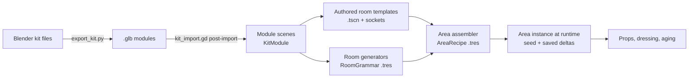

# Environment architecture: how levels are built

[Back to the front page](../../ENVIRONMENT_PLAN.md)

**In short:** this is the reference for *how the system works*. It changes
rarely. Rooms are built from Blender kit pieces (walls, vaults, shelves) that
snap to a 4 m grid. **Sockets** inside the pieces add variety (what sits in a
shelf recess, whether a lamp is lit). Some rooms are laid out by hand, others
by a rule-driven generator, and both use the same pieces. Interactive props
and saving come in phase 3.

**Inputs:** `design/room-atlas.html` (20 room types, kit, build modes), the game
design foundation (`design/The_Eternal_Library_Game_Design_Foundation_v0.1 (1).docx`),
`ART_DIRECTION.md` and the current prototype.

The section numbers (§0 to §11) are the original ones. Code comments cite
them, so they stay the same.

| Section | What it covers |
|---|---|
| §0 | Decisions you have already made |
| §1–2 | What changes from the prototype; the layers (kit → room → area → stratum) |
| §3 | The kit: grid rules, Blender side, Godot side |
| §4 | Authored rooms and sockets |
| §5.1–5.4 | Generated rooms (the phase 2 detail is in [phase-2-design.md](phase-2-design.md)) |
| §6.1–6.4 | Interactive objects, persistence, collision layers (the phase 3 detail is in [phase-3-design.md](phase-3-design.md)) |
| §7–9 | NPC readiness, streaming and lighting, folder layout |
| §11 | Risks |

---

## 0. Decisions already made

| Question | Decision |
|---|---|
| When do generated rooms exist? | **At runtime from a saved seed**, plus an **editor preview** that runs the same generator. A layout you like can be **baked** into a normal scene and finished by hand. |
| Where are module meshes made? | **Blender**, exported to `.glb`, with a Godot post-import script that adds collision, pixel materials and snap points. |
| How physical are props? | **Pick up plus light physics.** Props sleep as static objects until touched, then wake as rigid bodies. Moved, taken and broken props are saved per area. |
| First vertical slice | **R01 Reading Room** (authored from kit modules) joined to a generated **R02 Stack Gallery**. |

Language stays statically typed GDScript, matching the prototype and `AGENTS.md`.

---

## 1. Where the prototype stands, and what changes

The prototype builds everything in code at startup. `main.tscn` is nearly empty and
about 5,000 lines of GDScript (`world.gd`, `vista.gd`, `cavern.gd`, the `*_pass.gd`
files) create the geometry. That got the look right, but nothing can be selected,
moved or tweaked in the editor.

The new structure turns that around:

- **Geometry lives in scenes and Blender files.** Code only *assembles* scenes
  (generators) and *decorates* them (sockets, aging, dressing).
- **Every number a designer might tweak lives in a Resource (`.tres`)** shown in
  the Inspector, never as a constant buried in a script.
- **Authored and generated rooms use the same modules, sockets and connectors**,
  so a generated layout can be baked into an authored one and an authored room
  can sit inside a generated area.

What carries over from the prototype:

| Keep | Becomes |
|---|---|
| Pixel materials (`assets/textures/px`, `tools/pixel_materials*`) and the slot-name swap in `asset_factory.gd` | The material library the post-import script applies to modules. |
| World-triplanar 32 tx/m mapping | Default for architecture, so modules need no UV work and textures run across seams. |
| `art_direction.gd`, `atmosphere.gd` (grade, glow, fog, flicker) | A per-area `Atmosphere` node driven by an `AtmosphereProfile` resource. |
| `tools/build_props.py` Blender pipeline | Grows into `tools/export_kit.py`. |
| `vista.gd`, `cavern.gd`, `vista_cliff.gd` | Later, the R10 Chasm Spans generator (phase 5). |
| `tests/` capture, playtest and audit scripts | Reused as gates for every phase. |
| Hand-placed geometry in `world.gd` and the passes | Stays as the camp, which holds the gameplay loop. Authored rooms such as R01 are played alongside it (phase 1 step 6 decision); the camp is rebuilt from kit modules once props carry gameplay (phase 3). |

---

## 2. Layers



| Layer | What it is | Who edits it, and how |
|---|---|---|
| **Kit** | Modules: wall bays, arches, vaults, stairs, shelves, lamps | You, in Blender (shape) and the Inspector (metadata) |
| **Room** | An authored template scene, or the output of a room generator | Authored: you, in the editor. Generated: the rules, in `.tres` files |
| **Area** | A connected set of rooms (a few hundred metres), the unit of streaming and saving | `AreaRecipe` resource |
| **Stratum** | Style, ecology and rule set for a depth band | `StratumProfile` resource |

---

## 3. The kit: how modules fit together

### 3.1 Grid and conventions

- **Bay:** 4 m. **Storey:** 4 m. **Half bay:** 2 m. **Fine snap:** 0.5 m. Rotations in 90° steps.
- **Up is +Y; a room's "forward" is −Z** (Godot's default).
- **Three module shapes**, which is what lets pieces fit without hand alignment:

| Shape | Occupies | Origin | Examples |
|---|---|---|---|
| **Edge** | One cell edge, 4 m wide (or 2 m) | Floor level, at the left end of the edge, wall plane on the cell boundary, interior facing −Z | Plain wall, shelf-recess bay, arch opening, door, window |
| **Cell** | One or more whole cells | Floor-level corner of the cell | Floor tile, vault bay, dome cell, stair run, pool |
| **Post** | A grid corner | The corner point | Pier, column, corner block |

- **Wall thickness is split across the boundary** (half inside each cell), so two
  rooms built back to back share one wall without overlap or z-fighting.
- **Every module states its footprint** (`size_cells`, `storeys`) and its **edge
  signature**: one tag per side, from
  `solid | opening_3m | opening_full | door | open | none`. Generators match
  signatures; you never set them by hand on placed instances.
- **No scaling, ever.** Scaling breaks the 32 tx/m texel density. A 3 m arch and
  a 4 m arch are two modules.

### 3.2 Blender side (authoring and tweaking meshes)

- Sources live in `art_src/kit/` (with a `.gdignore`, so Godot doesn't import the
  `.blend` files directly and headless import never needs Blender). One file per
  family: `kit_walls.blend`, `kit_vaults.blend`, `kit_vertical.blend`,
  `kit_storage.blend`, `kit_dressing.blend`, `props.blend`.
- **One top-level object (or collection) = one module.** Naming:
  `M_<family>_<name>_<variant>`, e.g. `M_wall_shelfbay_4m_a`.
- Inside a module, child **empties** carry meaning by prefix:

| Empty prefix | Becomes | Purpose |
|---|---|---|
| `SNAP_<name>` | `Marker3D` connector | Where other modules or rooms attach (door, stair head, bridge end) |
| `SOCKET_<set>` | `VariantSocket` | A variation point, e.g. `SOCKET_recess_fill` inside a shelf bay |
| `LIGHT_<profile>` | `OmniLight3D` / `SpotLight3D` from a light profile | Lanterns carry their light |
| `ANCHOR_<kind>` | `Marker3D` in group `npc_anchor` | Seats, work spots, lookout points for future NPCs |

- **Collision** uses Godot's import name hints. Phase 0 modules put `-col` on the
  visible mesh (`wall_plain_4m__body-col`), which gives exact trimesh collision
  from the render mesh. For detailed meshes, add a separate low-poly child named
  `*-colonly` instead. A structural module with no collision gets an import
  warning.
- **Occluders** use the `-occonly` hint on thick walls, so occlusion culling is
  authored once per module.
- **Materials:** only the *slot name* matters (`ashlar`, `brick`, `plaster`,
  `tile_teal`, `wood`, …). The import script swaps in the matching pixel material.
- `tools/export_kit.py` (run by Blender headless, like `build_props.py`) writes one
  `.glb` per module into `assets/kit/<family>/`. A one-click `tools/export_kit.bat`
  wraps it. You can also export one file from inside Blender with the same script.

**Tweaking a mesh:** open the `.blend`, edit, run `export_kit.bat`, and switch back
to Godot. It reimports, and every room that uses the module updates, because
rooms reference the module scene, not a copy.

### 3.3 Godot side

- `tools/kit_import.gd` (an `EditorScenePostImport` script, set as the default for
  `assets/kit/`):
  1. assigns pixel materials by slot name and enforces texel density;
  2. converts `SNAP_`, `SOCKET_`, `LIGHT_` and `ANCHOR_` empties into real nodes;
  3. sets collision layers (see §6.4), visibility ranges and shadow flags;
  4. reads Blender custom properties (`size_cells`, `edges`, `tags`, `weight`) into
     metadata.
- `tools/kit_catalog.gd` (an editor tool) creates or updates one **wrapper scene**
  per module in `kit/modules/<family>/<name>.tscn`. Its root has a `KitModule`
  script exposing footprint, edge signature, style tags (`brick`, `plaster`,
  `tile`, `stratum_1` …) and a generator weight. Wrapper scenes are where you add
  Godot-only extras (a particle emitter, a sound) without touching Blender. The
  catalog never overwrites nodes you added.
- `kit/catalog.tres` (a `KitCatalog` resource) indexes every module by shape,
  signature and tags. Generators query it; you never edit it by hand.

---

## 4. Authored rooms: building and tweaking in the editor

### 4.1 Placing modules

Use **scene instancing with a small editor plugin**, not `GridMap`. GridMap only
stores meshes and collision, and would drop the sockets, lights, anchors and
connectors that live inside modules.

`addons/kit_palette/` (an `EditorPlugin`) adds:

- **A Kit dock** with module thumbnails, filtered by family and tags.
  Click a module, then click in the viewport to place it on the grid.
- **Shortcuts:** rotate 90°, flip, raise or lower a storey, and "repeat last along
  the edge" (lay a run of six shelf bays in one drag).
- **Connector snap:** dragging a room template near another snaps their `SNAP_`
  markers together.
- **Validate Room**, which checks that edges have no gaps, modules sit on the grid,
  nothing is scaled, collision is present, connectors are on cell boundaries, and
  every socket candidate fits its slot.

Godot's own grid snap (0.5 m, 90°) works alongside the plugin for free-form dressing.

### 4.2 Room template scene layout

```
ReadingRoom (RoomTemplate)              # id, footprint, stratum tags, age rules
├─ Shell        (Node3D)                # kit modules only; merged into one static batch at load
├─ Sockets      (Node3D)                # free-standing VariantSockets (module sockets live inside modules)
├─ Props        (Node3D)                # authored interactive props (WorldProp)
├─ Dressing     (Node3D)                # scatter volumes, shelf fills (MultiMesh at runtime)
├─ Lights       (Node3D)                # extra lights; lantern modules bring their own
├─ Connectors   (Node3D)                # SNAP markers exposed to the area assembler
├─ Atmosphere   (Atmosphere)            # optional override of the area's AtmosphereProfile
└─ Bounds       (Area3D)                # room volume for streaming, music, aging
```

### 4.3 Variant sockets (the "somewhat generated" part of authored rooms)

`VariantSocket` is an `@tool` `Node3D`. It references a **`SocketSet` resource**,
so a set like `recess_library.tres` is shared by every shelf recess in the game:
tune its weights once and they change everywhere.

| Socket mode | What it does | Example |
|---|---|---|
| `REPLACE` | Instance one candidate scene | Recess: shelves, tile panel, sealed door, collapsed |
| `TOGGLE` | Present or absent, by probability | A rug, a ladder, rubble |
| `SCATTER` | N props inside a box or along a line | Pots on a ledge, books on a table |
| `SHELF_FILL` | Fills a shelf volume with books as one MultiMesh | Every shelf in R01–R03 |
| `STATE` | Picks a state on a child | Lantern lit, failing or dark |

Each `SocketSet` entry has a scene, a weight, tags, and optional conditions
(`stratum`, `min_age_years`, `faction`, `settlement_state`).

**In the editor**, a socket shows a live preview. The Inspector has
**Prev / Next / Random** buttons and a **preview seed** field on the `RoomTemplate`
that re-rolls every socket in the room at once: the same thing the atlas's
"Reroll sockets" button does, but on the real scene. A **Pin** checkbox forces a
specific candidate for a hand-tuned spot.

**At runtime**, the pick is `hash(area_seed, room_id, socket_node_path)`, filtered by
conditions. Hashing by node path means adding a new socket never reshuffles the
others, so old saves keep their look.

### 4.4 Tweak workflows

| You want to… | Do this |
|---|---|
| Move a wall or add a bay | Open the room scene, select or place modules in the Kit dock, save |
| Change what recesses can contain | Edit `recess_library.tres`: add a scene, change weights |
| Force one recess to always be a sealed door | Select its socket, pick the candidate, tick **Pin** |
| See other variants of the room | Change the room's preview seed, or press **Random** |
| Make a one-off variant of a module | Duplicate the wrapper scene, add nodes; or duplicate the Blender object with a new `_b` suffix |
| Change a module's shape everywhere | Edit the `.blend`, run `export_kit.bat` |

---

## 5. Generated rooms: rules you can tweak

### 5.1 Two generation levels

1. **Area layout:** which rooms exist and how they connect (the `AreaRecipe`).
2. **Room layout:** for fully generated types (R02, R03, R06, R09, R11, R14, R15, R17,
   R10), fill a 3D cell grid using a `RoomGrammar`.

Both are plain data you edit in the Inspector:

| Resource | Holds | Example knobs |
|---|---|---|
| `StratumProfile` | Style tags, ecology, palette, atmosphere, which socket conditions apply | `styles: [brick, tile_teal]`, `lamp_density: 0.6` |
| `AreaRecipe` | Required authored rooms, counts of generated types, size, connector rules | `required: [ReadingRoom]`, `stack_galleries: 3–6`, `max_dead_ends: 2` |
| `RoomGrammar` (one subclass per generated type) | The layout rules for that type | R02: `max_straight_bays 6`, `side_passage_chance 0.11`, `collapse_chance 0.08`, `lamp_every_bays 2`, `lamp_falloff_by_distance` |
| `ModuleRules` | Which modules may fill which edge or cell signature, with weights and style tags | `edge solid + style brick → [wall_plain 3, wall_shelfbay 8, wall_niche 2]` |

### 5.2 Pipeline

1. **Graph.** The `AreaRecipe` places required authored rooms, then adds generated
   rooms and links (a spanning tree plus a few loops, so there's more than one way back).
2. **Place and route.** Authored templates are placed by their connectors.
   Corridors are routed on the 4 m grid by A*, with stair cells for level changes.
3. **Mark edges.** Every cell edge becomes `solid`, `opening`, `door` or `open`
   according to the grammar.
4. **Pick modules** by edge and cell signature from `ModuleRules`, weighted and
   seeded. This is a lookup table rather than full wave-function collapse; it is
   enough for corridor, grid, ring and lane rooms, and much easier to reason about.
5. **Resolve sockets** exactly as in authored rooms.
6. **Dress:** shelf fills, scatter, lamps by distance rule.
7. **Age:** apply `AgeRules` for time passed (see §6.3).
8. **Validate:** connectivity, plus a route audit with the real player capsule
   using `PhysicsServer3D.body_test_motion`, as `AGENTS.md` requires.

Generation runs on a worker thread and builds nodes off-tree, then adds them in
one go. A room of about 200 modules should take well under a frame budget per room
when spread across frames.

### 5.3 Editor preview and bake

`GeneratorPreview` (an `@tool` node; drop it in any scene) has slots for a
`RoomGrammar` or `AreaRecipe`, a seed, and buttons:

- **Generate:** builds the result live in the editor, as a temporary child.
- **Overlay:** draws the cell grid, edge types in colour, and socket picks as labels.
- **Step:** runs the pipeline one stage at a time, for debugging a rule.
- **Bake to scene:** writes a normal `.tscn` that uses the same module scenes and
  sockets. The baked scene is an ordinary authored room you can finish by hand,
  which is how a good generated layout becomes a landmark.

**Tweaking a rule:** select the `.tres`, change a number, press Generate. No play
mode needed.

### 5.4 Determinism and saves

- `area_seed = hash(world_seed, area_id)`. Every random choice comes from a
  sub-seed of that, keyed by what is being decided, never from call order.
- Saves store the seed, the **recipe version** and the player's deltas, not the
  geometry. If a recipe changes after release, the old version is kept for old saves.


---

## 6. Interactive objects

### 6.1 Four kinds of object

| Kind | Examples | Node | Interactive | Saved |
|---|---|---|---|---|
| **Architecture** | Walls, vaults, stairs | Module, merged static batch | No | No (regenerated) |
| **Dressing** | Most shelf books, rubble, wall pots out of reach | `MultiMeshInstance3D` | No | No |
| **Props** | Vases, loose books, stools, lanterns, crates | `WorldProp` | Yes: push, knock, pick up, break | Yes, as deltas |
| **Items** | Lore books, ingredients, tools | `WorldProp` + `ItemDef` | Yes: pick up into inventory | Yes |

### 6.2 `WorldProp`

- A `RigidBody3D` with `freeze = true` (static) at rest, so a room full of props
  costs about the same as static meshes.
- **Wakes** (unfreezes) on player contact, a hit, an explosion, or when something
  under it moves. It goes back to frozen once it has slept for a few seconds.
- An **active-body budget** (start with 48) re-freezes the oldest sleeping props if exceeded.
- **Breakable** props swap to pre-fractured pieces (made in Blender as
  `M_prop_vase_a_broken`). Pieces despawn after a while; a "broken" delta is saved.
- **Items** reference an `ItemDef` resource. Picking one up moves ownership to the
  inventory, so quick slots reference owned items instead of copying them.
  Dropping recreates the prop.
- Props use **local triplanar or UVs**, not world triplanar, so their texture
  doesn't swim when they move.

**Books** are the special case: thousands per room. Shelves are `SHELF_FILL`
dressing. When the player looks at a shelf, the nearest book slot can be
**promoted** into a real `WorldProp`: its MultiMesh instance is hidden and a prop
spawns in its place. Lore books are pinned slots that are always promotable.

### 6.3 Persistence and aging

- Every prop has a **stable id**: `area_id / room_id / node_path` for authored props,
  `area_id / room_id / generator_key` for generated ones.
- `AreaState` saves only deltas: `{id: {state: moved|taken|broken, transform}}`,
  plus spawned props (things the player dropped).
- **Load order:** generate the area from its seed, resolve sockets, apply aging for
  time passed, then apply player deltas. Player deltas always win.
- **Aging** (the design doc's "returning to a hometown after many years") is an
  `AgeRules` resource per stratum: lamps go out, recesses collapse, gardens
  overgrow, settlements change hands. It acts only on things the player hasn't touched.
- The persistence gate from `AGENTS.md` applies: save in one OS process, restore in
  a freshly launched one.

### 6.4 Collision layers (fixed now, so NPCs slot in later)

| Layer | Use |
|---|---|
| 1 | World static (architecture) |
| 2 | Interaction ray targets (already used by `interactable.gd`) |
| 3 | Props (`WorldProp`) |
| 4 | Player |
| 5 | NPCs and creatures (reserved) |
| 6 | Triggers and room bounds |
| 7 | Water volumes |

---

## 7. Ready for NPCs later, without building them now

- Modules carry `ANCHOR_` markers (seat, work, sleep, lookout, trade), so rooms are
  already annotated when NPCs arrive.
- Each room bakes a navigation mesh at load on a thread
  (`NavigationRegion3D.bake_navigation_mesh(true)`). Props on layer 3 are excluded,
  so a knocked-over vase doesn't trigger a rebake.
- Rooms keep their tags (faction, settlement, ecology) in `RoomTemplate`, for future
  spawn rules.

---

## 8. Streaming, performance, lighting

- **Streaming unit:** the area. Within an area, rooms load when the player is
  within two connectors of them and unload after leaving that range for a while.
  Loading uses `ResourceLoader.load_threaded_request`.
- **Static merging:** each room's `Shell` merges into a few batches per material at
  load, as the prototype already does with its merged static groups (keep under the
  playtest ceiling of about 100 per view).
- **Culling:** module occluders (`-occonly`) and `OccluderInstance3D`, with
  visibility ranges on dressing and small props.
- **Lighting:** runtime generation rules out baked lightmaps (`LightmapGI`). Use
  SDFGI (already on in the prototype) plus real-time lights. Lantern modules bring
  their own light with a **light budget**: only the nearest N cast shadows; the rest
  use cheap omni lights with no shadows.
- Keep the prototype's frame time (about 5.5 ms) as the target for a
  fully dressed room.

---

## 9. Folder layout

```
art_src/kit/*.blend            # Blender sources (.gdignore)
art_src/props/*.blend
assets/kit/<family>/*.glb      # exported modules (generated)
assets/props/*.glb
kit/modules/<family>/*.tscn    # wrapper scenes with KitModule (generated, then extended by hand)
kit/catalog.tres
kit/sockets/*.tres             # SocketSet resources
rooms/authored/*.tscn          # RoomTemplate scenes (R01, R05, R07 …)
rooms/baked/*.tscn             # generated layouts promoted to authored
gen/grammars/*.tres            # RoomGrammar per generated type
gen/rules/*.tres               # ModuleRules
gen/recipes/*.tres             # AreaRecipe
world/strata/*.tres            # StratumProfile, AgeRules, AtmosphereProfile
scripts/world/                 # KitModule, RoomTemplate, VariantSocket, WorldProp, AreaState, AreaAssembler
scripts/gen/                   # generators per room type
addons/kit_palette/            # editor dock, validate, preview
tools/export_kit.py|.bat, tools/kit_import.gd, tools/kit_catalog.gd
```

---
---


## 11. Risks and open items

- **Headless import.** Exporting `.glb` (rather than importing `.blend` directly)
  keeps CI and headless runs Blender-free. The cost is one export step after edits;
  `export_kit.bat` keeps it to a double-click.
- **Edge-signature tables may get too coarse** for organic spaces (R06 lanes, R15
  terraces). Those generators can place modules directly; the table stays the default.
- **World triplanar on architecture vs UVs on props.** Rules are in §6.2. Modules
  that move (doors, bridges that collapse) need UVs.
- **SDFGI with streaming** can pop when rooms load. Measure in phase 4; fallback is
  per-room `VoxelGI` for authored rooms.
- **Save size** grows with deltas. Cap dropped props per area and compact old deltas.
- ~~Missing references in `AGENTS.md`~~: resolved 2026-10-18. `AGENTS.md` had been
  copied from another project; it was rewritten for this one and no longer cites
  a `references/` folder.

