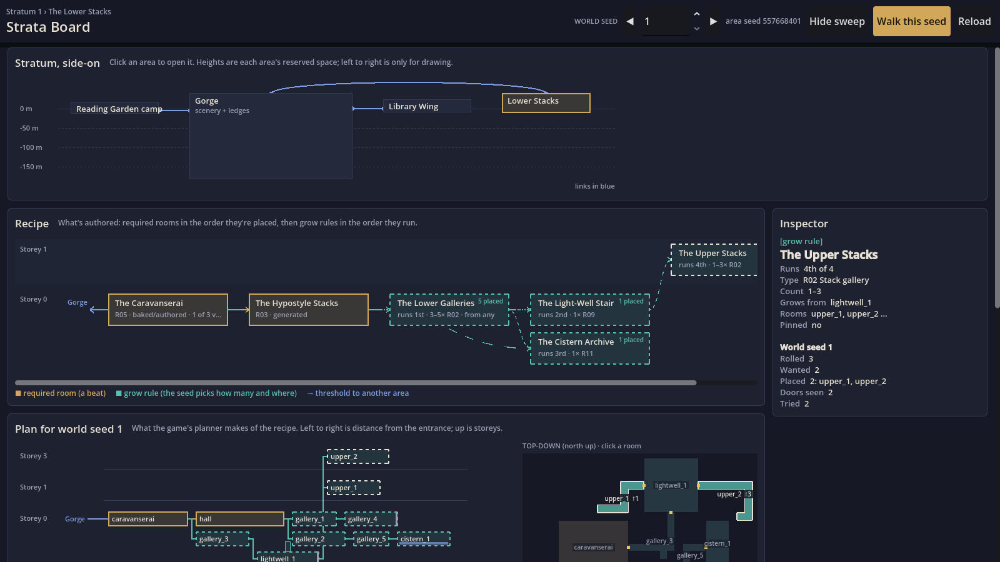
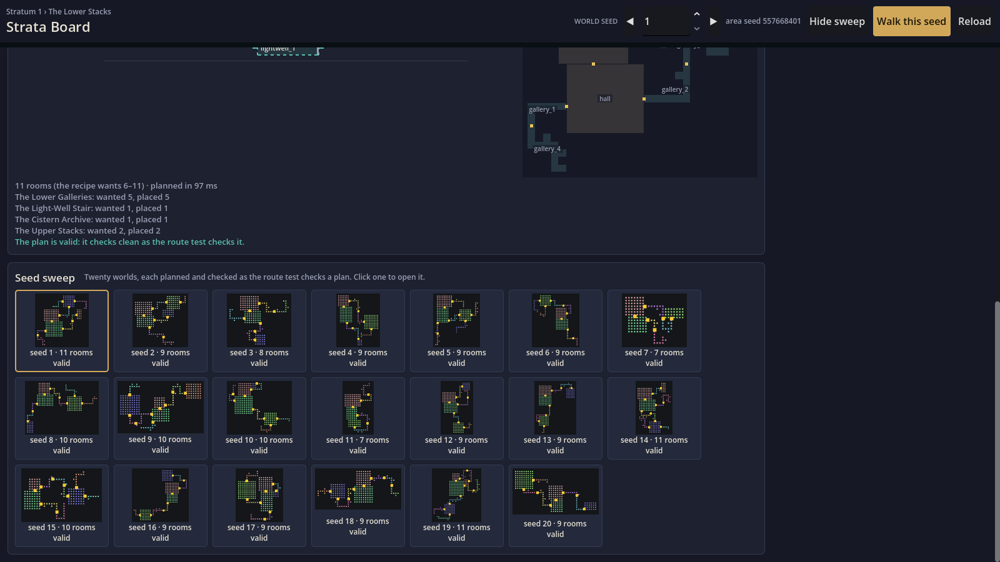
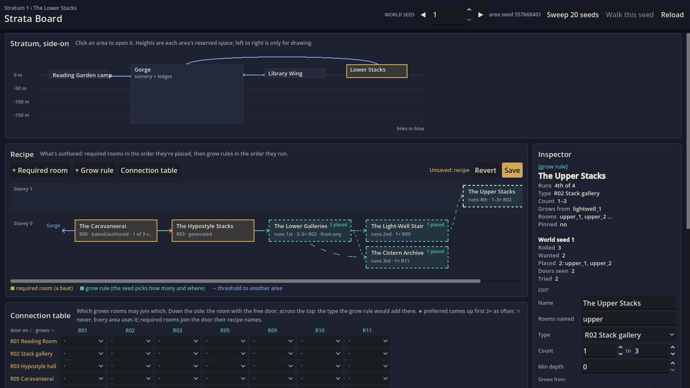
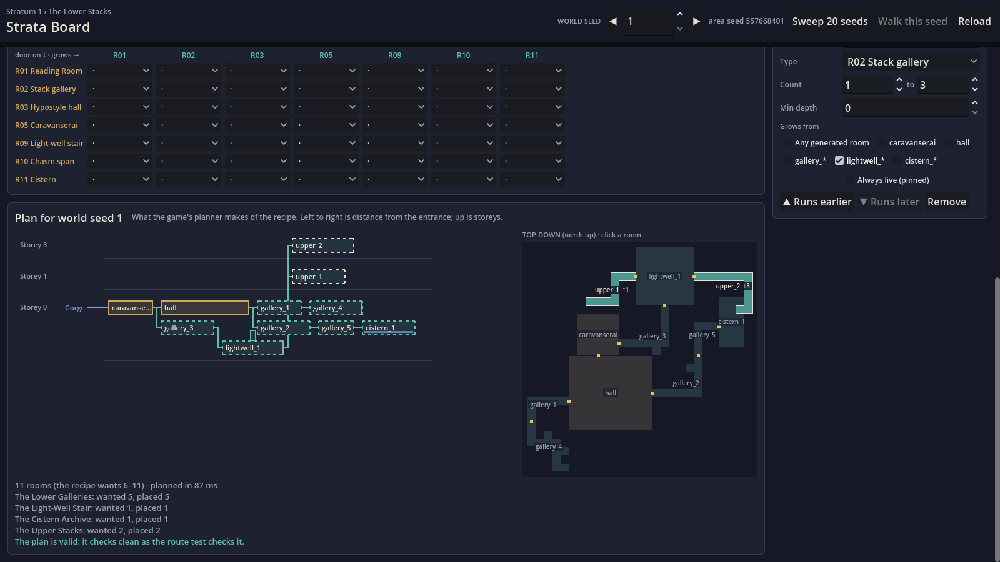

# Phase 10 progress: the world authoring tool (the Strata Board)

[Back to the front page](../../../ENVIRONMENT_PLAN.md) · [Brief](../phase-10-approval.md) · [The mock](https://claude.ai/artifact/SMqnDsVcsPTSL8bCw9zD7Y)

## Step 1: a seed per world, and the board to look at (2026-10-31, committed 2026-11-01)

### What you can try

**In the game**

- A new game (your own save slot, after *Forget this library* or with no save) rolls a random **world seed** from 1 to 999,999. Every area's seed comes from it, so each world has its own Lower Stacks, library wing and Gorge network.
- **F3** shows it: `world seed 482113 · lower_stacks seed 1734…` (with "(reseeded)" after the menu's reseed).
- **Esc → World seed N: start a world from a seed**: type a seed to start that world, or roll a random one. It forgets the current world, like *Forget this library*, and says so first.
- The save already kept `world_seed`; it now holds the rolled one. Saves made before today stay world 1.
- On the command line: `-- --world-seed=N` (or `=random`) starts a new world from that seed.
- Tests and gates keep world seed 1 (Q3), unless a test asks for another.

**In the editor: the Strata tab** (beside 2D, 3D and Script)

A full-size tab rather than a side dock like the kit palette (Q2 said a dock): the stratum, recipe, plan and sweep need the width. It's a one-line change if you'd rather have it docked.

- **The stratum, side-on:** the camp, the Gorge and both interiors as boxes of their reserved height, with their links. Click one to open it.
- **The recipe as a graph:** required rooms in brass, a column after the room they join, with their doors out (lapis arrows) and tags (type, baked or generated, *1 of 3 variants*, **entrance only** for the caravanserai and the Reading Room, Q6). Grow rules in turquoise: the order they run in, their count, where they grow from, and for this seed *N placed* or **short**.
- **The plan for one world seed,** from the game's own planner: side-on (left to right is the route from the entrance, up is storeys) and top-down. On the top-down map every room is outlined and named (rooms above the ground storey marked ↑1, ↑3 …); a room selected in either view, or every room of a selected rule, lights up and the rest dim; click a room on the map to select it, hover to see its name. Gold squares are doorways. Under it, each rule's *wanted / placed*, and when it falls short, why, from the planner's own counts: ran out of free doors, didn't fit, came out too short, sightline. A count the planner raised to reach the area's minimum says so (that's Q4, which step 2 stops).
- **◀ seed ▶**: the seed is a **world seed**, the same number as in a save and on F3, so a seed you like here is the world you get by typing it in.
- **Sweep 20 seeds:** the 20 world seeds around this one, each planned and marked valid or not, with its map. Click one to open it. About 12 s for the Lower Stacks; the editor stays usable.
- **Inspector:** select a required room, a grow rule or a planned room; its partner in the other view lights up.
- **Walk this seed:** runs the game in that area with that world seed, on a scratch save (`user://test/strata_walk.json`), never your own. It leaves a one-time request (`user://strata_walk_request.json`) that the game takes as it starts, within two minutes.

### After your first try (2026-10-31)

1. **Walk this seed started your last save instead of the seed.** It passed the area and seed as run arguments, and those never reached the game (the editor's *Customize Run Instances* can replace them). Now the board leaves a one-time request file the game reads at start; checked by writing one and starting the game: `main: Walk this seed: library, world seed 4242 (save user://test/strata_walk.json)`.
2. **The top-down map didn't say which room was which.** The board now draws the map itself from the planner's cells, with names and highlighting (above).
- **Reload** (and opening the tab) reads the recipe files again after a hand edit.
- Nothing can be edited yet: that's step 2. The Gorge and the camp show a note instead of a recipe (the Gorge's ledges and spans get their own board later); you can still walk any seed of the Gorge.

### How it works

The editor can't run the planner itself: the grammars and `RoomTemplate` aren't `@tool` scripts, so in the editor they load as empty placeholders, and making them `@tool` would make every room scene run its code while you edit it. So the board starts the game's planner as a separate headless Godot process (`addons/strata_board/service_main.gd`) and talks to it over a pipe (`planner_client.gd`). It answers with the plan as data: rooms, doors, checks, the per-rule counts and the top-down map. The first answer takes about 2 s (the process starting), then about 0.4 s a plan. The sweep queues behind the single-seed view, so stepping seeds during a sweep still answers first.

Files: `addons/strata_board/` (plugin, board, client, service, process), `tests/strata_board_test.gd`; in the game `scripts/world/world_state.gd` (the seed), `scripts/main.gd` and `scripts/hud.gd` (the menu entry and its text field), `scripts/stats_overlay.gd` (F3), `scripts/world/area_planner.gd` (the counts and the two fixes below).

### Two planner bugs the random seeds found

Before giving every new game its own seed, I planned world seeds 1-60 of both interiors:

1. **A gallery grown through the Reading Room** (library wing, world seed 5): two rooms in the same cells. The planner kept new rooms out of a baked or authored room only where its module meshes are, and the Reading Room's open middle has none. Now a scene room blocks its whole cells, as a generated room already did. **World 1 is unchanged**, as are all Lower Stacks plans; two other library worlds of 60 (16 and 52) change shape, both valid before and after.
2. **The same seed could give two different Lower Stacks.** The first plan of an area in a process differed from later ones: the Upper Stacks' two rooms swapped which light-well exit they hang off. The planner sorted door names with a sort that orders them by where they sit in memory, so the result depended on what had been loaded before (starting in the camp or in the Lower Stacks, say). It now sorts them by name. **World 1 now always gets one layout:** upper_1 (18 cells) off the light-well's lower west exit at storey 1, upper_2 (24 cells) off its upper exit at storey 3. Before, you may have seen these two the other way round. A save made in the Upper Stacks of world 1 may find its changes in the other room.

Of 60 worlds per interior after the fixes: the library wing is valid in all 60; the Lower Stacks in 58. Worlds 33 and 45 come out short (5 and 4 rooms; the recipe asks for at least 6) because the light-well didn't fit on either free door. Those worlds build and walk fine, just smaller. That's a recipe question for step 2 on the board, so new games roll any seed.

### Gates

| Gate | Result |
|---|---|
| `tests/strata_board_test.gd` (new): the board's plan is the planner's own, signature for signature (both interiors, worlds 1-3); per-rule counts add up; the planner process over the pipe gives the same plan; entrance-only marks; world seed rules (tests 1, own slot random, `forget(n)`); the board plans, draws every room and rule, steps seeds, sweeps 20 | 66 checks, 0 failures (now also: the map draws every room, lights a selected one, selects on click, names on hover) |
| Persistence (two processes): a rolled seed saved in one, loaded in a fresh one | Same seed (199524) |
| `tests/area_plan_test.gd` | 266 checks, 0 failures |
| `tests/area_route_test.gd` (both interiors, area seeds 1-5, built and walked) | 413 checks, 0 failures |
| `tests/gen_signature_test.gd` | 19 failures, the **same 19** with the planner as it was before today: its recorded signatures predate phase 6 step 5 (they still list `stack_gallery_entrance`) and haven't been re-recorded since. None are new |
| The editor starts with the plugin (headless) | No errors |
| GPU capture of the board | Above |

Not checked by me: the board inside the editor window itself (clicking through it, *Walk this seed* launching the game). The test runs the same board in a game window with the planner in-process, and the pipe separately.

## Step 2: editing areas on the board (2026-11-01, committed 2026-11-01, tried in the editor 2026-11-01: works)

### What you can try

**In the editor, the Strata tab.** Everything about an area's recipe can now be edited, and the plan, the map and the sweep follow your edit as you make it. Nothing is written until you press **Save**.

- **The edit bar** (top of the Recipe section): **+ Required room**, **+ Grow rule**, **Connection table**, then *Unsaved: recipe / connection table*, **Revert** and **Save**.
- **The form under the inspector** edits whatever is selected:
  - **A required room:** its name; its slot id (its id in saves, so renaming it loses changes made in it in existing worlds); what it's made from (a generated type, or baked/authored scenes of a type); which room it joins and at which door (the doors free in this seed's plan); always live; **Make this the entrance**; **Remove**. A room something else joins can't be removed until that's moved. Entrance-only scenes (the caravanserai, the Reading Room) are offered only at the entrance, and an entrance-only entrance stays the entrance (Q6). Both interiors have one today, so *Make this the entrance* is greyed out with the reason.
  - **Variants** of a baked or authored room: each scene's weight, a pin (every new world gets that one), remove, and *+ Add a variant* (scenes of the same type).
  - **A grow rule:** its name; what its rooms are called (`gallery` → gallery_1, gallery_2 …); type; count (min to max); **min depth** (only on doors at least that many doorways from the entrance); what it grows from (required rooms, other rules' rooms, or any generated room); always live; **▲ Runs earlier / ▼ Runs later** (earlier rules take free doors first); **Remove**. A rule that grows from another rule's rooms follows that rule's count.
  - **The area** (nothing selected): room count min to max, dead ends, sightline depth.
- **The connection table:** for every pair of room types, whether a grow rule may add that type off that type's door: *· allowed*, *★ preferred* (comes up first 3× as often), *✕ never*. One table for every area (`gen/rules/connections.tres`, made on first save). Required rooms aren't affected: they join the door their recipe names.
- **Why a rule falls short** now also says *N doors ruled out by the connection table* and *N doors too near the entrance (its minimum depth)*.
- **Save** writes the recipe (`gen/recipes/<area>.tres`). Before writing, the planner plans world seeds 1–20 as they are and again with your edit (keeping each world's variants, as its save would). If any room moves, it says so, *Rooms move in 7 of world seeds 1–20 (2, 4, …), so the version goes 8 → 9*, and raises the recipe's version, which is how a save knows its rooms moved. If nothing moves (a name, a weight, a pin), the version stays. Saving the connection table does the same for every interior it moves.
- **A hand edit meanwhile:** if the file changed on disk since the board read it, Save refuses once and says so; pressing **Save anyway** overwrites it. *Reload* (or reopening the tab) keeps your unsaved edits; *Revert* drops them.
- **Walk this seed** is off while there are unsaved edits: the game walks the saved recipe.

**In the game.**

- **Q4: a grow rule never goes past its own maximum.** The planner used to raise a rule's count to reach the area's minimum. Now a seed whose rules fall short is just short, and the board marks it invalid. This changes 25 of 80 Lower Stacks plans I checked (world seeds 1–60, area seeds 1–20), all still valid; world 1 and the library wing don't change. The Lower Stacks recipe went to **version 8** for it.
- **Q5: a save keeps each room's variant.** The first time a world plans an area, its save records which scene each room with variants got (the caravanserai's 3×3, 5×5 or 7×5). Later, with new weights, a pin or an added variant, that world keeps its court; only new worlds use the new odds. A reseeded area (the menu's reseed) is another world's plan and records nothing.

### How it works

The board keeps an edited copy of each recipe beside the one as read, and plans it by sending the edit to the planner process with each request. The planner process builds an `AreaRecipe` from the edit: the file's recipe with its rooms, rules and limits replaced, and everything else (placement, atmosphere, scenery, each room's module rules and doors out of the area) kept. On Save the same process writes it with `ResourceSaver`, and the editor rescans the file.

New in the game: `AreaSlot.scene_weights` and `pinned_choice`, `AreaGrow.min_depth`, `ConnectionTable` (`scripts/world/connection_table.gd`), `RoomTypes` (`scripts/world/room_types.gd`, the type of a room by its file), and `WorldState.kept_variants` / `keep_variants`. With no weights, no table and no minimum depth, the planner's choices are exactly what they were (checked across the 80 plans above: only Q4's changes).

### Gates

| Gate | Result |
|---|---|
| `tests/strata_board_test.gd`: step 1's checks plus: the catalog; an unedited description plans exactly as the file (both interiors, worlds 1-3) and moves nothing; a 1-1 count never places more (Q4); a depth no door reaches places nothing and says why; weights 1-0-0 give every new world the 3×3 court and move no saved world (Q5); a "never" table grows none; an unsaved table is forgotten after its plan; save to a scratch copy raises the version, keeps placement, atmosphere and doors out, and plans as the edit; an unchanged save keeps the version; a stale file is refused; two entrances refused; the game's recipe file untouched. On the board: edits mark it unsaved, turn Walk off, drop the sweep, replan; renames follow through; add and remove; ▲; Revert; the connection edit; Save's notice | 117 checks, 0 failures |
| Persistence (two processes): a world's caravanserai variant saved in one; a fresh one loads it and keeps it after the recipe pins another, while a new world takes the pin | 7 checks, 0 failures (world 35203, 3×3 court) |
| `tests/area_plan_test.gd` | 266 checks, 0 failures |
| `tests/area_route_test.gd` (both interiors, area seeds 1-5, built and walked; Q4 changed seed 5 from 7 to 9 rooms) | 424 checks, 0 failures |
| The editor starts with the plugin (headless) | No errors |
| GPU capture of the board | Above |

Not checked by me: the board inside the editor window (typing in its fields, Save writing the real recipe and the editor rescanning it). The test drives the same board in a game window, saving to a scratch file, never the game's recipe.

## Step 2b: named copies of a recipe (2026-11-01, committed a5cd65d, not yet tried in the editor)

You asked, after trying step 2, to keep several versions of an area to experiment with without losing earlier ones. You picked named recipe copies, built before step 3.

### What you can try

- Above the recipe's edit bar there is a **COPY** row. The picker shows **Live (what the game plays)** and every copy of the open area.
- **Save as copy…** asks for a name and keeps what's on the board as a new copy, unsaved edits included. It never writes over another copy or over the live recipe. The board then opens the copy, and the breadcrumb says `› copy: <name>`.
- While a copy is open, **Save** writes the copy and the game is untouched. **Sweep 20 seeds** sweeps the copy. **Walk this seed** walks the copy on the scratch save; the game prints `Area lower_stacks: walking the recipe copy …`.
- **Make live** puts the open copy in the game. The version goes up if rooms move in any of world seeds 1–20, as with a save. The recipe that was live is kept as a copy named `live v<n> before <copy>`, so nothing is lost.
- **Delete copy** asks first, then removes only that copy and goes back to Live.
- The picker is off while there are unsaved edits. Save, Save as copy or Revert first.

Copies live in `gen/recipes/drafts/<area id>/<name>.tres`. The game reads them only through Walk this seed.

### How it works

- In the service (`strata_service.gd`):
  - `save(…, as_name)` writes a new copy.
  - `make_live(path)` copies the live file byte for byte to the keep copy, then writes the copy over the live recipe with its version settled.
  - `delete_draft(path)` only ever deletes inside the copies folder.
  - `drafts(id)` lists the copies; the stratum answer lists each area's copies.
  - Saving a copy never computes or raises a version. A version only matters when a copy goes live.
- In the game: the walk request carries the copy's path. `WorldState.walk_recipe` accepts only paths under `gen/recipes/drafts/`. `SeamlessPlaces.recipe_path(id)` gives the walked area's copy, and `Area` plans it in place of the live recipe.
- Tests point the copies folder and the live recipe at scratch files (`Service.scratch`), so the real recipe is never written.

### Gates

| Gate | Result |
|---|---|
| `strata_board_test.gd -- copies`: the service checks, then the board's own buttons (see below) | 29 checks, 0 failures |
| The whole `strata_board_test.gd` (step 2's checks plus copies) | 146 checks, 0 failures |
| End to end: a real copy (1 gallery) plus a walk request for world 7, then the game run headless | The game walked the copy (`Area lower_stacks: walking the recipe copy …`), no errors. The check files were removed afterwards |
| The editor starts with the plugin (headless) | No errors |
| GPU capture: [board_copies.png](../../../previews/p10_step2/board_copies.png) | The COPY row sits above the edit bar. It is greyed out in the capture because an unsaved edit is on show |

What `-- copies` checks on the service:

- the file is named from the copy's name;
- saving a copy never raises a version and leaves the live recipe alone;
- a name already in use, or one with nothing usable in it, is refused;
- the copy plans as edited, and the stratum lists it;
- Make live raises the version (rooms move), the live recipe becomes the copy, and the old live recipe is kept byte for byte;
- delete refuses a live recipe and removes only the copy it was given.

And on the board:

- the picker and the buttons follow what's open;
- Save as copy opens the copy and the breadcrumb names it;
- the board plans the copy;
- Walk this seed sends the copy's path;
- Live opens the live recipe again;
- Make live writes the live recipe and its notice names the kept copy;
- Delete copy goes back to Live.

Not checked by me: the board in the editor window (the name dialog, the delete confirmation, the editor rescanning new copies).
